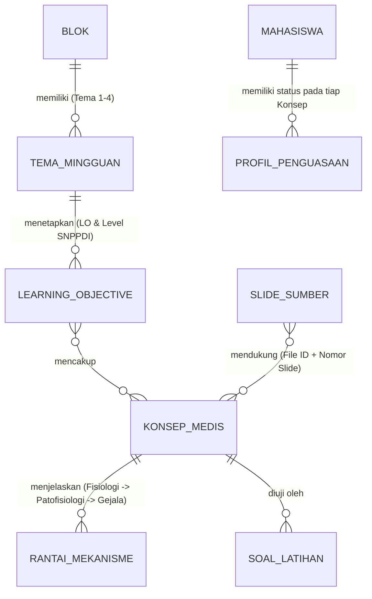
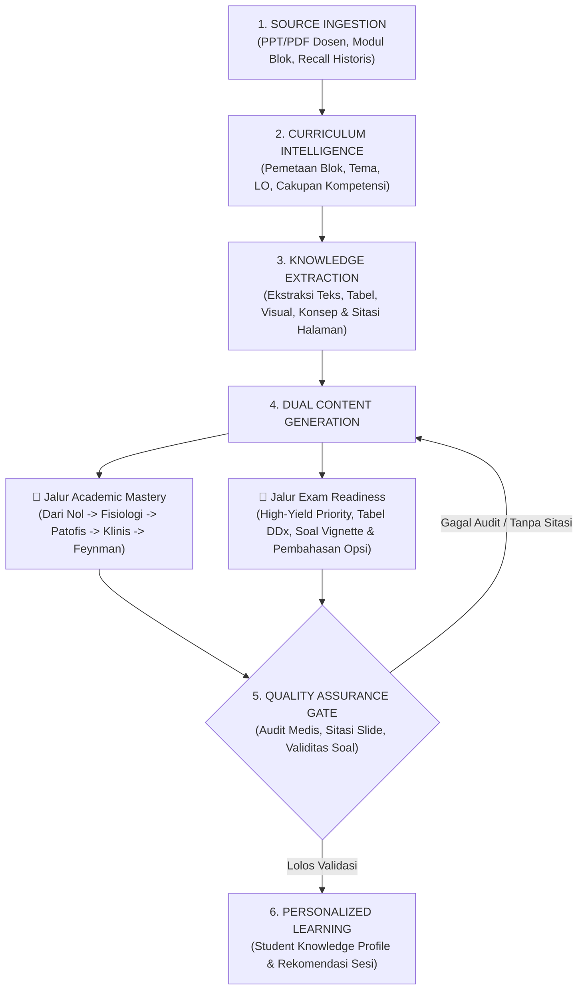

# VERTEX-PREP 2.0 — Blueprint Sistem & Spesifikasi Proof of Concept (PoC)

> [!IMPORTANT]
> **Posisi Produk yang Ditetapkan: *Dual-Purpose Medical Learning & Exam Preparation System***
> **VERTEX-PREP 2.0** bukan aplikasi peringkas slide, melainkan sistem pembelajaran kedokteran berbasis AI yang menyatukan **Academic Mastery** (memahami ilmu kedokteran dari fisiologi dasar hingga penalaran klinis) dan **Exam Readiness** (kesiapan UAB yang terukur, efisien, dan berbasis kelemahan mahasiswa) di atas **satu Basis Pengetahuan Terstruktur** yang sama.

---

## 1. Arsitektur Epistemik: Kontrak 3 Lapisan Informasi (*Three-Layer Attribution*)

Untuk mencegah halusinasi medis dan menjaga integritas akademik antara materi dosen vs penjelasan AI vs literatur luar, setiap blok konten di dalam **VERTEX-PREP 2.0** wajib menyertakan tag lapisan sumber:

| Lapisan | Label UI | Aturan Ketat & Keterlacakan (*Traceability*) | Contoh Implementasi pada Blok EMN |
| :--- | :--- | :--- | :--- |
| **Lapisan 1: *Official Source*** | `📌 Sumber Dosen [File, Hal. X]` | Hanya berisi klaim, tabel, gambar, kriteria, dan angka yang **tertulis eksplisit** di slide PPT/PDF dosen atau `00. MODUL BLOK`. Wajib menautkan nama file dan nomor halaman slide. | `[KUL 2 Defisiensi Vitamin, Slide 17]`: *"Methylmalonic acid (MMA) biasanya normal pada defisiensi B9 (Folat), namun dapat meningkat pada defisiensi B12."* |
| **Lapisan 2: *AI Explanation*** | `🧠 Penjelasan Mekanisme AI` | Jembatan logika untuk mengisi *gap* penjelasan di slide yang terlalu singkat (fisiologi normal, analogi *Feynman*, rantai sebab-akibat). **Dilarang diklaim sebagai kutipan dosen.** | Penjelasan mengapa Metformin kronik menurunkan absorpsi kompleks *Intrinsic Factor–B12* di reseptor cubilin ileum terminal sehingga memicu demielinasi saraf perifer. |
| **Lapisan 3: *External Knowledge*** | `📚 Referensi Textbook / Guideline` | Pengayaan dari literatur resmi modul (*Harrison's Ed. 22, Guyton Ed. 11, Sherwood, Harper, Goodman & Gilman, NICE 2024*). Wajib mencantumkan nama sumber & tahun/edisi. | **Detektor Perbedaan (*Conflict Alert*):** Jika ada perbedaan angka/target antara slide dosen lama dengan *guideline* terbaru, sistem menampilkan **Kotak Komparasi** (*"Versi Slide Dosen vs Versi Guideline"*), bukan mengganti isi slide secara diam-diam. |

---

## 2. Struktur Basis Pengetahuan Relasional (*Medical Concept Graph*)

Materi tidak disimpan sebagai file rangkuman lepas, melainkan sebagai *node* yang saling terhubung lintas kuliah dan lintas blok:

* **Keunggulan Lintas-Kuliah:** Konsep seperti ` Kerja Insulin & Transduksi Sinyal GLUT4 ` yang dipelajari pada kuliah Fisiologi/Biokimia otomatis terhubung ke `KUL 12 Diabetes Mellitus (IWL)`, `KUL 14 Komplikasi & Kegawatan DM (IWL)`, dan `KUL 16 Farmakologi Obat Anti-Diabetes (SAN)`.
* Ketika seorang mahasiswa salah menjawab soal tentang *Ketoasidosis Diabetikum (KAD)* karena tidak paham mengapa defisiensi insulin memicu lipolisis dan benda keton, sistem langsung melacak balik ke node konsep dasar `Fisiologi Insulin & Metabolisme Lipid`.

---

## 3. Pipeline 6-Tahap **VERTEX-PREP AI Engine** & *Quality Assurance (QA) Gate*

### Aturan Pemeriksaan pada Tahap 5 (*Quality Assurance Gate*):
Sebelum materi atau soal ditampilkan sebagai konten tervalidasi, mesin pemeriksa (atau peninjau) memverifikasi 5 kriteria wajib:
1. **Keterlacakan Sumber (*Zero Uncited Claims*):** Apakah setiap klaim di *Lapisan 1 (Official Source)* memiliki nomor halaman slide yang benar?
2. **Keamanan Medis (*Zero Critical Medical Error*):** Apakah dosis, kontraindikasi, dan alur kegawatdaruratan sesuai dengan slide dan referensi standar?
3. **Kesesuaian Cakupan LO (*Curriculum Alignment*):** Apakah seluruh *Learning Objectives* di `00. MODUL` untuk kuliah tersebut sudah tercakup?
4. **Validitas Konstruksi Soal Vignette:** Apakah soal memiliki *lead-in* yang jelas, skenario klinis yang logis, 1 jawaban paling tepat yang tak terbantahkan, dan 4 distraktor yang masuk akal?
5. **Kejujuran Statistik Dosen & Recall:** Tidak membuat klaim prematur tentang "pola dosen" sebelum sampel lintas-kuliah mencukupi; menandai soal *recall* murni sebagai referensi historis.

---

## 4. Spesifikasi **Student Knowledge Profile** (6 Taksonomi Kesalahan)

Sistem membedakan antara **Skor Tes Sesaat (*Immediate Performance*)** dan **Penguasaan Jangka Panjang (*Long-Term Mastery*, diuji ulang H+7)**. Setiap kesalahan jawaban mahasiswa pada *Mini Assessment* atau *CBT Simulator* diklasifikasikan ke dalam 1 dari 6 akar masalah:

| Kode Error | Jenis Kesalahan | Indikator pada Jawaban Mahasiswa | Tindakan Perbaikan Otomatis (*Remediation Action*) |
| :--- | :--- | :--- | :--- |
| **`E1`** | **Knowledge Gap** *(Belum tahu fakta dasar)* | Salah pada pertanyaan definisi, klasifikasi, nilai normal, atau fungsi dasar fisiologi. | Buka kartu **"Ajari Aku dari Nol"** & *Flashcard* fakta inti pada konsep terkait. |
| **`E2`** | **Conceptual Error** *(Salah paham mekanisme)* | Salah menjawab pertanyaan *"Mengapa / Bagaimana mekanisme..."* (patofisiologi/farmakodinamik). | Tampilkan **Diagram Alur Mekanisme (Sebab $\rightarrow$ Akibat)** & mode *Feynman Learning*. |
| **`E3`** | **Confusion Error** *(Tertukar 2 penyakit/obat mirip)* | Memilih distraktor penyakit kembar (misal: memilih *Defisiensi Folat* pada kasus *Defisiensi B12* dengan gejala neuropati). | Tampilkan langsung **Tabel Pembanding (*Differential Diagnosis Matrix*)** khusus kedua entitas tersebut. |
| **`E4`** | **Interpretation Error** *(Gagal baca lab/gambar)* | Salah menginterpretasi angka lab (MCV, TSH/fT4, AGD, skor SOFA) atau salah mengenali gambar lesi/histologi. | Buka modul **Penjelas Gambar & Tabel Lab** beserta cara membaca cepatnya. |
| **`E5`** | **Clinical Reasoning Error** *(Gagal merangkai skenario)* | Paham teori dasar saat ditanya langsung, tetapi gagal menyimpulkan diagnosis/terapi saat disajikan cerita pasien lengkap. | Berikan latihan **Bedah Kata Kunci Vignette (*Clue Highlighting*)** bertahap. |
| **`E6`** | **Careless Error** *(Salah baca / terburu-buru)* | Waktu jawab terlalu cepat (<10 detik) atau melewatkan kata negasi (*"KECUALI"*, *"TIDAK tepat"*), padahal konsep tersebut sudah pernah dikuasai. | Beri peringatan fokus & tampilkan kembali kata kunci soal yang terlewat. |

---

## 5. Rencana Eksekusi Sekarang: **Eksperimen Pertama — Proof of Concept (PoC)**

Sesuai keputusan strategis pada Bagian 12: **Kita tidak menulis baris kode dashboard web sebelum membuktikan kualitas *Knowledge, Learning, & Exam Engine* pada 1 file PPT/PDF kuliah nyata dari Blok EMN.**

### Spesifikasi 10 Output Wajib pada Proof of Concept (PoC):
Untuk 1 file kuliah EMN yang dipilih, kita akan menghasilkan dokumen/prototipe pengalaman belajar utuh yang mencakup:
1. **Peta Seluruh Konsep (*Concept Map & Dependency Graph*)** — hubungan hierarkis antar-konsep dari dasar hingga klinis.
2. **Pemetaan LO & Kompetensi Kurikulum** — penyelarasan isi slide dengan *Learning Objectives* dan level kompetensi di `00. MODUL EMN 2026.pdf`.
3. **Ringkasan Prioritas Ujian (*Exam Readiness High-Yield Notes*)** — terfilter berdasarkan kompetensi modul & penekanan eksplisit slide.
4. **Penjelasan Bertingkat dari Nol hingga Kedokteran (*Academic Mastery*)** — pemisahan jelas antara *Lapisan 1 (Official Source)*, *Lapisan 2 (AI Explanation / Feynman)*, dan *Lapisan 3 (External Textbook/Guideline)*.
5. **Diagram Mekanisme (*Pathophysiology & Clinical Flow*)** — bagan alur bagaimana gangguan dasar menghasilkan gejala klinis dan komplikasi.
6. **Tabel Pembanding (*Differential Diagnosis & Anti-Confusion Matrix*)** — pembeda tajam antar penyakit/kondisi yang mirip.
7. **Soal MCQ & Vignette Klinis Berstandar Kurikulum** — mencakup variasi tingkat kognitif (konsep dasar, mekanisme, interpretasi lab/gambar, diagnosis, dan tatalaksana).
8. **Pembahasan Seluruh Opsi (A–E)** — membedah alasan ilmiah mengapa jawaban benar tepat dan mengapa setiap distraktor salah.
9. **Referensi Slide Presisi & Sumber Tambahan** — penunjukan halaman slide (`[Slide X]`) dan rujukan buku ajar (`Harrison's`, `Goodman & Gilman`, `NICE`, dll.).
10. **Mini Assessment Diagnostik (*Student Knowledge Profile Simulation*)** — instrumen tes singkat yang memetakan 6 tipe kesalahan (`E1`–`E6`) beserta rekomendasi jalur belajarnya.
