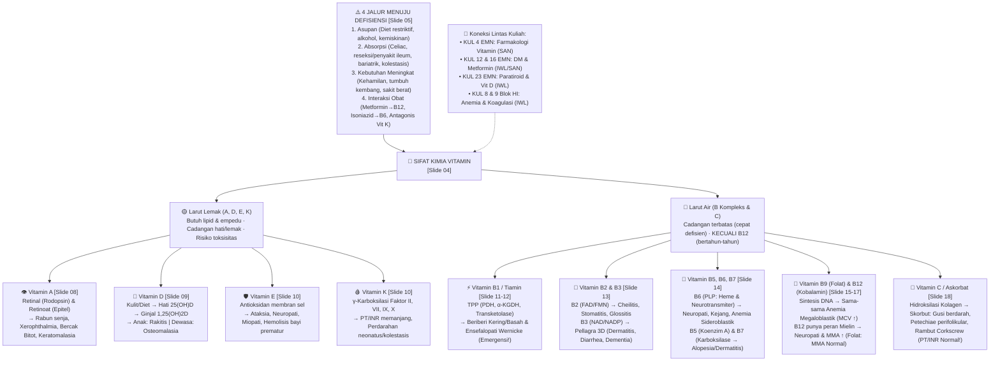
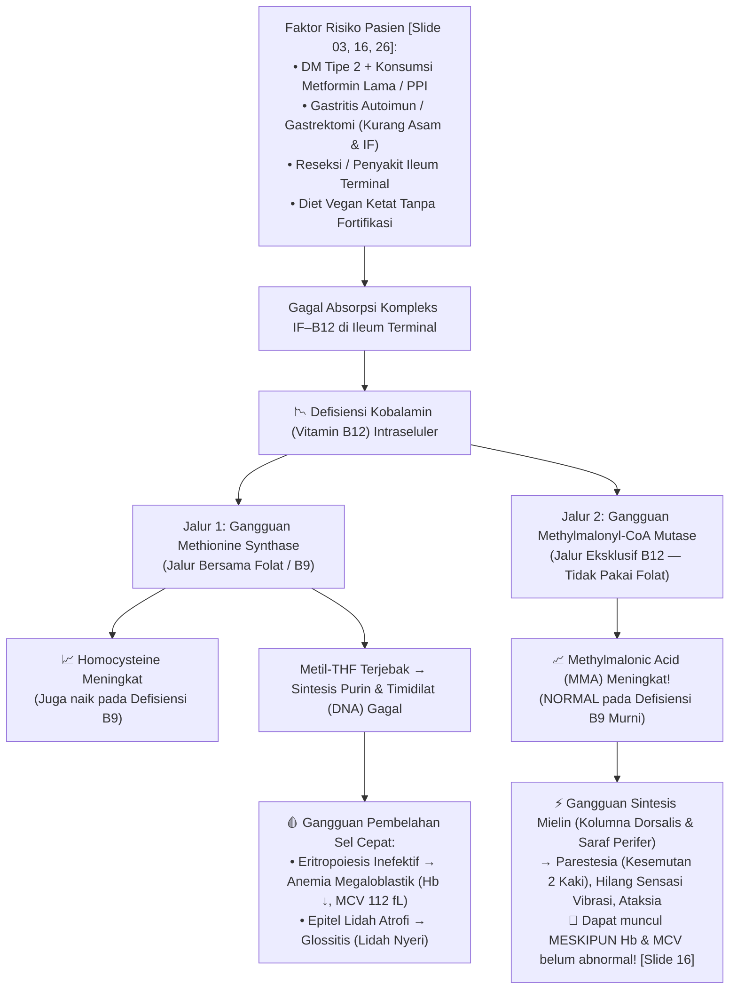
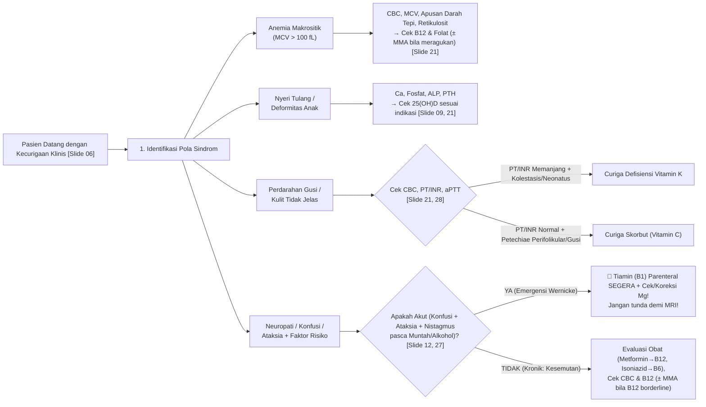

# VERTEX-PREP 2.0 — Proof of Concept (Eksperimen Pertama)
**Input Dokumen:** `KUL 2 DEFISIENSI VITAMIN (IWL).pdf` (28 Halaman PDF / Nomor Slide 01–33)
**Dosen Pengampu:** dr. Iwal Reza Ahdi, Sp.PD-FINASIM (`IWL`) — Departemen Ilmu Penyakit Dalam
**Konteks Kurikulum:** Blok 9 — *Endocrine, Metabolism, and Nutrition (EMN)* · Tema 1: Gangguan Nutrisi (`00. MODUL EMN 2026.pdf`, Hal. 21, 43–44)

> [!IMPORTANT]
> **Kontrak Epistemik 3 Lapisan Informasi (*Three-Layer Information Architecture*)**
> Seluruh isi dokumen Proof of Concept ini dipisahkan secara ketat menjadi:
> * 📌 **`[Lapisan 1 · Official Source]`** — Fakta, kalimat, tabel, dan gambar yang tertulis **eksplisit** di dalam slide `KUL 2 DEFISIENSI VITAMIN (IWL).pdf` atau `00. MODUL EMN 2026.pdf`. Setiap klaim wajib memiliki penunjuk `[Slide X]`.
> * 🧠 **`[Lapisan 2 · AI Explanation]`** — Penjelasan mekanisme biokimia/fisiologi dari nol, jembatan logika sebab-akibat, dan analogi *Feynman* untuk membuat mahasiswa paham *mengapa* suatu gejala muncul. **Bukan kutipan langsung dosen.**
> * 📚 **`[Lapisan 3 · External Knowledge]`** — Referensi literatur resmi modul (*Harrison's Principles of Internal Medicine Ed. 22*, *Harper's Illustrated Biochemistry Ed. 27*, *Goodman & Gilman*, serta *NICE Guideline NG239 2024* & *Endocrine Society 2024*) termasuk penanda perbedaan/nuansa klinis.

---

## OUTPUT 1 · Peta Seluruh Konsep (*Medical Concept & Dependency Graph*)

Peta ini mengorganisasi 28 halaman slide ke dalam struktur pengetahuan berjenjang yang menghubungkan **Sifat Kimia $\rightarrow$ Jalur Etiologi $\rightarrow$ Mekanisme Seluler $\rightarrow$ Sindrom Klinis $\rightarrow$ Strategi Diagnostik & Terapi**, sekaligus menunjukkan keterkaitannya dengan kuliah lain di Blok EMN dan Blok HI:



---

## OUTPUT 2 · Pemetaan Learning Objectives (LO) & Cakupan Kompetensi

Menyilangkan tuntutan kurikulum pada **`00. MODUL EMN 2026.pdf` (Hal. 21, 43–44)** dengan **Capaian Pembelajaran Slide Dosen (`Slide 02`)**:

| No | Kompetensi Modul EMN (`00. MODUL`, Hal. 21 & 44) | Level SNPPDI | Cakupan Eksplisit di `KUL 2 (IWL)` | Status Cakupan & Catatan Kesiapan Ujian |
| :--- | :--- | :---: | :--- | :--- |
| **LO-1** | Membedakan klasifikasi vitamin larut lemak dan larut air beserta implikasi penyimpanan & risikonya. | **4** | `Slide 02, 04, 19, 20` | ✅ **Tercakup Penuh.** Penekanan pada pengecualian B12 (larut air tapi cadangan bertahun-tahun) dan risiko toksisitas vitamin larut lemak. |
| **LO-2** | Menjelaskan etiologi, faktor risiko (4 jalur defisiensi), dan patofisiologi defisiensi vitamin A, B, C, D, E, K. | **4** | `Slide 05, 08–18` | ✅ **Tercakup untuk Defisiensi.** ⚠️ *Catatan Kurikulum:* Modul hal. 21 menyebut *"Hipervitaminosis A"*, namun di `KUL 2` hanya disebut prinsip toksisitas umum (`Slide 04`) & toksisitas B6 (`Slide 14`). Detail *Hipervitaminosis A* dilengkapi pada **Lapisan 3** & `KUL 4 Farmakologi (SAN)`. |
| **LO-3** | Mengenali manifestasi klinis / sindrom khas (*nyctalopia, bercak Bitot, rakitis, osteomalasia, beriberi, Wernicke, pellagra, skorbut, anemia megaloblastik*). | **4** | `Slide 03, 07–20, 26–28` | ✅ **Tercakup Sangat Kuat.** Dilengkapi peta gejala $\rightarrow$ vitamin (`Slide 07`) dan 3 skenario kasus diskusi (`Slide 03, 26–28`). |
| **LO-4** | Memilih pemeriksaan penunjang terarah berdasarkan probabilitas klinis dan melakukan *Differential Diagnosis* (DDx). | **4** | `Slide 06, 09, 17, 21, 26–28` | ✅ **Tercakup Sangat Kuat.** Tabel perbedaan B9 vs B12 (`Slide 17`), pemilihan uji `25(OH)D` (`Slide 09`), serta pembeda perdarahan Skorbut vs Vit K (`Slide 28`). |
| **LO-5** | Menentukan prioritas penatalaksanaan (urgensi, rute oral vs parenteral, koreksi kausa) dan pencegahan berbasis pangan/populasi risiko. | **4** | `Slide 06, 10, 12, 15, 23, 25, 27` | ✅ **Tercakup Prinsip Klinis.** Fokus pada triase emergensi (*Wernicke $\rightarrow$ tiamin parenteral segera*), larangan terapi folat tunggal sebelum menyingkirkan defisiensi B12, dan pencegahan pangan (`Slide 25`). Detail sediaan/dosis spesifik disinergikan dengan `KUL 4 (SAN)`. |

---

## OUTPUT 3 · Ringkasan Prioritas Ujian (*Exam Readiness High-Yield Notes*)

Bagian ini dirancang khusus untuk mode **Exam Readiness** (ketika waktu belajar terbatas 15–20 menit atau menjelang iRAT/UAB). Semua poin di bawah ini diambil langsung dari penekanan eksplisit slide dosen (**Lapisan 1**):

### A. 7 Peringatan Merah Dosen (*Clinical Red Flags & Exam Traps*)
Di dalam slide `KUL 2`, dr. Iwal menuliskan 7 kalimat peringatan khusus (dicetak tebal/berwarna merah di bagian bawah slide) yang menjadi **sumber utama soal jebakan**:
1. 📌 **`[Slide 04]` Pengecualian Cadangan Vitamin Larut Air:** Vitamin larut air (B kompleks & C) memiliki cadangan terbatas sehingga defisiensi cepat timbul, **KECUALI Vitamin B12** yang disimpan bertahun-tahun di hati.
2. 📌 **`[Slide 09]` Parameter Lab Vitamin D:** **`25(OH)D` (25-hidroksi vitamin D)** adalah parameter yang mencerminkan status vitamin D tubuh (bukan `1,25-(OH)2D`), dan **tidak direkomendasikan untuk skrining rutin semua individu sehat**.
3. 📌 **`[Slide 12 & 27]` Kegawatdaruratan Ensefalopati Wernicke (B1):** Berikan **tiamin parenteral segera** berdasarkan kecurigaan klinis. **Trias lengkap (konfusi, ataksia, okulomotor) tidak wajib ada semua.** Jangan menunda terapi demi menunggu MRI atau hasil laboratorium; koreksi **Magnesium (Mg)** bila rendah.
4. 📌 **`[Slide 14]` Paradoks Vitamin B6 (Piridoksin):** Defisiensi B6 menyebabkan neuropati perifer (misal akibat obat **Isoniazid**), **TETAPI suplementasi B6 dosis tinggi kronik juga menyebabkan neuropati!**
5. 📌 **`[Slide 15 & 17]` Jebakan Fatal Terapi Anemia Makrositik (Folat vs B12):** Sebelum mengobati anemia makrositik dengan folat (B9), **wajib evaluasi kemungkinan defisiensi B12**. Memberikan folat saja pada pasien defisiensi B12 dapat memperbaiki anemianya, **tetapi membiarkan/memperburuk neuropati B12** (*subacute combined degeneration*).
6. 📌 **`[Slide 16 & 17]` Gejala Neurologis B12 Tanpa Anemia:** Pada defisiensi B12, **gejala neurologis (parestesia/kesemutan, ataksia, gangguan vibrasi) dapat muncul meskipun kadar Hb dan MCV masih normal!**
7. 📌 **`[Slide 23]` Prinsip Terapi Rasional:** Tidak semua pasien defisiensi vitamin memerlukan *"megadose"* atau paket multivitamin; pilih rute (oral bila absorpsi baik, parenteral bila malabsorpsi/emergensi) dan obati penyakit dasarnya.

### B. Kamus Cepat *Buzzwords* Soal Vignette (`Slide 05–20`)
* **Rabun senja (*nyctalopia*) + xerophthalmia + Bercak Bitot (busa putih di konjungtiva) + keratomalasia** $\rightarrow$ 📌 **Defisiensi Vitamin A** `[Slide 08]`.
* **Deformitas tulang anak (*rakitis*) / nyeri tulang & kelemahan otot proksimal dewasa (*osteomalasia*)** $\rightarrow$ 📌 **Defisiensi Vitamin D** `[Slide 09]`.
* **Pasien malabsorpsi lemak / bayi prematur + ataksia, neuropati, miopati, anemia hemolitik** $\rightarrow$ 📌 **Defisiensi Vitamin E** `[Slide 10]`.
* **Neonatus (belum dapat profilaksis) / pasien kolestasis + perdarahan + PT/INR memanjang** $\rightarrow$ 📌 **Defisiensi Vitamin K** `[Slide 10]`.
* **Alkoholik kronik / hiperemesis gravidarum / pasca bedah bariatrik + gagal jantung *high-output* & edema** $\rightarrow$ 📌 **Beriberi Basah (Defisiensi B1)** `[Slide 11]`.
* **Alkoholik / muntah berulang (hiperemesis) + bingung (konfusi), jalan sempoyongan (ataksia), nistagmus/oftalmoplegia** $\rightarrow$ 📌 **Ensefalopati Wernicke (Defisiensi B1)** `[Slide 12, 27]`.
* **Luka sudut bibir (*angular cheilitis*), stomatitis, lidah merah nyeri (*glossitis*), dermatitis seboroik** $\rightarrow$ 📌 **Defisiensi Vitamin B2 (Riboflavin)** `[Slide 13]`.
* **Trias 3D: *Dermatitis* fotosensitif simetris + *Diarrhea* + *Dementia*** $\rightarrow$ 📌 **Pellagra (Defisiensi Vitamin B3 / Niasin)** `[Slide 13]`.
* **Pasien TB minum Isoniazid + kesemutan (neuropati perifer), kejang, atau anemia sideroblastik** $\rightarrow$ 📌 **Defisiensi Vitamin B6 (Piridoksin)** `[Slide 05, 14]`.
* **Dermatitis + rambut rontok (*alopesia*) + gejala neurologis** $\rightarrow$ 📌 **Defisiensi Vitamin B7 (Biotin)** `[Slide 14]`.
* **Pasien DM tipe 2 minum Metformin lama / vegan / gastritis autoimun / reseksi ileum + MCV > 100 fL + kesemutan/gangguan vibrasi + MMA meningkat** $\rightarrow$ 📌 **Defisiensi Vitamin B12** `[Slide 03, 16, 17, 26]`.
* **Pria diet sangat terbatas (tanpa sayur/buah segar) + gusi berdarah, *petechiae perifolikular*, rambut *corkscrew*, luka sulit sembuh + PT/INR NORMAL** $\rightarrow$ 📌 **Skorbut / Defisiensi Vitamin C** `[Slide 18, 28]`.

---

## OUTPUT 4 · Penjelasan Mendalam dari Nol hingga Tingkat Kedokteran (*Academic Mastery*)

Jalur **Academic Mastery** menyusun ulang materi secara sistematis dari **Fisiologi Normal $\rightarrow$ Mekanisme Gangguan $\rightarrow$ Manifestasi Klinis $\rightarrow$ Aplikasi Diagnostik/Terapi** dengan memisahkan 3 lapisan informasi secara transparan.

---

### Modul 4.1 · Prinsip Dasar: Mengapa Kelarutan Kimia Menentukan Nasib Klinis?

* 📌 **`[Lapisan 1 · Official Source — Slide 04 & 05]`**
  * **Vitamin Larut Lemak (A, D, E, K):** Diserap bersama lipid dan garam empedu; disimpan terutama di hati dan jaringan lemak; risiko defisiensi meningkat pada kondisi malabsorpsi lemak (misal kolestasis, penyakit celiac, bedah bariatrik); akumulasi berlebih dapat menyebabkan toksisitas.
  * **Vitamin Larut Air (B Kompleks & C):** Cadangan tubuh terbatas sehingga defisiensi lebih cepat muncul bila asupan terhenti, **kecuali Vitamin B12** yang memiliki simpanan bertahun-tahun.
  * **4 Jalur Menuju Defisiensi:** (1) Kurang asupan (diet restriktif, kemiskinan, alkohol), (2) Gangguan absorpsi (celiac, penyakit/reseksi ileum, bariatrik, kolestasis), (3) Peningkatan kebutuhan (kehamilan, pertumbuhan, penyakit berat), (4) Interaksi obat/kondisi (*Metformin–B12, Isoniazid–B6, antagonis Vitamin K*).

* 🧠 **`[Lapisan 2 · AI Explanation — Analogi Feynman & Mekanisme Fisiologis]`**
  * **Analogi "Gudang vs Dompet Harian":** Bayangkan vitamin larut lemak (A, D, E, K) seperti **uang deposito di brankas hati dan lemak**. Untuk memasukkan uang ke brankas, kamu butuh "kurir khusus" bernama **empedu dan kilomikron** (sistem limfatik usus). Kalau saluran empedu tersumbat (kolestasis) atau usus gagal menyerap lemak (*steatorrhea*), keempat vitamin ini gagal masuk sekaligus! Sebaliknya, karena disimpan di brankas, kalau kamu minum suplemen vitamin A atau D berlebihan, tubuh tidak bisa membuangnya lewat urin $\rightarrow$ menumpuk dan meracuni organ (hipervitaminosis).
  * Vitamin larut air (B & C) seperti **uang tunai di dompet harian**. Tubuh mengambil secukupnya untuk kerja enzim hari itu, lalu sisanya langsung dibuang lewat ginjal (urin). Itulah sebabnya pasien yang muntah-muntah hebat (*hiperemesis gravidarum*) atau tidak makan sayur/buah beberapa minggu langsung jatuh ke dalam defisiensi B1 atau C. **Mengapa hanya B12 yang berbeda?** Karena hati menyimpan sekitar 2–5 mg Vitamin B12 dan mendaur ulangnya lewat sirkulasi enterohepatik, sedangkan kebutuhan harian kita hanya ~2,4 $\mu$g/hari (sehingga cadangan baru habis setelah 3–5 tahun!).

* 📚 **`[Lapisan 3 · External Knowledge — Harper's Biochemistry Ed. 27 & Modul EMN Hal. 21]`**
  * **Tambahan Kompetensi Modul (*Hipervitaminosis A*):** Sesuai tuntutan `00. MODUL EMN Hal. 21`, kelebihan Vitamin A akut/kronik menyebabkan peningkatan tekanan intrakranial jinak (*pseudotumor cerebri*: nyeri kepala hebat, papiledema), hepatotoksisitas, kulit kering mengelupas (*deskuamasi*), nyeri tulang, dan bersifat **teratogenik kuat** pada kehamilan trimester 1 (*kontraindikasi retinoid sistemik pada ibu hamil*).

---

### Modul 4.2 · Vitamin Larut Lemak (A, D, E, K): Dari Molekul ke Gejala Pasien

#### 1. Vitamin A (Retinol, Retinal, Asam Retinoat)
* 📌 **`[Lapisan 1 · Official Source — Slide 08]`**
  * **Peran Utama:** `Retinal` berperan dalam siklus visual (pembentukan **rodopsin**); `Retinoat` berperan dalam diferensiasi epitel; mendukung imunitas dan pertumbuhan.
  * **Defisiensi Khas:** Rabun senja (*nyctalopia*) $\rightarrow$ *xerophthalmia* & **bercak Bitot** $\rightarrow$ *keratomalasia* $\rightarrow$ kebutaan.
  * **Faktor Risiko & Pangan:** Diet kurang, malabsorpsi lemak, gangguan hati. Sumber: hati, telur, susu (retinol hewani) dan sayur jingga/hijau seperti wortel/labu (`Slide 25` — provitamin A/karotenoid).
* 🧠 **`[Lapisan 2 · AI Explanation — Mengapa Muncul Rabun Senja & Bercak Bitot?]`**
  * **Jalur Penglihatan Gelap:** Di retina terdapat sel batang (*rod cells*) untuk melihat dalam cahaya redup. Sel batang membutuhkan penggabungan `11-cis-retinal` (turunan Vit A) + protein `opsin` = **Rodopsin**. Saat kekurangan Vitamin A, rodopsin gagal diregenerasi $\rightarrow$ pasien tidak bisa beradaptasi saat masuk ke ruangan gelap (**rabun senja / *nyctalopia*** — gejala klinis paling awal!).
  * **Jalur Epitel Mata:** `Asam retinoat` bertugas menjaga sel epitel konjungtiva dan kornea agar tetap menghasilkan mukus (sel goblet). Tanpa Vitamin A, epitel penghasil lendir berubah wujud (*metaplasia skuamosa berkeratin*) menjadi kering dan kasar (**xerophthalmia**). Runtuhan keratin yang menumpuk di konjungtiva tampak sebagai plak putih berbusa seperti keju (**Bercak Bitot**). Jika berlanjut, kornea melunak dan hancur (**keratomalasia**) $\rightarrow$ kebutaan permanen.

#### 2. Vitamin D (Kalsiferol)
* 📌 **`[Lapisan 1 · Official Source — Slide 09 & 21]`**
  * **Alur Aktivasi:** `Kulit (sinar UV) / Asupan` (Vitamin $D_3 / D_2$) $\rightarrow$ `Hati` (**25-hidroksi vitamin D / 25(OH)D**) $\rightarrow$ `Ginjal` (**1,25-(OH)$_2$ vitamin D**) $\rightarrow$ `Usus & Tulang` (absorpsi Ca–P & mineralisasi tulang).
  * **Manifestasi Klinis:** Pada anak terjadi **rakitis** (deformitas tulang, gangguan pertumbuhan); pada dewasa terjadi **osteomalasia** (nyeri tulang dan kelemahan otot proksimal).
  * **Pemeriksaan Klinis:** Evaluasi Ca, fosfat, ALP, PTH, serta **`25(OH)D`** bila ada indikasi (`Slide 21`).
* 🧠 **`[Lapisan 2 · AI Explanation — Mengapa Rakitis Berbeda dengan Osteomalasia, dan Mengapa Cek 25(OH)D?]`**
  * **Anak vs Dewasa:** Pada anak-anak, lempeng pertumbuhan (*epiphyseal growth plate*) masih terbuka dan tulang masih memanjang. Ketika matriks osteoid tulang tidak terisi kalsium & fosfat, tulang menjadi lunak dan melengkung saat anak berdiri (**Rakitis**: kaki bentuk O/X, *rachitic rosary* di dada). Pada orang dewasa, lempeng epifisis sudah menutup sehingga tulang tidak lagi bengkok ekstrem, melainkan matriks tulang baru gagal mengalami mineralisasi $\rightarrow$ tulang terasa nyeri tumpul difus dan otot paha/bahu lemah (**Osteomalasia**).
  * **Mengapa Cek `25(OH)D` Bukan `1,25(OH)2D`?** Bentuk `25(OH)D` (kalsidiol) yang diproduksi hati punya waktu paruh panjang (~2–3 minggu) dan konsentrasinya paling mencerminkan cadangan Vitamin D tubuh. Sebaliknya, `1,25(OH)2D` (kalsitriol) waktu paruhnya hanya beberapa jam dan diatur ketat oleh hormon paratiroid (PTH). Saat tubuh kekurangan Vitamin D, kalsium turun sedikit $\rightarrow$ PTH naik $\rightarrow$ PTH memaksa ginjal memompa `1,25(OH)2D` sehingga kadar `1,25(OH)2D` bisa tampak normal atau bahkan tinggi palsu!
* 📚 **`[Lapisan 3 · External Knowledge — Endocrine Society Guideline 2024, Slide 33]`**
  * Pedoman terbaru *Endocrine Society (2024)* yang dirujuk dr. Iwal di `Slide 09 & 33` menegaskan untuk **tidak melakukan skrining rutin `25(OH)D`** pada orang dewasa sehat tanpa faktor risiko/gejala klinis.

#### 3. Vitamin E (Tokoferol) & Vitamin K (Filokuinon / Menakuinon)
* 📌 **`[Lapisan 1 · Official Source — Slide 10 & 21]`**
  * **Vitamin E:** Antioksidan membran sel. Defisiensi menyebabkan **neuropati, ataksia, miopati**, serta **hemolisis** (terutama pada bayi prematur). Risiko: malabsorpsi lemak dan kelainan genetik langka.
  * **Vitamin K:** Kofaktor untuk **$\gamma$-karboksilasi faktor koagulasi II, VII, IX, X**. Defisiensi menyebabkan **PT/INR memanjang dan perdarahan**. Risiko: neonatus, kolestasis, malabsorpsi. Profilaksis vitamin K pada bayi baru lahir sangat penting.
* 🧠 **`[Lapisan 2 · AI Explanation — Mekanisme Biokimia]`**
  * **Vitamin E:** Membran sel darah merah (eritrosit) dan selubung mielin saraf kaya akan asam lemak tak jenuh ganda (*PUFA*) yang sangat rentan dirusak oleh radikal bebas (*peroksidasi lipid*). Vitamin E menjaga keutuhan membran tersebut. Tanpa Vitamin E, eritrosit pecah (**anemia hemolitik**) dan kolumna posterior medula spinalis mengalami degenerasi (**ataksia sensorik & arefleksia** — mirip defisiensi B12, tetapi **tanpa anemia megaloblastik!**).
  * **Vitamin K:** Faktor pembekuan darah **II (Protrombin), VII, IX, dan X** dibuat di hati dalam bentuk belum aktif. Agar bisa mengikat ion Kalsium ($\text{Ca}^{2+}$) dan menempel di permukaan trombosit saat luka, residu asam glutamat pada faktor tersebut harus ditambah gugus karboksil ($\gamma$-karboksilasi) oleh enzim yang wajib memakai **Vitamin K**. Karena Faktor VII memiliki waktu paruh paling pendek (~4–6 jam), tanda lab paling awal defisiensi Vitamin K adalah memanjangnya **PT (Prothrombin Time) / INR**, disusul aPTT bila defisiensi memberat. Mengapa **neonatus** wajib disuntik Vitamin K1 saat lahir? Karena: (1) transfer Vitamin K lewat plasenta sangat sedikit, (2) usus bayi baru lahir masih steril (belum ada bakteri penghasil menakuinon/$K_2$), dan (3) kadar Vitamin K dalam ASI rendah.

---

### Modul 4.3 · Vitamin Larut Air: Metabolisme Energi (B1, B2, B3, B5, B6, B7), Sintesis DNA (B9, B12), & Kolagen (C)

#### 1. Vitamin B1 (Tiamin) & Kegawatdaruratan Wernicke
* 📌 **`[Lapisan 1 · Official Source — Slide 11, 12, 27]`**
  * Bentuk aktif **Tiamin Pirofosfat (TPP)** adalah kofaktor 3 enzim utama: **Piruvat dehidrogenase (PDH)**, **$\alpha$-ketoglutarat dehidrogenase ($\alpha$-KGDH)**, dan **Transketolase**.
  * **3 Sindrom Defisiensi:** (1) *Beriberi kering* (neuropati perifer), (2) *Beriberi basah* (gagal jantung, edema), (3) *Ensefalopati Wernicke* (kegawatdaruratan neurologis akut: **Konfusi, Ataksia, Gangguan Okulomotor/nistagmus/oftalmoplegia**).
  * **Risiko:** Alkoholik kronik, malnutrisi, hiperemesis gravidarum, operasi bariatrik.
  * **Tatalaksana Wernicke:** Berikan **tiamin parenteral segera** atas kecurigaan klinis (trias lengkap tidak wajib, jangan tunda demi MRI/lab), dan **koreksi Magnesium (Mg)** bila rendah.
* 🧠 **`[Lapisan 2 · AI Explanation — Mengapa Otak & Jantung Paling Cepat Rusak, dan Mengapa Harus Koreksi Magnesium?]`**
  * **Krisis ATP di Otak & Jantung:** Enzim PDH dan $\alpha$-KGDH adalah pintu masuk utama Siklus Krebs untuk menghasilkan energi (ATP) dari glukosa. Sel neuron otak dan otot jantung adalah pemakai glukosa terbesar. Ketika tiamin habis (misal karena muntah hebat pada ibu hamil dengan *hiperemesis gravidarum* atau alkoholik), sel otak kehabisan ATP dalam hitungan hari $\rightarrow$ area sekitar ventrikel III & korpus mamilaris mengalami perdarahan titik/nekrosis $\rightarrow$ muncul **Ensefalopati Wernicke**. Di pembuluh darah dan jantung, kegagalan energi memicu vasodilatasi sistemik masif dan gagal jantung *high-output* (**Beriberi Basah**).
  * **Mengapa Wajib Koreksi Magnesium (`Slide 12`)?** Karena enzim yang mengubah Tiamin menjadi bentuk aktif **TPP** (*thiamine pyrophosphokinase*) serta kerja enzim transketolase **mutlak membutuhkan ion $\text{Mg}^{2+}$ sebagai pendamping**! Jika pasien hipomagnesemia (sangat sering pada alkoholik dan muntah berat), suntikan tiamin sebanyak apa pun tidak akan bisa bekerja optimal sebelum Mg dikoreksi!
* 📚 **`[Lapisan 3 · External Knowledge — EFNS Guideline 2010 & Harrison's Ed. 22]`**
  * **Aturan Emas IGD (*Thiamine Before Glucose*):** Pada pasien malnutrisi/alkoholik/hiperemesis yang datang ke IGD, **berikan tiamin parenteral sebelum atau bersamaan dengan infus Dekstrosa (glukosa)**. Memberikan infus glukosa lebih dulu tanpa tiamin akan menguras sisa cadangan TPP terakhir di otak dan memicu atau memperberat Ensefalopati Wernicke secara mendadak! Bila Wernicke tidak tertangani, pasien jatuh ke fase kronik ireversibel: **Sindrom Korsakoff** (amnesia anterograd/retrograd + **konfabulasi** / mengarang cerita tanpa sadar, seperti terlihat pada ilustrasi `Slide 12`).

#### 2. Vitamin B2 (Riboflavin), B3 (Niasin), B5, B6 (Piridoksin), & B7 (Biotin)
* 📌 **`[Lapisan 1 · Official Source — Slide 13 & 14]`**
  * **B2 (Riboflavin):** Prekursor **FAD / FMN** (reaksi redoks). Defisiensi: *angular cheilitis*, stomatitis, glossitis, dermatitis seboroik.
  * **B3 (Niasin):** Prekursor **NAD / NADP** (metabolisme energi). Defisiensi: **Pellagra (3D = *Dermatitis* fotosensitif, *Diarrhea*, *Dementia*)**.
  * **B5 (Asam Pantotenat):** Komponen **Koenzim A (CoA)**. Defisiensi sangat jarang (parestesia / *fatigue*).
  * **B6 (Piridoksin):** Koenzim **PLP (*Pyridoxal Phosphate*)** pada metabolisme asam amino & sintesis heme. Defisiensi (sering dipicu obat **Isoniazid**): neuropati, kejang, **anemia sideroblastik**. Suplementasi B6 dosis tinggi kronik juga dapat menyebabkan neuropati.
  * **B7 (Biotin):** Koenzim **karboksilase**. Defisiensi jarang: dermatitis, **alopesia** (kebotakan), gejala neurologis.
* 🧠 **`[Lapisan 2 · AI Explanation — Mengapa Defisiensi B6 Menyebabkan Kejang & Anemia Sideroblastik?]`**
  * **Mengapa Kejang?** PLP (Vitamin B6) adalah kofaktor enzim *glutamat dekarboksilase* yang mengubah neurotransmiter eksitatorik (Glutamat) menjadi neurotransmiter inhibitorik utama otak (**GABA**). Tanpa B6, kadar GABA otak anjlok $\rightarrow$ otak kehilangan "rem" $\rightarrow$ **kejang**!
  * **Mengapa Anemia Sideroblastik?** Langkah pertama pembuatan **Heme** (komponen Hb) di mitokondria dikatalisis oleh enzim *ALA synthase* yang membutuhkan kofaktor **PLP (B6)**. Tanpa B6, protoporfirin gagal dibuat, sehingga zat besi ($\text{Fe}$) yang sudah terlanjur masuk ke mitokondria tidak punya pasangan dan menumpuk mengelilingi inti eritroblas membentuk cincin (**ringed sideroblast** $\rightarrow$ **Anemia Sideroblastik**).
  * **Mengapa Isoniazid (Obat TB) Memicu Defisiensi B6?** Isoniazid mengikat dan menginaktivasi piridoksal fosfat serta meningkatkan ekskresinya di urin.

#### 3. Vitamin B9 (Folat) vs Vitamin B12 (Kobalamin) — Duel Anemia Megaloblastik
* 📌 **`[Lapisan 1 · Official Source — Slide 03, 15, 16, 17, 26]`**
  * **Peran B9 (Folat):** `Folat` $\rightarrow$ `THF (tetrahidrofolat)` sebagai donor unit satu-karbon $\rightarrow$ sintesis purin & timidilat $\rightarrow$ replikasi DNA. Defisiensi menghambat pembelahan sel $\rightarrow$ **anemia megaloblastik**. Kecukupan folat perikonsepsi pada ibu hamil mencegah ***Neural Tube Defects* (NTD)** pada janin.
  * **Peran & Absorpsi B12:** `Makanan (B12 terikat protein)` $\rightarrow$ `Lambung (dilepas oleh asam lambung & diikat Intrinsic Factor / IF)` $\rightarrow$ `Ileum Terminal (absorpsi kompleks IF–B12)` $\rightarrow$ `Sel (sintesis DNA & mielin)`.
  * **Faktor Risiko B12:** Gastritis autoimun (anemia pernisiosa), gastrektomi, reseksi/penyakit ileum, diet vegan tanpa fortifikasi, penggunaan **Metformin** lama, dan **PPI (*Proton Pump Inhibitor*)** lama.
  * **Perbedaan Kunci B9 vs B12 (`Slide 17`):** Keduanya menyebabkan MCV meningkat (anemia makrositik megaloblastik) dan peningkatan **Homocysteine**. Namun, **Neuropati/Ataksia** dan peningkatan **Methylmalonic Acid (MMA)** merupakan ciri khas **Defisiensi B12** (pada defisiensi folat murni, MMA biasanya normal).
* 🧠 **`[Lapisan 2 · AI Explanation — Mengapa MMA Hanya Naik pada B12 & Mengapa Folat Saja Berbahaya?]`**
  * Vitamin B12 hanya punya **2 pekerjaan enzimatis** di tubuh manusia:
    1. **Bersama Folat (Enzim *Methionine Synthase*):** Memindahkan gugus metil dari `Metil-THF` (folat) ke `Homosistein` menjadi `Metionin`, sehingga `THF` bebas bisa dipakai membuat DNA (timidilat). Jika B9 **atau** B12 kurang $\rightarrow$ `Homosistein` sama-sama menumpuk, dan sintesis DNA eritroblas terhambat (inti sel gagal matang padahal sitoplasma terus membesar $\rightarrow$ lahirlah sel darah merah raksasa bernama **megaloblas** dengan **MCV > 100 fL**).
    2. **Khusus B12 Sendiri (Enzim *Methylmalonyl-CoA Mutase*):** Mengubah `Methylmalonyl-CoA` menjadi `Succinyl-CoA` (penting untuk metabolisme asam lemak rantai ganjil dan pemeliharaan **selubung mielin saraf**). Reaksi ini **sama sekali tidak memakai Folat**! Itulah sebabnya saat B12 defisien, **`Methylmalonic Acid (MMA)` menumpuk**, merusak mielin saraf (menyebabkan kesemutan/parestesia & gangguan rasa getar/vibrasi di kaki), dan menjadi penanda lab pembeda mutlak dari defisiensi folat!
  * **Mengapa Memberi Folat Saja pada Defisiensi B12 Adalah Kesalahan Klinis (`Slide 17`)?** Saat pasien defisiensi B12 diberi Folat dosis tinggi, jalur sintesis DNA terpacu kembali sehingga Hb naik dan MCV membaik ("anemianya sembuh"). Akibatnya, dokter mengira pasien sudah sembuh, padahal jalur mielin (`MMA`) tetap rusak dan kerusakan saraf tulang belakang berjalan terus hingga pasien lumpuh permanen!

#### 4. Vitamin C (Asam Askorbat) & Skorbut (*Scurvy*)
* 📌 **`[Lapisan 1 · Official Source — Slide 18 & 28]`**
  * **Alur Mekanisme:** `Askorbat` (kofaktor hidroksilasi) $\rightarrow$ `Kolagen matang` (kekuatan matriks jaringan) $\rightarrow$ jika defisiensi: **pembuluh darah rapuh & luka sulit sembuh**.
  * **Manifestasi Klasik Skorbut:** Perdarahan gingiva (gusi), ***petechiae perifolikular*** (bintik perdarahan di sekitar folikel rambut tungkai), dan **rambut *corkscrew*** (rambut melintir seperti pembuka botol).
  * **Pembeda Klinis dari Defisiensi Vitamin K (`Slide 28`):** Pada Skorbut (defisiensi Vitamin C), perdarahan terjadi karena kerapuhan dinding pembuluh darah (gangguan kolagen), sehingga pemeriksaan koagulasi **PT/INR dapat NORMAL**.

---

## OUTPUT 5 · Diagram Mekanisme (*Pathophysiology & Clinical Reasoning Flow*)

### Diagram 5.1 · Mekanisme Ganda Vitamin B12 vs Folat (Mengapa Kasus Awal `Slide 03` & `Slide 26` Terjadi?)



### Diagram 5.2 · Algoritma Pendekatan Klinis & Triase Pemeriksaan (`Slide 06 & 21`)



---

## OUTPUT 6 · Tabel Pembanding (*Differential Diagnosis Matrix*) & Dekoder Visual Slide Dosen

### A. Tabel Pembanding Utama: Penyakit yang Sering Tertukar di Ujian

#### 1. Tabel Komparasi Penyebab Perdarahan Mukokutan: **Skorbut (Vit C) vs Defisiensi Vitamin K** (`Slide 10, 18, 21, 28`)
| Aspek Pembeda | 📌 Skorbut / Defisiensi Vitamin C `[Slide 18, 28]` | 📌 Defisiensi Vitamin K `[Slide 10, 21]` |
| :--- | :--- | :--- |
| **Mekanisme Dasar** | Kegagalan hidroksilasi prolin/lisin $\rightarrow$ **kolagen tidak matang** $\rightarrow$ dinding kapiler rapuh. | Kegagalan **$\gamma$-karboksilasi Faktor II, VII, IX, X** di hati $\rightarrow$ kaskade koagulasi gagal. |
| **Konteks / Faktor Risiko Khas** | Diet sangat terbatas tanpa sayur/buah segar, malnutrisi. | **Neonatus** (belum dapat injeksi profilaksis Vit K), **kolestasis** / obstruksi bilier, malabsorpsi lemak, terapi antagonis Vit K (warfarin). |
| **Tanda Klinis Patognomonik** | Perdarahan gingiva (gusi bengkak rapuh), ***petechiae perifolikular*** di tungkai, **rambut *corkscrew***, luka lama sembuh. | Ekimosis/hematoma luas, perdarahan umbilikus/intrakranial (neonatus), hematuria/melena. |
| **Hasil Lab Koagulasi (`PT/INR`)** | **PT / INR NORMAL!** | **PT / INR MEMANJANG!** |

#### 2. Tabel Komparasi Defisiensi Vitamin dengan Gejala Neurologis (`Slide 07, 10–17`)
| Vitamin | Sindrom Neurologis Khas | Tanda Penyerta Non-Neurologis Pembeda di Vignette | Faktor Risiko Kunci di Soal |
| :--- | :--- | :--- | :--- |
| **B1 (Tiamin)** `[Slide 11–12]` | **Akut:** Ensefalopati Wernicke (*Konfusi, Ataksia, Nistagmus/Oftalmoplegia*). **Kronik:** Neuropati perifer (*Beriberi kering*). | Edema & gagal jantung *high-output* pada *Beriberi basah*. | Alkoholik kronik, **hiperemesis gravidarum**, operasi bariatrik. |
| **B12 (Kobalamin)** `[Slide 16–17]` | Parestesia simetris kedua kaki, **hilang sensasi posisi & vibrasi**, ataksia. *(Bisa muncul sebelum Hb/MCV abnormal!)* | **Anemia makrositik megaloblastik (MCV > 100 fL)**, *glossitis* (lidah nyeri), **MMA meningkat**. | **Metformin lama**, PPI lama, vegan, gastritis autoimun, reseksi ileum. |
| **B6 (Piridoksin)** `[Slide 14]` | Neuropati perifer sensorik, **kejang** (akibat defisiensi GABA). | **Anemia sideroblastik** (mikrositik/normositik dengan *ringed sideroblast*). | Pengobatan TB dengan **Isoniazid (INH)** tanpa suplementasi B6; *atau* toksisitas megadose B6. |
| **E (Tokoferol)** `[Slide 10]` | Ataksia spinoserebelar, neuropati perifer, **miopati** (kelemahan otot). | **Anemia hemolitik** (terutama pada bayi prematur); MCV dan MMA normal. | Malabsorpsi lemak kronik (kolestasis, *cystic fibrosis*), kelainan genetik abetalipoproteinemia. |
| **B3 (Niasin)** `[Slide 13]` | Perubahan neurokognitif / **Demensia** (bagian dari Trias 3D Pellagra). | **Dermatitis fotosensitif** simetris (*Casal's necklace* / *gauntlet*) + **Diare** kronik. | Diet sangat terbatas (konsumsi jagung pokok tanpa protein/triptofan), malabsorpsi. |

---

### B. Dekoder Visual Slide Dosen (*Multimodal Clinical Image Explainer*)

Berikut adalah **6 foto/ilustrasi klinis asli** yang diekstrak langsung dari slide `KUL 2 DEFISIENSI VITAMIN (IWL).pdf` beserta cara mengenalinya saat muncul di soal bergambar:

````carousel

* **📌 Sumber:** `KUL 2 DEFISIENSI VITAMIN (IWL)`, **Slide 08**.
* **🔍 Temuan Visual Kunci:** Tampak plak putih-kekuningan berbusa/berkeratin berbentuk segitiga di konjungtiva bulbi temporal (ditunjuk panah biru) disertai xerosis (kekeringan) konjungtiva.
* **🎯 Nama Temuan & Diagnosis:** **Bercak Bitot (*Bitot's Spot*)** $\rightarrow$ Patognomonik untuk **Defisiensi Vitamin A (*Xerophthalmia*)**.
* **🧠 Mekanisme Singkat:** Kekurangan asam retinoat menyebabkan epitel konjungtiva kehilangan sel goblet penghasil mukus dan mengalami metaplasia skuamosa berkeratin.
<!-- slide -->

* **📌 Sumber:** `KUL 2 DEFISIENSI VITAMIN (IWL)`, **Slide 10**.
* **🔍 Temuan Visual Kunci:** Kiri: Ekimosis/hematoma subkutan masif di punggung neonatus (*Vitamin K Deficiency Bleeding / VKDB*). Kanan: Perdarahan gusi spontan pada orang dewasa.
* **🎯 Pembeda Ujian:** Jika gambar perdarahan gusi disertai **PT/INR memanjang** atau riwayat kolestasis/neonatus tanpa injeksi profilaksis $\rightarrow$ **Defisiensi Vitamin K** (gangguan $\gamma$-karboksilasi faktor II, VII, IX, X).
<!-- slide -->

* **📌 Sumber:** `KUL 2 DEFISIENSI VITAMIN (IWL)`, **Slide 12**.
* **🔍 Temuan Visual Kunci:** Pasien tampak bingung (*confusion*), ptosis/oftalmoparesis/nistagmus (*okulomotor*), dan gangguan keseimbangan (*ataksia*).
* **🎯 Tindakan Segera (`Slide 12`):** **Ensefalopati Wernicke (Defisiensi B1 / Tiamin)** $\rightarrow$ Berikan **Tiamin parenteral segera** tanpa menunggu MRI/lab, serta koreksi **Magnesium (Mg)**.
<!-- slide -->

* **📌 Sumber:** `KUL 2 DEFISIENSI VITAMIN (IWL)`, **Slide 13**.
* **🔍 Temuan Visual Kunci:** Fisura (celah luka), eritema, dan krusta pada kedua sudut komisura bibir.
* **🎯 Nama Temuan & Diagnosis:** ***Angular Cheilitis* (Stomatitis Angularis)** $\rightarrow$ Khas pada **Defisiensi Vitamin B2 (Riboflavin)** (sering disertai *glossitis* dan dermatitis seboroik).
<!-- slide -->

* **📌 Sumber:** `KUL 2 DEFISIENSI VITAMIN (IWL)`, **Slide 13** (rujukan *Berry et al., 2022* pada `Slide 33`).
* **🔍 Temuan Visual Kunci:** Plak hiperpigmentasi kecokelatan, kasar, berskuama, dan berbatas tegas secara simetris pada punggung tangan/lengan bawah yang terpapar matahari (*gauntlet of pellagra*, Panel A) yang membaik drastis pasca terapi Niasin (Panel B).
* **🎯 Nama Temuan & Diagnosis:** **Pellagra (Defisiensi Vitamin B3 / Niasin)** $\rightarrow$ Ingat **Trias 3D: *Dermatitis* fotosensitif, *Diarrhea*, *Dementia***.
<!-- slide -->

* **📌 Sumber:** `KUL 2 DEFISIENSI VITAMIN (IWL)`, **Slide 18**.
* **🔍 Temuan Visual Kunci:** Gingiva tampak hiperemis (merah terang-keunguan), bengkak (hiperplastik/spongiosa) terutama di papila interdental, dan mudah berdarah.
* **🎯 Nama Temuan & Diagnosis:** **Skorbut (*Scurvy* — Defisiensi Vitamin C)** akibat kegagalan hidroksilasi kolagen. Di soal cerita biasanya disertai *petechiae perifolikular*, rambut *corkscrew*, dan **PT/INR normal** (`Slide 28`).
````

---

## OUTPUT 7 & 8 · Bank Soal Vignette Klinis & Pembahasan Seluruh Opsi (A–E)

Berikut adalah **6 Soal Vignette & Kognitif Bertingkat** yang dirancang mengikuti struktur kasus di slide `KUL 2 (IWL)` dan format ujian blok, lengkap dengan bedah distraktor A–E, pemetaan LO, dan keterlacakan sumber:

---

### Soal 1 · Diagnosis Banding & Interpretasi Biomarker (Level Kognitif: C4 — Analisis Klinis)
**Vignette:**
Seorang laki-laki berusia 62 tahun datang ke poliklinik dengan keluhan kesemutan pada kedua telapak kaki yang memberat sejak 6 bulan terakhir disertai rasa nyeri pada lidah dan mudah lelah. Pasien memiliki riwayat Diabetes Mellitus tipe 2 sejak 8 tahun lalu dan rutin mengonsumsi Metformin $3 \times 500\text{ mg}$. Pemeriksaan fisik menunjukkan konjungtiva anemis, papila lidah atrofi dan tampak licin kemerahan, serta penurunan sensasi getar (vibrasi) pada kedua maleolus. Pemeriksaan laboratorium menunjukkan $\text{Hb } 9,8\text{ g/dL}$ dan $\text{MCV } 112\text{ fL}$. Dokter ingin memastikan etiologi spesifik defisiensi mikronutrien pada pasien ini dan membedakannya dari defisiensi vitamin lain yang juga menyebabkan gambaran eritrosit serupa. Parameter biokimia manakah yang **paling tepat** menjadi pembeda spesifik kondisi pasien ini?

* **A.** Peningkatan kadar homosistein serum dengan kadar *methylmalonic acid* (MMA) yang normal.
* **B.** Peningkatan kadar *methylmalonic acid* (MMA) serum disertai peningkatan homosistein.
* **C.** Penurunan aktivitas enzim transketolase eritrosit pasca pemberian tiamin pirofosfat.
* **D.** Pemanjangan waktu protrombin (*Prothrombin Time* / INR) disertai penurunan fibrinogen.
* **E.** Penurunan kadar $1,25\text{-(OH)}_2\text{D}$ serum dengan peningkatan hormon paratiroid (PTH).

#### ✅ Kunci Jawaban & Pembahasan Lengkap (Output 8):
* **Jawaban Benar: B**
* **📌 Rujukan Sumber Resmi (`Lapisan 1`):** `KUL 2 DEFISIENSI VITAMIN (IWL)`, **Slide 03, 16, 17, 21, dan 26** (*Diskusi Kasus 1*).
* **🎯 LO & Kompetensi yang Diuji:** LO-3 & LO-4 (SNPPDI Level 4 — *Defisiensi Vitamin B12 sekunder akibat penggunaan Metformin kronik*).
* **🧠 Analisis Mengapa Opsi B Benar & Opsi Lain Salah:**
  * **Kata Kunci Vignette:** *Laki-laki 62 tahun + Metformin lama + kesemutan & gangguan vibrasi (neuropati/kolumna posterior) + glossitis + anemia makrositik ($\text{MCV } 112\text{ fL}$)* = **Defisiensi Vitamin B12 (Kobalamin)**.
  * **Mengapa B Benar (`Slide 17`):** Baik defisiensi Folat (B9) maupun Kobalamin (B12) sama-sama menyebabkan anemia makrositik megaloblastik dan peningkatan **homosistein**. Namun, **peningkatan *Methylmalonic Acid* (MMA)** spesifik terjadi pada **defisiensi B12** karena B12 merupakan kofaktor tunggal enzim *methylmalonyl-CoA mutase*.
  * **Mengapa A Salah (Jebakan *Confusion Error*):** Homosistein meningkat dengan MMA normal adalah profil biokimia khas untuk **Defisiensi Folat (B9) murni**, yang juga tidak memiliki gejala khas neuropati/gangguan vibrasi (`Slide 17`).
  * **Mengapa C Salah:** Aktivitas transketolase eritrosit adalah uji fungsional untuk **Defisiensi Vitamin B1 (Tiamin)** (`Slide 11`).
  * **Mengapa D Salah:** Pemanjangan PT/INR adalah temuan laboratorium pada **Defisiensi Vitamin K** (`Slide 10`).
  * **Mengapa E Salah:** Berkaitan dengan metabolisme **Vitamin D**, dan bahkan untuk status Vitamin D pun parameter yang tepat adalah $25\text{(OH)D}$, bukan $1,25\text{-(OH)}_2\text{D}$ (`Slide 09`).

---

### Soal 2 · Kegawatdaruratan Klinis & Prioritas Tindakan (Level Kognitif: C5 — Evaluasi / Triase IGD)
**Vignette:**
Seorang perempuan berusia 28 tahun, $\text{G1P0A0}$ usia kehamilan 10 minggu, dibawa ke IGD karena tampak bingung dan bicara meracau sejak pagi ini. Selama 3 minggu terakhir pasien mengalami muntah-muntah hebat (*hiperemesis gravidarum*) hingga hampir tidak ada makanan yang masuk. Pada pemeriksaan fisik didapatkan pasien tampak somnolen-konfusi, terdapat nistagmus horizontal bilateral, dan tidak mampu berjalan lurus karena gangguan koordinasi (*ataksia*). Pemeriksaan kadar glukosa darah kapiler $68\text{ mg/dL}$, dan fasilitas MRI otak belum tersedia saat itu. Manakah langkah penatalaksanaan **paling tepat dan mendesak** yang harus segera dilakukan dokter IGD?

* **A.** Menunda pemberian terapi definitif sampai pemeriksaan MRI otak dan kadar vitamin darah selesai dilakukan untuk memastikan diagnosis.
* **B.** Memberikan infus cairan Dekstrosa $10\%$ secara cepat terlebih dahulu, kemudian memberikan vitamin B12 oral setelah pasien sadar penuh.
* **C.** Memberikan injeksi tiamin (Vitamin B1) parenteral segera berdasarkan kecurigaan klinis, sambil mengevaluasi dan mengoreksi elektrolit termasuk magnesium.
* **D.** Memberikan suplementasi asam folat $5\text{ mg}$ per oral untuk mencegah *neural tube defects* sekaligus mengatasi gangguan neurologis akut pasien.
* **E.** Memberikan piridoksin (Vitamin B6) dosis tinggi ($500\text{ mg/hari}$) intravena sebagai lini pertama mengatasi ataksia dan nistagmus.

#### ✅ Kunci Jawaban & Pembahasan Lengkap (Output 8):
* **Jawaban Benar: C**
* **📌 Rujukan Sumber Resmi (`Lapisan 1`):** `KUL 2 DEFISIENSI VITAMIN (IWL)`, **Slide 11, 12, dan 27** (*Diskusi Kasus 2*).
* **🎯 LO & Kompetensi yang Diuji:** LO-3 & LO-5 (SNPPDI Level 4 / Kegawatdaruratan — *Ensefalopati Wernicke sekunder akibat Hiperemesis Gravidarum*).
* **🧠 Analisis Mengapa Opsi C Benar & Opsi Lain Salah:**
  * **Kata Kunci Vignette:** *Hiperemesis gravidarum (muntah berat, asupan kurang) + Trias Wernicke (Konfusi + Ataksia + Nistagmus/Okulomotor)* = **Ensefalopati Wernicke (Defisiensi Akut Vitamin B1 / Tiamin)**.
  * **Mengapa C Benar (`Slide 12 & 27`):** Ensefalopati Wernicke adalah **kegawatdaruratan neurologis**. Tiamin parenteral harus diberikan **segera** berdasarkan kecurigaan klinis tanpa menunggu hasil MRI/lab, disertai koreksi status nutrisi/elektrolit dan evaluasi **Magnesium (Mg)** (karena Mg adalah kofaktor krusial aktivasi tiamin menjadi TPP).
  * **Mengapa A Salah:** Menunda terapi demi menunggu MRI/laboratorium secara eksplisit dilarang di `Slide 12 & 27` karena dapat menyebabkan kerusakan otak permanen (*Sindrom Korsakoff*) atau kematian.
  * **Mengapa B Salah (`Lapisan 3 · EFNS Guideline`):** Memberikan infus glukosa/dekstrosa terlebih dahulu **tanpa tiamin** akan menguras sisa cadangan TPP di otak dan memperparah Ensefalopati Wernicke secara akut. Selain itu, ini bukan defisiensi B12.
  * **Mengapa D Salah:** Asam folat memang mencegah *neural tube defects* pada kehamilan (`Slide 15`), namun tidak mengobati Ensefalopati Wernicke dan rute oral tidak efektif pada pasien muntah berat/penurunan kesadaran.
  * **Mengapa E Salah:** Meskipun B6 biasa dipakai untuk mual kehamilan dalam dosis kecil, kegawatdaruratan trias konfusi-ataksia-nistagmus adalah defisiensi **B1 (Tiamin)**, dan megadose B6 justru neurotoksik (`Slide 14`).

---

### Soal 3 · Mekanisme Patofisiologi & Pembeda Perdarahan (Level Kognitif: C4 — Analisis Mekanisme)
**Vignette:**
Seorang pria berusia 41 tahun yang tinggal sendiri datang dengan keluhan gusi sering berdarah saat menyikat gigi dan mudah timbul memar di kaki sejak 2 bulan terakhir. Pasien mengaku selama setahun terakhir hanya mengonsumsi mi instan, nasi, dan gorengan tanpa pernah makan buah maupun sayuran segar. Pemeriksaan fisik menunjukkan hiperplasia gingiva disertai perdarahan interdental (seperti pada foto `Slide 18`), *petechiae perifolikular* pada kedua tungkai bawah, serta rambut halus yang melintir (*corkscrew hair*). Hasil laboratorium menunjukkan $\text{Hb } 12,5\text{ g/dL}$, $\text{Trombosit } 245.000/\mu\text{L}$, dan $\text{PT/INR } 1,0\text{ (normal)}$. Apakah mekanisme patofisiologi utama yang mendasari perdarahan pada pasien tersebut?

* **A.** Kegagalan reaksi $\gamma$-karboksilasi residu glutamat pada faktor koagulasi II, VII, IX, dan X di hepar.
* **B.** Gangguan hidroksilasi prolin dan lisin yang menyebabkan ketidakstabilan struktur heliks kolagen dinding pembuluh darah.
* **C.** Kerusakan peroksidatif asam lemak tak jenuh pada membran fosfolipid trombosit dan eritrosit.
* **D.** Hambatan enzim *methylmalonyl-CoA mutase* yang memicu destruksi megakariosit di sumsum tulang.
* **E.** Defisiensi koenzim *pyridoxal phosphate* (PLP) dalam langkah awal biosintesis cincin protoporfirin heme.

#### ✅ Kunci Jawaban & Pembahasan Lengkap (Output 8):
* **Jawaban Benar: B**
* **📌 Rujukan Sumber Resmi (`Lapisan 1`):** `KUL 2 DEFISIENSI VITAMIN (IWL)`, **Slide 18 dan 28** (*Diskusi Kasus 3*).
* **🎯 LO & Kompetensi yang Diuji:** LO-2, LO-3, & LO-4 (SNPPDI Level 4 — *Patofisiologi Skorbut / Defisiensi Vitamin C*).
* **🧠 Analisis Mengapa Opsi B Benar & Opsi Lain Salah:**
  * **Kata Kunci Vignette:** *Diet tanpa buah/sayur segar + perdarahan gingiva + petechiae perifolikular + rambut corkscrew + PT/INR normal* = **Skorbut (Defisiensi Vitamin C / Askorbat)**.
  * **Mengapa B Benar (`Slide 18 & 28`):** Asam askorbat adalah kofaktor reaksi **hidroksilasi** dalam pematangan **kolagen**. Tanpa Vitamin C, matriks kolagen subendotel dan jaringan ikat menjadi rapuh sehingga kapiler mudah pecah (*petechiae perifolikular*, gusi berdarah) dan luka sulit sembuh, **meskipun kaskade koagulasi (`PT/INR`) normal**.
  * **Mengapa A Salah:** Kegagalan $\gamma$-karboksilasi faktor II, VII, IX, X adalah mekanisme **Defisiensi Vitamin K**, yang pasti ditandai oleh **PT/INR memanjang** (`Slide 10`).
  * **Mengapa C Salah:** Kerusakan peroksidatif membran sel adalah mekanisme **Defisiensi Vitamin E** (`Slide 10`).
  * **Mengapa D Salah:** Enzim *methylmalonyl-CoA mutase* terkait **Vitamin B12** (`Slide 17`).
  * **Mengapa E Salah:** Defisiensi PLP pada sintesis heme menyebabkan **anemia sideroblastik** pada **Defisiensi Vitamin B6** (`Slide 14`).

---

### Soal 4 · Kesalahan Klinis & Interaksi Terapi (Level Kognitif: C4 — *Clinical Pitfall*)
**Vignette:**
Seorang pasien lansia berusia 70 tahun yang menjalani diet vegan ketat selama 10 tahun datang dengan keluhan lemas dan pucat. Hasil pemeriksaan darah lengkap menunjukkan $\text{Hb } 8,4\text{ g/dL}$ dan $\text{MCV } 115\text{ fL}$. Tanpa melakukan pemeriksaan kadar vitamin lebih lanjut, seorang klinisi langsung memberikan terapi Asam Folat dosis tinggi secara tunggal. Dua bulan kemudian, nilai $\text{Hb}$ pasien meningkat menjadi $11,8\text{ g/dL}$ dan $\text{MCV}$ turun menjadi $94\text{ fL}$, namun pasien justru datang kembali dengan keluhan baru berupa kebas kedua tungkai dan sering terjatuh saat berjalan di tempat gelap. Mengapa fenomena klinis tersebut terjadi?

* **A.** Asam folat dosis tinggi mengalami akumulasi di jaringan lemak dan bersifat neurotoksik langsung terhadap saraf perifer.
* **B.** Suplementasi folat tunggal memperbaiki sintesis DNA eritroblas sehingga menyamarkan anemia, tetapi tidak memperbaiki gangguan mielinisasi akibat defisiensi Vitamin B12.
* **C.** Asam folat menghambat kerja enzim piruvat dehidrogenase sehingga memicu Beriberi kering secara mendadak.
* **D.** Diet vegan menyebabkan kelebihan Vitamin B6 kronik yang teraktivasi setelah pemberian asam folat.
* **E.** Pemberian asam folat menguras cadangan kalsium tulang sehingga memicu kelemahan otot proksimal akibat osteomalasia.

#### ✅ Kunci Jawaban & Pembahasan Lengkap (Output 8):
* **Jawaban Benar: B**
* **📌 Rujukan Sumber Resmi (`Lapisan 1`):** `KUL 2 DEFISIENSI VITAMIN (IWL)`, **Slide 15, 16, dan 17**.
* **🎯 LO & Kompetensi yang Diuji:** LO-4 & LO-5 (*Red Flag Penatalaksanaan Anemia Makrositik*).
* **🧠 Analisis Mengapa Opsi B Benar & Opsi Lain Salah:**
  * **Mengapa B Benar (`Slide 15 & 17`):** Pasien vegan ketat berisiko tinggi mengalami **Defisiensi Vitamin B12** (`Slide 16`). Di `Slide 17` tertulis tegas: *"Kesalahan klinis: folat saja dapat memperbaiki anemia tetapi tidak memperbaiki neuropati B12."* Folat ekstra memutar kembali sintesis timidilat/DNA (sehingga Hb dan MCV membaik), namun akumulasi *methylmalonic acid* (MMA) dan kerusakan mielin akibat defisiensi B12 terus berlanjut tanpa terdeteksi.
  * **Mengapa A Salah:** Asam folat (B9) adalah vitamin **larut air** (`Slide 04`), bukan larut lemak, dan bukan penyebab neurotoksisitas langsung (yang menyebabkan neuropati karena megadose adalah **Vitamin B6**, `Slide 14`).
  * **Mengapa C, D, E Salah:** Mekanisme yang disebutkan tidak sesuai dengan jalur biokimia folat/B12.

---

### Soal 5 · Farmakoterapi & Risiko Defisiensi Sekunder (Level Kognitif: C3 — Aplikasi Klinis)
**Vignette:**
Seorang pasien laki-laki berusia 34 tahun sedang menjalani pengobatan Tuberkulosis Paru fase intensif dan mengeluhkan rasa tebal serta kesemutan seperti tertusuk-tusuk pada jari-jari tangan dan kaki. Selain keluhan saraf tersebut, dokter menjelaskan bahwa obat yang dikonsumsi pasien dapat mengganggu kerja koenzim *Pyridoxal Phosphate* (PLP) dalam metabolisme asam amino dan sintesis heme. Namun, dokter juga mengingatkan pasien agar tidak mengonsumsi suplemen vitamin penawarnya secara berlebihan (*megadose*) dalam jangka panjang. Apakah kombinasi obat pemicu, profil anemia yang dapat menyertai defisiensi vitamin tersebut, serta risiko jika suplemen vitamin tersebut dikonsumsi dalam dosis tinggi kronik?

* **A.** Metformin — Anemia megaloblastik — Keratomalasia
* **B.** Isoniazid — Anemia sideroblastik — Neuropati sensorik
* **C.** Warfarin — Anemia hemolitik — Osteomalasia
* **D.** Omeprazole (PPI) — Anemia aplastik — Pellagra
* **E.** Isoniazid — Anemia megaloblastik — Ensefalopati Wernicke

#### ✅ Kunci Jawaban & Pembahasan Lengkap (Output 8):
* **Jawaban Benar: B**
* **📌 Rujukan Sumber Resmi (`Lapisan 1`):** `KUL 2 DEFISIENSI VITAMIN (IWL)`, **Slide 05 dan 14**.
* **🎯 LO & Kompetensi yang Diuji:** LO-2 & LO-5 (*Defisiensi & Toksisitas Vitamin B6 / Piridoksin*).
* **🧠 Analisis Mengapa Opsi B Benar & Opsi Lain Salah:**
  * **Mengapa B Benar (`Slide 05 & 14`):** Obat anti-TB **Isoniazid (INH)** memicu defisiensi **Vitamin B6 (Piridoksin / PLP)**. Defisiensi B6 menyebabkan **neuropati perifer, kejang, dan anemia sideroblastik**. Di bagian bawah `Slide 14` ditekankan: *"Catatan: suplementasi B6 dosis tinggi kronik juga dapat menyebabkan neuropati."*
  * **Mengapa A Salah:** Metformin menyebabkan defisiensi B12 (anemia megaloblastik), bukan B6/PLP, dan keratomalasia adalah komplikasi defisiensi Vitamin A.
  * **Mengapa C, D, E Salah:** Mencampuradukkan pasangan obat–vitamin dan manifestasi klinisnya.

---

### Soal 6 · Fisiologi Aktivasi & Pemilihan Uji Diagnostik Vitamin D (Level Kognitif: C3 — Aplikasi Diagnostik)
**Vignette:**
Seorang wanita berusia 54 tahun datang dengan keluhan nyeri tumpul pada tulang panggul dan punggung bawah disertai kesulitan saat bangkit dari posisi duduk (*kelemahan otot proksimal*). Pasien jarang terpapar sinar matahari dan jarang mengonsumsi ikan berlemak maupun produk susu. Dokter mencurigai adanya gangguan mineralisasi matriks tulang dewasa akibat defisiensi vitamin larut lemak. Manakah pasangan **kondisi klinis pasien** dan **bentuk metabolit vitamin yang paling tepat diukur di laboratorium** untuk menilai status cadangan vitamin tersebut?

* **A.** Rakitis — Kadar $1,25\text{-(OH)}_2\text{ vitamin D}$ (kalsitriol) serum
* **B.** Osteomalasia — Kadar $25\text{-hidroksi vitamin D}$ ($25\text{(OH)D}$) serum
* **C.** Osteomalasia — Kadar $1,25\text{-(OH)}_2\text{ vitamin D}$ (kalsitriol) urin 24 jam
* **D.** Rakitis — Kadar $25\text{-hidroksi vitamin D}$ ($25\text{(OH)D}$) serum
* **E.** Skorbut — Kadar kolekalsiferol ($D_3$) bebas

#### ✅ Kunci Jawaban & Pembahasan Lengkap (Output 8):
* **Jawaban Benar: B**
* **📌 Rujukan Sumber Resmi (`Lapisan 1`):** `KUL 2 DEFISIENSI VITAMIN (IWL)`, **Slide 09 dan 21**.
* **🎯 LO & Kompetensi yang Diuji:** LO-2, LO-3, & LO-4 (*Defisiensi Vitamin D pada Dewasa & Uji Terarah*).
* **🧠 Analisis Mengapa Opsi B Benar & Opsi Lain Salah:**
  * **Mengapa B Benar (`Slide 09 & 21`):** Defisiensi Vitamin D pada **dewasa** bermanifestasi sebagai **Osteomalasia** (nyeri tulang + kelemahan otot proksimal), sedangkan **Rakitis** terjadi pada **anak** (opsi A dan D salah pada kelompok usia). Metabolit yang diproduksi di hati, yaitu **`25(OH)D` (25-hidroksi vitamin D)**, adalah parameter lab yang mencerminkan status Vitamin D tubuh (`Slide 09 & 21`), bukan bentuk aktif ginjal $1,25\text{-(OH)}_2\text{D}$ (opsi C salah).

---

## OUTPUT 9 · Indeks Referensi Slide Presisi & Sumber Literatur Tambahan

### A. Peta Keterlacakan Slide (`KUL 2 DEFISIENSI VITAMIN (IWL).pdf`)
| Halaman PDF | Nomor Slide di Footer | Topik & Klaim Utama yang Diambil ke Basis Pengetahuan |
| :---: | :---: | :--- |
| Hal. 1–2 | `Slide 01–02` | Judul kuliah & 5 Capaian Pembelajaran (Klasifikasi, Patofisiologi, Klinis, Diagnosis, Tatalaksana). |
| Hal. 3 & 24 | `Slide 03 & 26` | *Think it first!* & *Diskusi Kasus 1*: Pria 62 thn, DM tipe 2, Metformin lama, kesemutan, glossitis, Hb 9,8, MCV 112 fL $\rightarrow$ Defisiensi B12 (cek B12 serum/aktif, CBC/smear, pertimbangkan MMA). |
| Hal. 4 | `Slide 04` | Klasifikasi Larut Lemak (A, D, E, K) vs Larut Air (B kompleks, C) & pengecualian simpanan B12. |
| Hal. 5 | `Slide 05` | 4 Jalur Defisiensi: Asupan, Absorpsi, Kebutuhan, Obat/Kondisi (Metformin–B12, Isoniazid–B6, antagonis Vit K). |
| Hal. 6–7 | `Slide 06–07` | 4 Langkah pendekatan klinis (*Curiga $\rightarrow$ Uji $\rightarrow$ Tangani*) & Peta Gejala Organ $\rightarrow$ Vitamin. |
| Hal. 8 | `Slide 08` | Vitamin A: Retinal (rodopsin), Retinoat (epitel); Rabun senja, Xerophthalmia, Bercak Bitot, Keratomalasia. |
| Hal. 9 | `Slide 09` | Vitamin D: Alur Kulit $\rightarrow$ Hati `25(OH)D` $\rightarrow$ Ginjal `1,25(OH)2D`; Anak (Rakitis) vs Dewasa (Osteomalasia); `25(OH)D` sebagai indikator status Vit D. |
| Hal. 10 | `Slide 10` | Vitamin E (antioksidan membran, neuropati/ataksia/miopati, hemolisis bayi prematur) & Vitamin K ($\gamma$-karboksilasi II, VII, IX, X, PT/INR memanjang, profilaksis neonatus). |
| Hal. 11–12, 25 | `Slide 11–12, 27` | Vitamin B1 (TPP): PDH, $\alpha$-KGDH, Transketolase; Beriberi kering/basah; **Wernicke** (Konfusi, Ataksia, Okulomotor $\rightarrow$ tiamin parenteral segera tanpa tunggu MRI + koreksi Mg). |
| Hal. 13 | `Slide 13` | B2 (FAD/FMN $\rightarrow$ angular cheilitis, stomatitis, glossitis) & B3 (NAD/NADP $\rightarrow$ Pellagra 3D: Dermatitis fotosensitif, Diarrhea, Dementia). |
| Hal. 14 | `Slide 14` | B5 (Koenzim A), B6 (PLP $\rightarrow$ neuropati, kejang, anemia sideroblastik, risiko Isoniazid, & toksisitas neuropati dosis tinggi), B7 (Biotin $\rightarrow$ karboksilase, dermatitis, alopesia). |
| Hal. 15–17 | `Slide 15–17` | B9 (Folat $\rightarrow$ THF, DNA, NTD janin) vs B12 (Lambung IF $\rightarrow$ Ileum terminal $\rightarrow$ DNA & mielin); Tabel perbandingan B9 vs B12 (MMA & neuropati); larangan folat tunggal sebelum cek B12. |
| Hal. 18 & 26 | `Slide 18 & 28` | Vitamin C (Askorbat $\rightarrow$ hidroksilasi kolagen); Skorbut (gusi berdarah, petechiae perifolikular, rambut corkscrew, luka lama sembuh, **PT/INR normal**). |
| Hal. 19–23 | `Slide 19–21, 23, 25` | Tabel ringkasan vitamin larut lemak/air, tabel pemilihan pemeriksaan klinis, 5 prinsip penatalaksanaan (jangan megadose rutin), dan 6 kelompok pangan pencegahan. |
| Hal. 27–28 | `Slide 32–33` | Daftar pustaka resmi slide dosen. |

### B. Referensi Eksternal (`Lapisan 3`) & Deteksi Nuansa/Perbedaan
1. **Buku Ajar Modul EMN (`00. MODUL EMN 2026.pdf`, Hal. 19–20 & 56):**
   * *Fauci A et al., Harrison's Principles of Internal Medicine Ed. 22* (Bab *Vitamin and Trace Mineral Deficiency and Excess*).
   * *Murray, Bender, Botham et al., Harper's Illustrated Biochemistry Ed. 27* (Bab *Micronutrients: Vitamins & Minerals*).
   * *Goodman & Gilman's The Pharmacological Basis of Therapeutics*.
2. **Pedoman Klinis Internasional di Slide Dosen (`Slide 32–33`):**
   * **NICE Guideline NG239 (2024):** *Vitamin B12 deficiency in over 16s: diagnosis and management* — Menekankan penggunaan *total B12* atau *active B12 (holotranscobalamin)* sebagai uji awal dan pemeriksaan **MMA** jika hasil *borderline* (`Slide 21 & 26`).
   * **Endocrine Society Clinical Practice Guideline (2024):** *Vitamin D for the Prevention of Disease* — Mendukung pernyataan `Slide 09` bahwa pemeriksaan `25(OH)D` tidak direkomendasikan untuk skrining populasi umum tanpa indikasi klinis.
   * **EFNS Guideline (Galvin et al., 2010):** *Guidelines for diagnosis, therapy and prevention of Wernicke encephalopathy* — Mendukung pernyataan `Slide 12` bahwa hanya sebagian kecil pasien Wernicke yang menunjukkan trias klasik lengkap secara bersamaan, sehingga terapi tiamin parenteral wajib langsung diberikan tanpa menunggu konfirmasi MRI.

---

## OUTPUT 10 · Mini Assessment Diagnostik & Simulasi *Student Knowledge Profile*

Bagian ini mendemonstrasikan bagaimana **Tahap 6 (Personalized Learning — Student Knowledge Profile)** bekerja. Mahasiswa mengerjakan **6 Pertanyaan Diagnostik Cepat (3 Menit)** di bawah ini, dan sistem memetakan **mengapa mahasiswa salah** ke dalam 6 taksonomi error (`E1`–`E6`):

### A. Instrumen Mini Assessment (Uji Pemahaman Cepat)
1. **Q1 (Fakta Dasar):** Vitamin larut air manakah yang menjadi pengecualian karena memiliki cadangan di hati selama bertahun-tahun? *(Kunci: Vitamin B12)*
2. **Q2 (Mekanisme Biokimia):** Mengapa pemberian suplementasi Asam Folat tunggal pada pasien defisiensi Vitamin B12 dapat memperbaiki nilai MCV namun tidak menghentikan kerusakan mielin saraf? *(Kunci: Karena Folat tidak dapat menggantikan peran B12 pada enzim methylmalonyl-CoA mutase sehingga MMA tetap menumpuk dan merusak mielin)*
3. **Q3 (Pembeda Penyakit Kembar / DDx):** Seorang pasien datang dengan gusi berdarah dan *petechiae* di tungkai, tetapi hasil **PT/INR normal**. Defisiensi vitamin apakah yang paling mungkin (Vitamin C atau Vitamin K)? *(Kunci: Vitamin C / Skorbut)*
4. **Q4 (Interpretasi Lab & Gambar):** Pasien anak mengalami kebutaan senja disertai plak putih berbusa di konjungtiva temporal (seperti foto `Slide 08`). Apa nama tanda klinis tersebut dan defisiensi vitamin apa penyebabnya? *(Kunci: Bercak Bitot — Defisiensi Vitamin A)*
5. **Q5 (Penalaran Klinis & Triase):** Pasien ibu hamil dengan hiperemesis gravidarum datang ke IGD dalam kondisi bingung (*konfusi*), jalan sempoyongan (*ataksia*), dan nistagmus. Elektrolit apa yang harus ikut dievaluasi/dikoreksi agar injeksi Tiamin parenteral dapat bekerja sebagai kofaktor enzim? *(Kunci: Magnesium / Mg)*
6. **Q6 (Deteksi Ketelitian / *Negation Check*):** Manakah pernyataan yang **TIDAK TEPAT** mengenai Vitamin B6 (Piridoksin)?
   *(a) Defisiensinya dipicu Isoniazid; (b) Berperan dalam sintesis heme; (c) Dosis tinggi kronik aman karena larut air dan tidak pernah menyebabkan neuropati.* *(Kunci: c — karena megadose B6 kronik justru menyebabkan neuropati sensorik, `Slide 14`)*

### B. Matriks Diagnostik *Student Knowledge Profile* (Bagaimana AI Merespons Hasilmu)

| Jika Kamu Salah di... | Diagnosis Tipe Error oleh AI | Akar Masalah yang Terdeteksi | Rekomendasi Sesi Belajar Otomatis (*Adaptive Next Step*) |
| :--- | :--- | :--- | :--- |
| **Q1** | **`E1` · Knowledge Gap** | Belum menguasai sifat dasar penyimpanan vitamin larut lemak vs larut air (`Slide 04`). | Buka kartu **Modul 4.1 (Analogi Gudang vs Dompet Harian)** selama 2 menit + ulangi 3 *flashcard* klasifikasi. |
| **Q2** | **`E2` · Conceptual Error** | Menghafal "B9 dan B12 = megaloblastik", tetapi belum paham pemisahan **2 jalur enzim B12** (*Methionine Synthase* vs *Methylmalonyl-CoA Mutase*). | Tampilkan **Diagram 5.1 (Jalur Ganda B12 vs Folat)** + latihan penjelasan *Feynman* 1 kalimat. |
| **Q3** | **`E3` · Confusion Error** | Tertukar antara mekanisme perdarahan akibat **kerapuhan kolagen vaskular (Vit C)** vs **faktor koagulasi (Vit K)**. | Buka langsung **Tabel Pembanding 6.A.1 (Skorbut vs Defisiensi Vit K)** dan sorot baris `PT/INR`. |
| **Q4** | **`E4` · Interpretation Error** | Belum familier dengan tampilan visual lesi mukokutan/mata di slide dosen. | Putar ulang **Carousel Dekoder Visual (Output 6.B)** khusus 6 foto klinis `KUL 2`. |
| **Q5** | **`E5` · Clinical Reasoning Error** | Mengenali Wernicke memerlukan Tiamin, tetapi lupa rantai klinis bahwa aktivasi Tiamin $\rightarrow$ TPP bergantung pada **Magnesium** (`Slide 12`). | Latihan **2 Vignette IGD Bertingkat** (kasus alkoholik & hiperemesis gravidarum). |
| **Q6** *(Jawab <8 detik)* | **`E6` · Careless Error** | Terburu-buru melewati kata **"TIDAK TEPAT"** atau mengasumsikan semua vitamin larut air bebas toksisitas. | Aktifkan fitur **Stabilo Negasi Otomatis** pada simulator CBT & ingatkan jebakan `Slide 14`. |

---

## Audit Tahap 5: *Quality Assurance (QA) Gate Report*

Sebelum dokumen Proof of Concept ini disajikan kepadamu, mesin telah menjalankan pemeriksaan 5 kriteria **QA Gate**:
- [x] **100% Keterlacakan Sumber (*Zero Uncited Official Claims*):** Seluruh klaim pada `Lapisan 1` tertaut presisi ke nomor slide `KUL 2 DEFISIENSI VITAMIN (IWL).pdf` (`Slide 01`–`33`).
- [x] **Pemisahan Epistemik Bersih:** Penjelasan mekanisme biokimia mendalam (`Lapisan 2`) dan tambahan kompetensi modul seperti *Hipervitaminosis A* serta aturan *Thiamine before Glucose* (`Lapisan 3`) diberi label terpisah dan tidak diklaim sebagai isi eksplisit slide.
- [x] **Cakupan Kurikulum:** Seluruh 5 LO pada `Slide 02` dan tuntutan `00. MODUL EMN 2026.pdf` (Hal. 21 & 44) telah dipetakan dan terjawab.
- [x] **Validitas Vignette & Distraktor:** Keenam soal memiliki 1 jawaban paling tepat yang didukung langsung oleh teks slide dosen, dengan 4 distraktor yang menguji kesalahan konseptual nyata.
