# Blok 7 (BDT) · Kuliah 3: Patient Safety (Keselamatan Pasien)

**Dosen Pengampu:** dr. Riskiyah, MMRS · **Sumber Asli:** 80 Slide PPT · **Rekam Jejak Ujian:** 9 Soal Asli UAB & Remidi BDT

!!! success "Belajar Tuntas Tanpa Perlu Buka File PPT"
    Seluruh isi **80 slide** telah dirangkum menjadi **Mindmap Interaktif + 7 Bab Diagram Vektor (`Mermaid.js`)** di bawah ini. Jika Anda ingin memverifikasi gambar slide aslinya, cukup klik tab **"Bukti Slide Asli Dosen"** di setiap bab (klik gambar untuk *zoom* layar penuh).

---

## Peta Konsep Utuh 1 Kuliah (Interactive `Markmap`)

*Klik titik lingkaran pada cabang untuk melipat/membuka topik, atau scroll untuk memperbesar:*

<div class="markmap-box">
<div class="markmap">
<script type="text/template">
# Patient Safety (dr. Riskiyah)
## 1. Lima Jenis Insiden (Slide 18)
- KPC: Kondisi potensial (alat rusak/lantai licin), belum insiden
- KNC (Near Miss): Salah tindakan, BELUM kena pasien (UAB BDT-1)
- KTC: SUDAH kena pasien, TIDAK timbul cedera
- KTD: SUDAH kena pasien, TIMBUL cedera
- Sentinel: Kematian / Cacat berat / Salah sisi operasi (UAB No.29 & 70)
## 2. Tiga Kerangka Utama
- 7 Standar (Slide 23-24): Kata Benda (Hak Pasien, Peran Kepemimpinan)
- 6 SKP (Slide 32-33): 6 Sasaran Klinis (Identifikasi s.d. Risiko Jatuh)
- 7 Langkah (Slide 61): Kata Kerja Aktif (Membangun, Memimpin, Mengembangkan)
## 3. Enam Sasaran Keselamatan Pasien (SKP 1-6)
- SKP 1: Min. 2 dari 4 Identitas + 4 Warna Gelang (Biru, Pink, Merah, Kuning)
- SKP 2: Komunikasi Telepon TBaK (konfirmasi 1x24 jam) & SBAR
- SKP 3: Obat High-Alert (KCl Pekat, LASA) -> Label HIGH ALERT!
- SKP 4: Surgical Marking (pasien sadar) + Time-Out sebelum insisi
- SKP 5: 5 Moments Hand Hygiene WHO & Injeksi Aman
- SKP 6: Skrining Jatuh (Morse/Humpty Dumpty) & Gelang Kuning
## 4. Pelaporan & Investigasi (Slide 69-75)
- Laporan Internal: Maksimal 2 x 24 Jam (Rahasia & Non-Punitive)
- Grading Biru / Hijau: Investigasi Sederhana (1-2 minggu)
- Grading Kuning / Merah: Root Cause Analysis / RCA (Maks 45 hari)
</script>
</div>
</div>

---

## Bab 1 · Tangga 5 Insiden Keselamatan Pasien (Slide 1–22)

=== "Intisari & Diagram Alur Visual"

    Untuk menjawab soal kasus insiden di UAB tanpa pernah salah, ikuti diagram pohon keputusan 2 langkah dari **Slide 18** berikut:

    ```mermaid
    flowchart LR
        A["Kondisi / Kesalahan Medis"] --> B{"Sudah ada tindakan salah?"}
        B -- "Belum (Baru kondisi bahaya,
misal alat rusak / lantai licin)" --> KPC["1. KPC
(Kejadian Potensial Cedera)"]
        B -- "Sudah terjadi kesalahan" --> C{"Sudah terpapar ke tubuh pasien?"}
        C -- "BELUM (Ketahuan sebelum
diberikan ke pasien)" --> KNC["2. KNC / Near Miss
(Kejadian Nyaris Cedera)
★ Soal UAB BDT-1"]
        C -- "SUDAH mengenai pasien" --> D{"Timbul cedera pada pasien?"}
        D -- "TIDAK ada cedera" --> KTC["3. KTC
(Kejadian Tidak Cedera)"]
        D -- "ADA cedera klinis" --> E{"Meninggal / Cacat Permanen?"}
        E -- "Cedera ringan-sedang
(Reversibel)" --> KTD["4. KTD / Adverse Event
(Kejadian Tidak Diharapkan)"]
        E -- "MENINGGAL / Cacat Berat /
Salah Sisi Operasi" --> SENT["5. KEJADIAN SENTINEL
★ Soal UAB No. 29 & No. 70"]
    ```

    * **Prinsip Dasar (`Slide 19–20`)**: *Being Safe Means Do No Harm*. Empat tujuan utamanya adalah membangun budaya keselamatan, meningkatkan akuntabilitas RS, menurunkan angka KTD, dan melaksanakan program pencegahan sehingga tidak terjadi pengulangan.
    * **3 Kasus Latihan di Slide Dosen (`Slide 18–19`)**:
        1. *Bayi tertukar saat diserahkan ke ibu pasca-persalinan* $
ightarrow$ **Kejadian Sentinel**.
        2. *Salah dosis obat KCl IV sehingga pasien meninggal* $
ightarrow$ **Kejadian Sentinel**.
        3. *Dokter salah tulis dosis obat, farmasi sudah siapkan, tapi ketahuan perawat sebelum disuntikkan ke pasien* $
ightarrow$ **KNC (Kejadian Nyaris Cedera)**.

    !!! danger "Jebakan Soal Asli UAB BDT (No. 29 & UAB 22 No. 70)"
        Jika di soal diceritakan pasien mendapat suntikan obat (misal Antalgin) lalu mengalami **syok anafilaktik hingga meninggal dunia**, jangan pilih KTD biasa! Karena berujung **kematian**, sesuai definisi baris terakhir Slide 18 jawabannya mutlak **Kejadian Sentinel**.

=== "Bukti Slide Asli Dosen (Klik untuk Perbesar)"

    <div class="slide-grid">
      <div class="slide-card">
        <a href="slides_bdt_kul3/slide_18.jpg" class="glightbox" data-gallery="bdt-b1" data-title="Slide 18 · Definisi Resmi 5 Insiden (KTD, KNC, KTC, KPC, Sentinel)">
          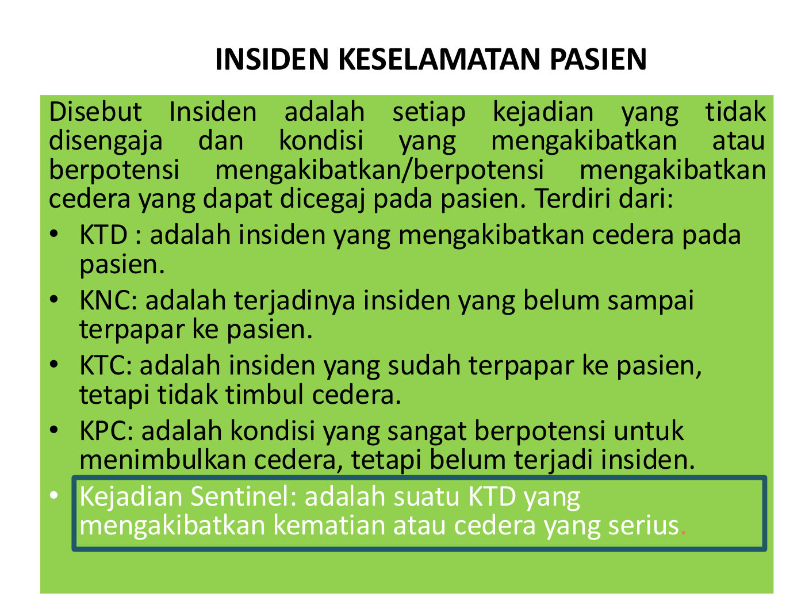
        </a>
        <div class="slide-caption">Slide 18 · Definisi 5 Insiden (Sumber 3 Soal UAB)</div>
      </div>
      <div class="slide-card">
        <a href="slides_bdt_kul3/slide_19.jpg" class="glightbox" data-gallery="bdt-b1" data-title="Slide 19 · Prinsip Utama: Do No Harm">
          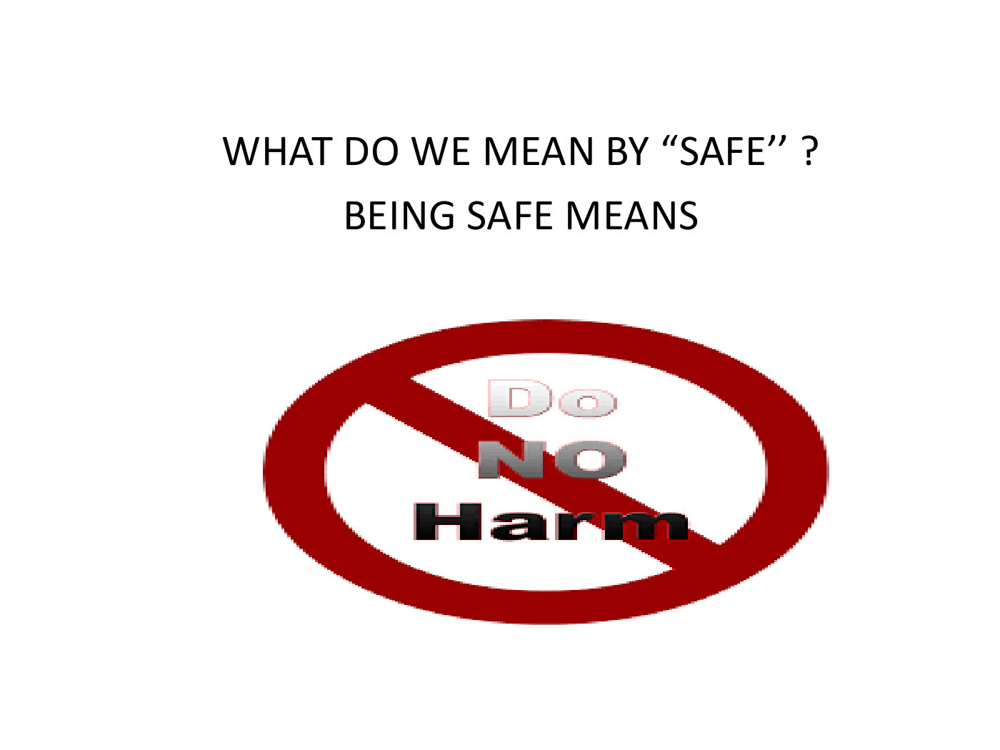
        </a>
        <div class="slide-caption">Slide 19 · Prinsip Utama: Do No Harm</div>
      </div>
      <div class="slide-card">
        <a href="slides_bdt_kul3/slide_20.jpg" class="glightbox" data-gallery="bdt-b1" data-title="Slide 20 · 4 Tujuan Patient Safety di Rumah Sakit">
          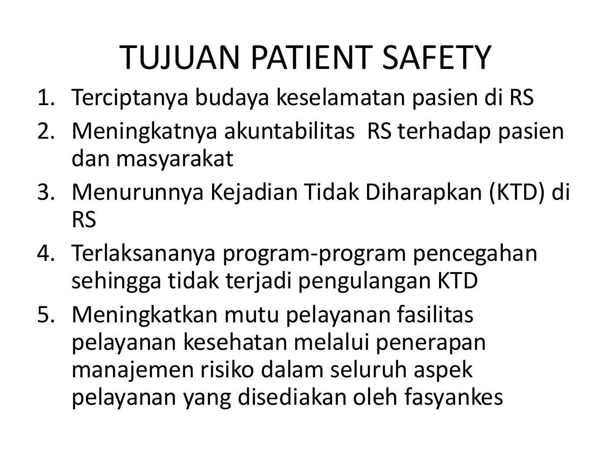
        </a>
        <div class="slide-caption">Slide 20 · 4 Tujuan Patient Safety</div>
      </div>
    </div>

---

## Bab 2 · Pembeda 7 Standar vs 6 SKP vs 7 Langkah (Slide 23–33 & 61)

=== "Tabel Pembeda & Cara Hafal 5 Detik"

    Di UAB BDT, dosen mengeluarkan **2 soal berbeda (`Axonation No. 32` & `No. 44`)** yang menanyakan isi **7 Standar Keselamatan Pasien**, lalu mengambil opsi pengecohnya dari **7 Langkah Menuju Keselamatan Pasien (`Slide 61`)**.

    | Urutan | 7 Standar Keselamatan Pasien (`Slide 23–24`)<br>*Ciri: Diawali KATA BENDA* | 6 Sasaran Keselamatan Pasien / SKP (`Slide 32–33`)<br>*Ciri: 6 Prosedur Klinis* | 7 Langkah Menuju Keselamatan Pasien (`Slide 61`)<br>*Ciri: Diawali KATA KERJA AKTIF* |
    | :--- | :--- | :--- | :--- |
    | **1** | ==**Hak pasien**== *(Keluar di UAB No. 44)* | Ketepatan identifikasi pasien | **Membangun** kesadaran akan nilai keselamatan |
    | **2** | **Pendidikan** bagi pasien dan keluarga | Peningkatan komunikasi yang efektif | **Memimpin** dan mendukung staf *(Pengecoh UAB!)* |
    | **3** | **Keselamatan pasien** dalam kesinambungan pelayanan | Peningkatan keamanan obat yang perlu diwaspadai | **Mengintegrasikan** aktivitas pengelolaan risiko |
    | **4** | **Penggunaan metode** peningkatan kinerja untuk evaluasi | Kepastian tepat-lokasi, tepat-prosedur, tepat-pasien operasi | **Mengembangkan** sistem pelaporan *(Pengecoh UAB!)* |
    | **5** | ==**Peran kepemimpinan**== dalam meningkatkan keselamatan *(UAB No. 32)* | Pengurangan risiko infeksi terkait pelayanan kesehatan | **Melibatkan** dan berkomunikasi dengan pasien |
    | **6** | **Pendidikan** bagi staf tentang keselamatan pasien | Pengurangan risiko cedera pasien akibat terjatuh | **Belajar** dan berbagi pengalaman (RCA) |
    | **7** | **Komunikasi** merupakan kunci bagi staf | *— (Hanya 6 Sasaran)* | **Mencegah** cedera melalui implementasi sistem |

    !!! tip "Rumus Cepat Membedakan di Ruang Ujian"
        - Bila soal menanyakan **7 Standar** $
ightarrow$ cari opsi yang bunyinya **Kata Benda**: **"Hak pasien"** atau **"Peran kepemimpinan dalam meningkatkan keselamatan pasien"**.
        - Bila opsi diawali akhiran kerja ***Me-*** (*Membangun, Memimpin, Mengintegrasikan, Mengembangkan, Melibatkan, Mencegah*) $
ightarrow$ itu pasti **7 Langkah (`Slide 61`)**, bukan 7 Standar!

=== "Bukti Slide Asli Dosen (Klik untuk Perbesar)"

    <div class="slide-grid">
      <div class="slide-card">
        <a href="slides_bdt_kul3/slide_23.jpg" class="glightbox" data-gallery="bdt-b2" data-title="Slide 23 · 7 Standar Keselamatan Pasien (Standar 1–4)">
          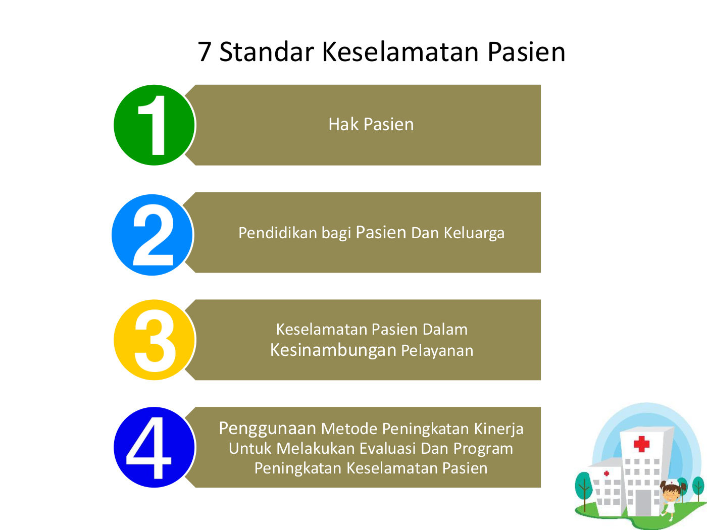
        </a>
        <div class="slide-caption">Slide 23 · 7 Standar (Nomor 1: Hak Pasien)</div>
      </div>
      <div class="slide-card">
        <a href="slides_bdt_kul3/slide_24.jpg" class="glightbox" data-gallery="bdt-b2" data-title="Slide 24 · 7 Standar Keselamatan Pasien (Standar 5–7)">
          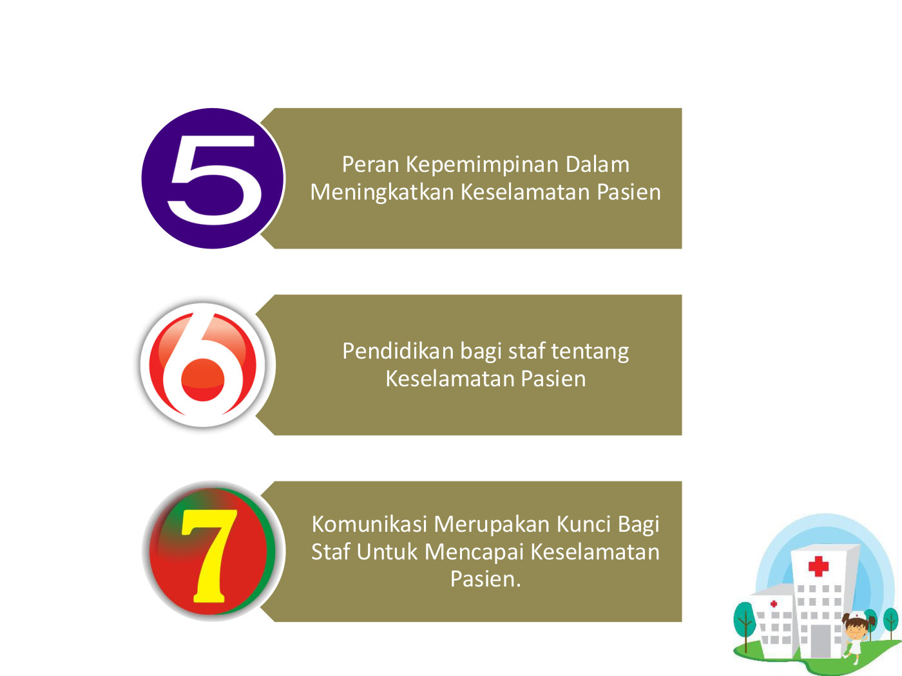
        </a>
        <div class="slide-caption">Slide 24 · 7 Standar (Nomor 5: Peran Kepemimpinan)</div>
      </div>
      <div class="slide-card">
        <a href="slides_bdt_kul3/slide_61.jpg" class="glightbox" data-gallery="bdt-b2" data-title="Slide 61 · 7 Langkah Keselamatan Pasien (Sumber Pengecoh Opsi UAB)">
          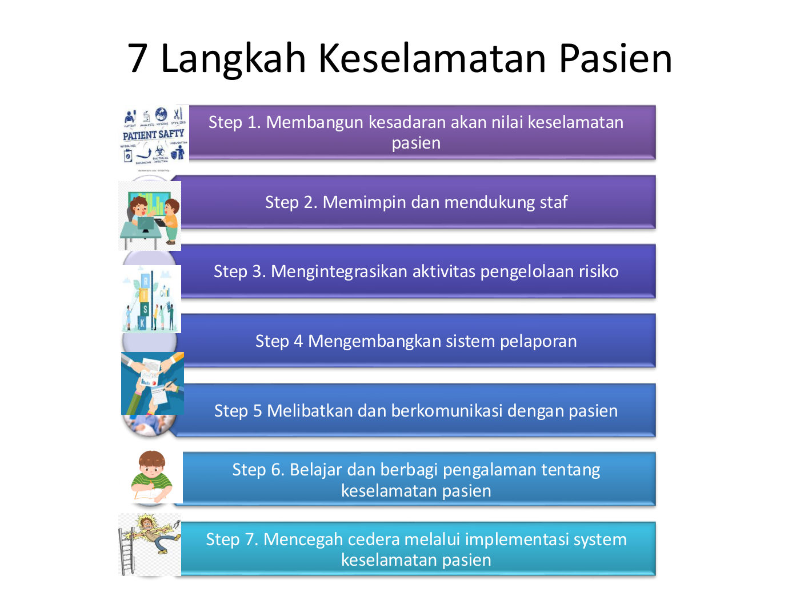
        </a>
        <div class="slide-caption">Slide 61 · 7 Langkah (Pengecoh Soal Standar)</div>
      </div>
    </div>

---

## Bab 3 · SKP 1: Ketepatan Identifikasi & 4 Warna Gelang (Slide 32, 34–38)

=== "Intisari & Diagram Alur Visual"

    ```mermaid
    flowchart TD
        ID["SKP 1: Ketepatan Identifikasi Pasien
(Wajib Minimal 2 dari 4 Identitas Resmi)"] --> P1["1. Nama Lengkap Pasien"]
        ID --> P2["2. Tanggal Lahir"]
        ID --> P3["3. Nomor Rekam Medis (No. RM)"]
        ID --> P4["4. Nomor Induk Kependudukan (NIK)"]
        ID -. "DILARANG KERAS!" .-> NO["❌ Nomor Kamar / Nomor Tempat Tidur"]

        GEL["4 Warna Gelang Pasien (Slide 35)"] --> GB["🔵 Gelang Biru:
Identitas Laki-Laki"]
        GEL --> GP["🩷 Gelang Pink:
Identitas Perempuan"]
        GEL --> GM["🔴 Gelang Merah:
Riwayat Alergi Tinggi"]
        GEL --> GK["🟡 Gelang Kuning:
Risiko Jatuh Tinggi"]
    ```

    * **Cara Bertanya yang Benar (`Slide 34`)**: Wajib menggunakan **pertanyaan terbuka (verbal aktif)**: *"Siapa nama Bapak?"* dan *"Kapan tanggal lahir Bapak?"*. Dilarang bertanya tertutup (*"Apakah Bapak Tn. Budi?"*) karena pasien yang mengantuk atau gangguan pendengaran bisa mengangguk meski salah orang.
    * **4 Saat Wajib Verifikasi Identitas (`Slide 37`)**:
        1. Sebelum pemberian obat (oral maupun injeksi).
        2. Sebelum transfusi darah / produk darah.
        3. Sebelum pengambilan darah / spesimen pemeriksaan klinis.
        4. Sebelum melakukan tindakan medis / prosedur operasi.

=== "Bukti Slide Asli Dosen (Klik untuk Perbesar)"

    <div class="slide-grid">
      <div class="slide-card">
        <a href="slides_bdt_kul3/slide_35.jpg" class="glightbox" data-gallery="bdt-b3" data-title="Slide 35 · Foto Gelang Merah (Alergi), Kuning (Risiko Jatuh), Biru (Laki-laki)">
          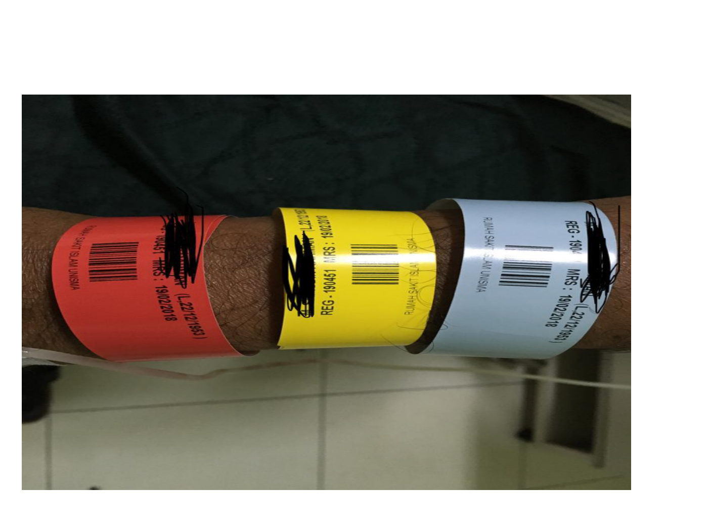
        </a>
        <div class="slide-caption">Slide 35 · Foto Gelang Merah, Kuning, Biru</div>
      </div>
      <div class="slide-card">
        <a href="slides_bdt_kul3/slide_34.jpg" class="glightbox" data-gallery="bdt-b3" data-title="Slide 34 · Aturan Minimal 2 Identitas & Pertanyaan Terbuka">
          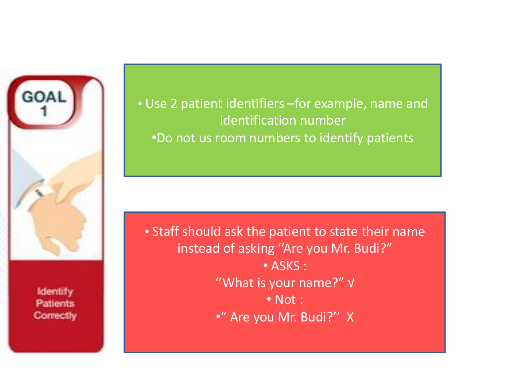
        </a>
        <div class="slide-caption">Slide 34 · Aturan 2 Identitas & Cara Bertanya</div>
      </div>
      <div class="slide-card">
        <a href="slides_bdt_kul3/slide_37.jpg" class="glightbox" data-gallery="bdt-b3" data-title="Slide 37 · 4 Momen Wajib Identifikasi Pasien">
          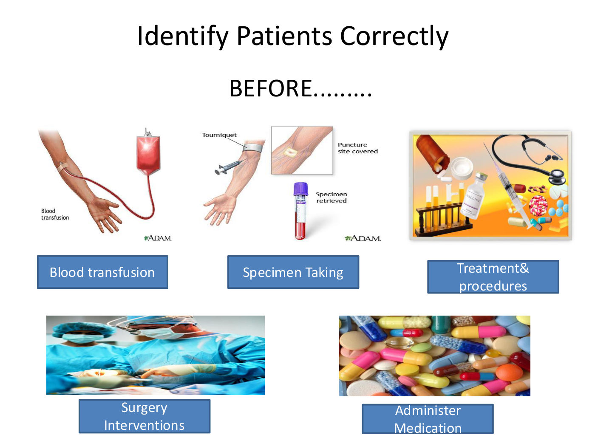
        </a>
        <div class="slide-caption">Slide 37 · 4 Momen Wajib Identifikasi</div>
      </div>
    </div>

---

## Bab 4 · SKP 2: Komunikasi Efektif TBaK & SBAR (Slide 39–42)

=== "Intisari & Diagram Alur Visual"

    ```mermaid
    flowchart LR
        S1["1. TULIS LENGKAP
(Write Down)
Catat nama obat, dosis,
rute, & frekuensi di RM"] --> S2["2. BACA ULANG
(Read Back)
Perawat membacakan ulang;
obat LASA wajib DIEJA"]
        S2 --> S3["3. KONFIRMASI 1x24 JAM
(Confirmation)
DPJP wajib tanda tangan pada
stempel NOTASI maks 1x24 jam"]
    ```

    * **Pelaporan Kondisi Pasien dengan Metode SBAR (`Slide 41`)**:
        * **S (*Situation*)**: Identitas pasien dan masalah klinis utama yang sedang terjadi saat ini.
        * **B (*Background*)**: Riwayat penyakit, alasan masuk RS, terapi yang sudah diberikan.
        * **A (*Assessment*)**: Hasil pemeriksaan fisik terbaru, tanda vital, dan nilai laboratorium kritis.
        * **R (*Recommendation*)**: Saran atau permintaan instruksi tindakan lebih lanjut kepada DPJP.
    * **Syarat *Medication Order* Lengkap (`Slide 42`)**: Wajib memuat (1) Nama pasien, (2) Tanggal & jam resep, (3) Nama obat, (4) Dosis & satuan (`mg`, `unit`), (5) Rute pemberian, serta (6) Frekuensi & durasi pemberian.

=== "Bukti Slide Asli Dosen (Klik untuk Perbesar)"

    <div class="slide-grid">
      <div class="slide-card">
        <a href="slides_bdt_kul3/slide_41.jpg" class="glightbox" data-gallery="bdt-b4" data-title="Slide 41 · Contoh Rekam Medis SBAR & Stempel Notasi Paraf DPJP">
          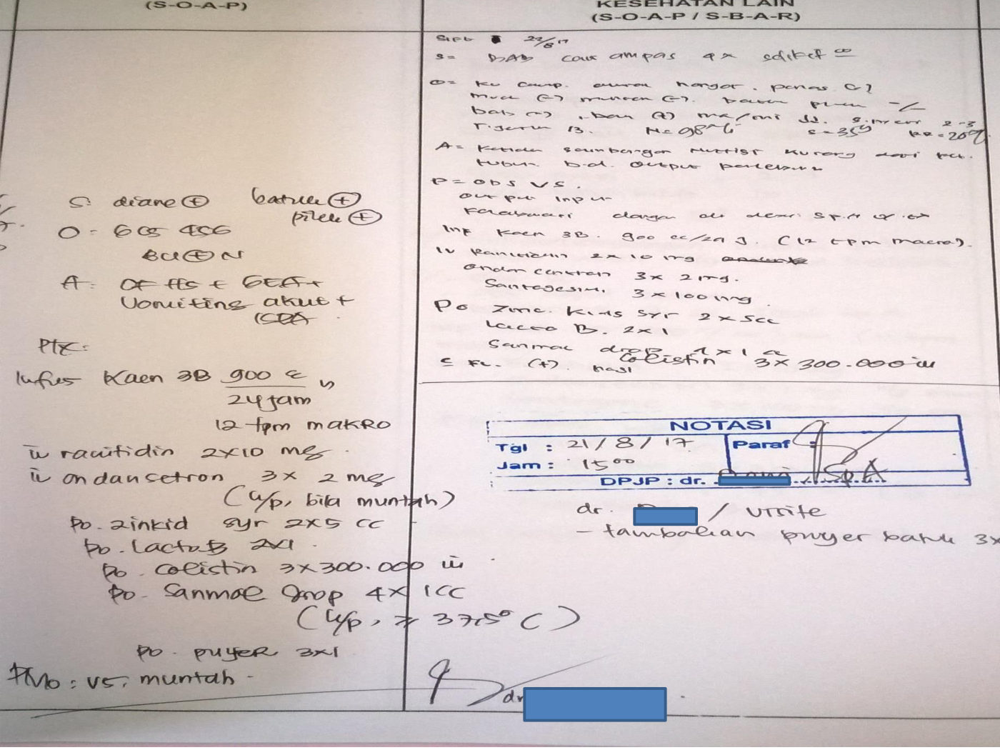
        </a>
        <div class="slide-caption">Slide 41 · Catatan SBAR & Stempel Notasi</div>
      </div>
      <div class="slide-card">
        <a href="slides_bdt_kul3/slide_42.jpg" class="glightbox" data-gallery="bdt-b4" data-title="Slide 42 · Komponen Resep Lengkap (Medication Order)">
          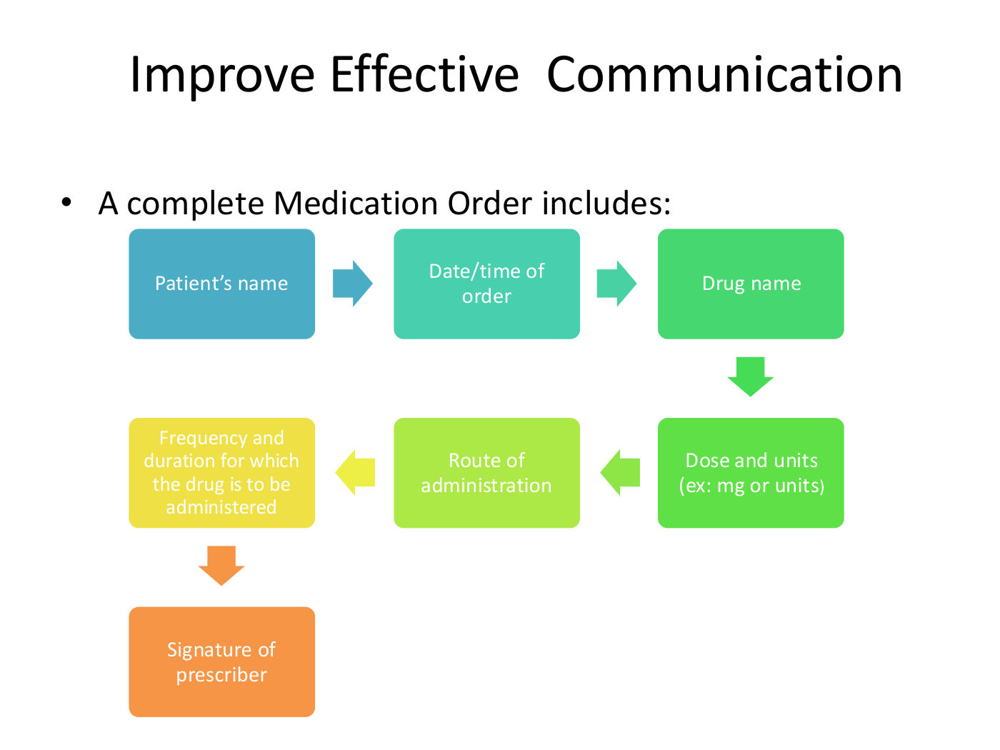
        </a>
        <div class="slide-caption">Slide 42 · Komponen Medication Order</div>
      </div>
    </div>

---

## Bab 5 · SKP 3: Keamanan Obat High-Alert & Elektrolit Pekat (Slide 43–50)

=== "Intisari & Diagram Alur Visual"

    ```mermaid
    flowchart TD
        HA["SKP 3: Obat yang Perlu Diwaspadai
(High-Alert Medications — Slide 43)"] --> G1["1. Elektrolit Konsentrat Pekat
• KCl pekat ≥ 2 mEq/mL
• NaCl hipertonik > 0,9%
• MgSO4 ≥ 20% & Dextrose ≥ 20%"]
        HA --> G2["2. Obat LASA / NORUM
(Look-Alike Sound-Alike)
Kemasan mirip atau nama terdengar mirip
→ Gunakan Tall Man Lettering"]
        HA --> G3["3. Obat Risiko Tinggi Lain
• Concentrated Heparin
• Insulin, Kemoterapi, Narkotika"]
        G1 --> RULE["Aturan Ketat Slide 47 & 48:
1. Pasang stiker 'HIGH ALERT! MEDICATION'
2. TARIK KCl pekat dari ruang rawat biasa!
3. Simpan terkunci & lakukan Double-Check"]
    ```

    !!! danger "Bedah Soal Asli Remidi BDT No. 39 (Diambil Persis dari Gambar Slide 48!)"
        Soal menanyakan: *"Label apakah yang wajib dipasang pada cairan Concentrated Potassium Chloride (KCl)?"*
        Lihat gambar botol di **Slide 48** (tab sebelah): tulisan besar di badan botol adalah **`HIGH ALERT! MEDICATION`**. Dosen membuat opsi pengecoh `Distinct`, `Warning`, dan `Harmful` dari teks kotak biru di samping botol pada Slide 48!

=== "Bukti Slide Asli Dosen (Klik untuk Perbesar)"

    <div class="slide-grid">
      <div class="slide-card">
        <a href="slides_bdt_kul3/slide_48.jpg" class="glightbox" data-gallery="bdt-b5" data-title="Slide 48 · Gambar Botol HIGH ALERT! MEDICATION (Sumber Soal Remidi No. 39)">
          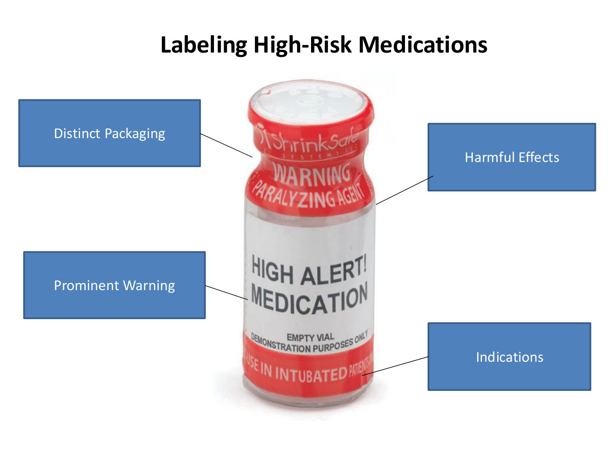
        </a>
        <div class="slide-caption">Slide 48 · Botol HIGH ALERT! (Soal Remidi No.39)</div>
      </div>
      <div class="slide-card">
        <a href="slides_bdt_kul3/slide_46.jpg" class="glightbox" data-gallery="bdt-b5" data-title="Slide 46 · Daftar Cairan High Concentration (KCl, Heparin, Glukosa, NaCl)">
          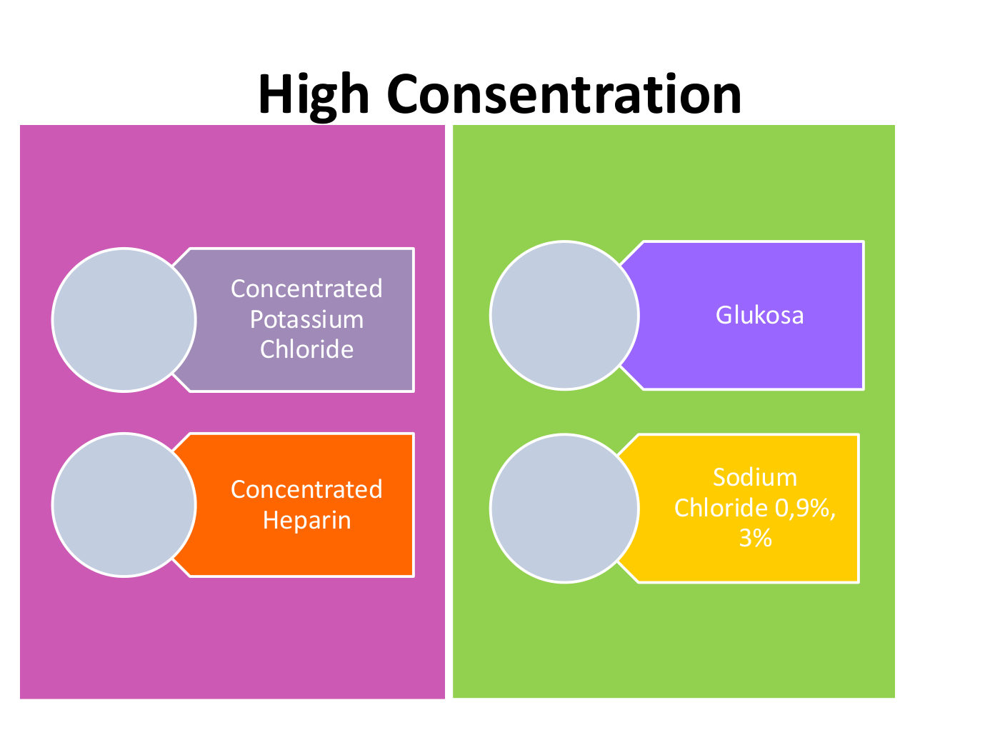
        </a>
        <div class="slide-caption">Slide 46 · Contoh Cairan High Concentration</div>
      </div>
      <div class="slide-card">
        <a href="slides_bdt_kul3/slide_47.jpg" class="glightbox" data-gallery="bdt-b5" data-title="Slide 47 · 5 Langkah Mengurangi Risiko Obat High-Alert">
          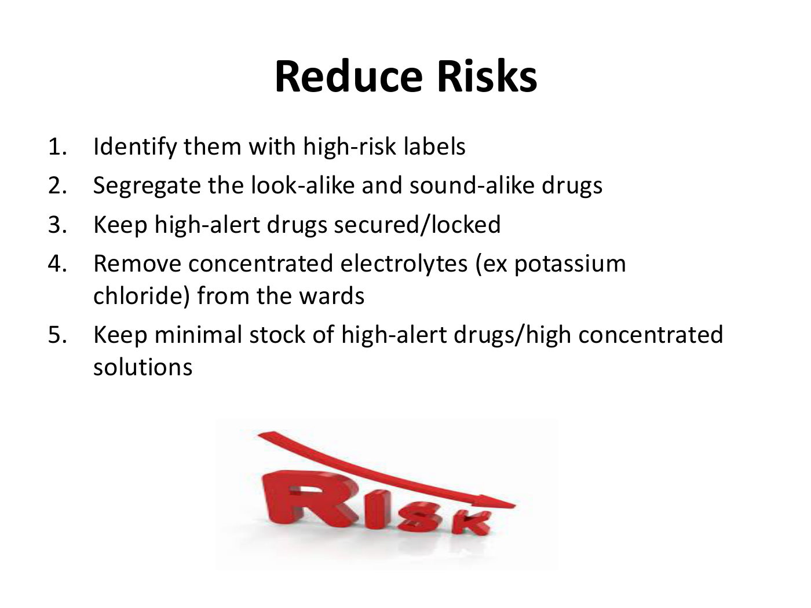
        </a>
        <div class="slide-caption">Slide 47 · Tarik KCl Pekat dari Bangsal</div>
      </div>
    </div>

---

## Bab 6 · SKP 4: Tepat Lokasi, Prosedur, & Pasien Operasi (Slide 51–54)

=== "Intisari & Diagram Alur Visual"

    ```mermaid
    flowchart LR
        M1["1. SURGICAL MARKING
(Di Ruang Rawat)
Dokter operator memberi tanda
lokasi operasi melibatkan pasien
saat pasien masih SADAR"] --> M2["2. VERIFIKASI PRA-INSISI
(6 Ceklis Slide 51)
Identitas, Sisi/Lokasi, Prosedur,
Posisi pasien, Implan, & Alat khusus"]
        M2 --> M3["3. SURGICAL TIME-OUT
(Di Kamar Operasi)
Jeda komunikasi aktif seluruh tim
TEPAT SEBELUM INSISI KULIT"]
    ```

    * **4 Penyebab Utama Kesalahan Operasi (`Slide 54 — Causes of Surgical Errors`)**:
        1. ==**Komunikasi yang tidak efektif antara anggota tim bedah**== *(Keluar persis di UAB BDT Axonation No. 43!)*.
        2. Kurangnya kerja sama tim (*teamwork*).
        3. Kurangnya melibatkan pasien dalam menandai lokasi operasi (*surgical marking*).
        4. Kurangnya standar prosedur untuk memeriksa lokasi operasi sebelum tindakan.

=== "Bukti Slide Asli Dosen (Klik untuk Perbesar)"

    <div class="slide-grid">
      <div class="slide-card">
        <a href="slides_bdt_kul3/slide_54.jpg" class="glightbox" data-gallery="bdt-b6" data-title="Slide 54 · Causes of Surgical Errors (Sumber Soal UAB No. 43)">
          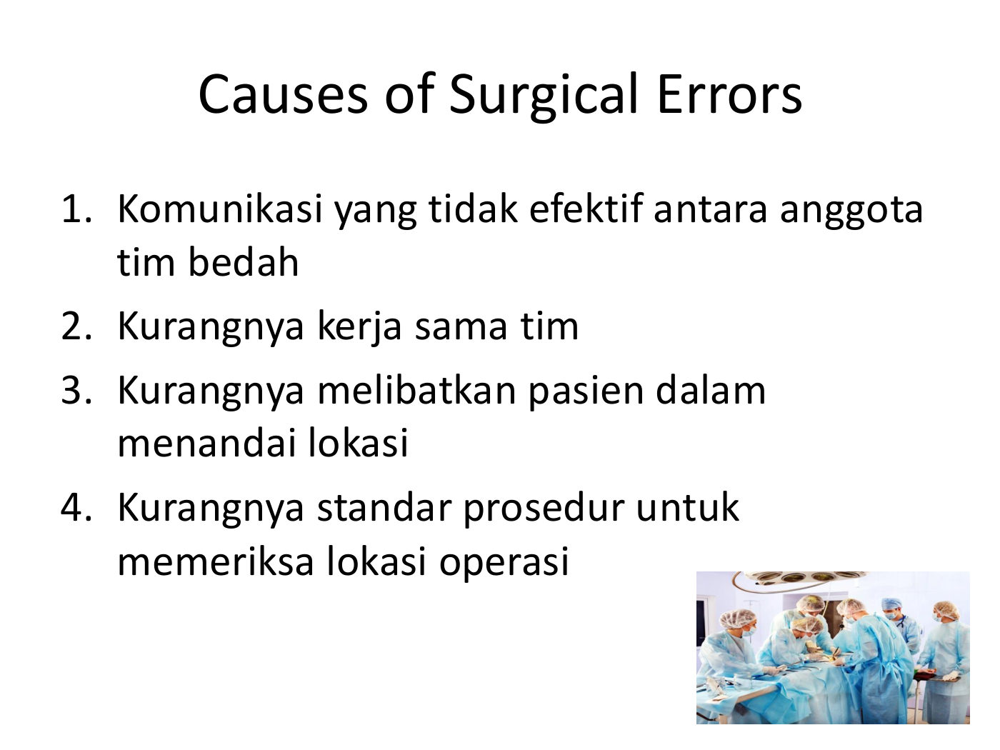
        </a>
        <div class="slide-caption">Slide 54 · Penyebab #1: Komunikasi Tim Bedah</div>
      </div>
      <div class="slide-card">
        <a href="slides_bdt_kul3/slide_51.jpg" class="glightbox" data-gallery="bdt-b6" data-title="Slide 51 · 6 Ceklis Verifikasi & Time-Out Sebelum Operasi">
          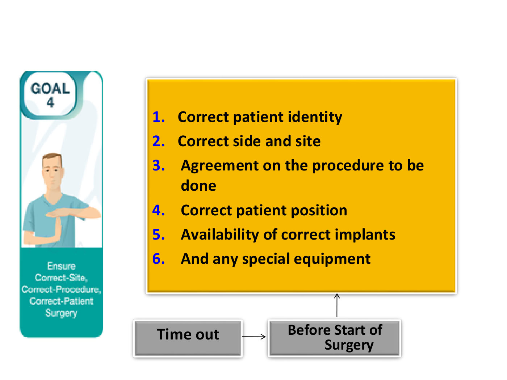
        </a>
        <div class="slide-caption">Slide 51 · 6 Ceklis Time-Out Sebelum Insisi</div>
      </div>
      <div class="slide-card">
        <a href="slides_bdt_kul3/slide_52.jpg" class="glightbox" data-gallery="bdt-b6" data-title="Slide 52 · Komponen Surgical Timeout">
          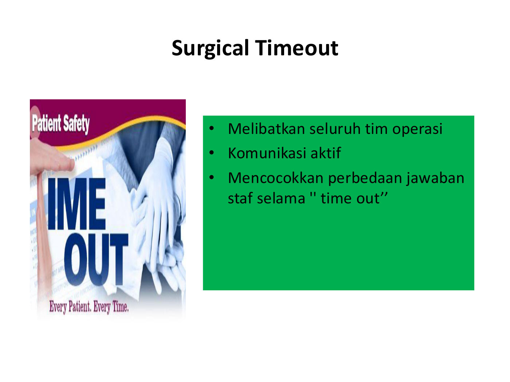
        </a>
        <div class="slide-caption">Slide 52 · Prosedur Surgical Timeout</div>
      </div>
    </div>

---

## Bab 7 · SKP 5–6, Pelaporan 2x24 Jam, Grading Risiko & RCA (Slide 55–80)

=== "Intisari & Diagram Alur Visual"

    ```mermaid
    flowchart TD
        INS["Terjadi Insiden (KNC / KTD / Sentinel)"] --> LAP["Wajib Lapor Internal ke Tim KPRS
MAKSIMAL 2 x 24 JAM
(Rahasia, Tidak Boleh Difotokopi, Non-Blaming)"]
        LAP --> GRD{"Grading Matriks Risiko
(Dampak x Probabilitas — Slide 71 & 73)"}
        GRD -- "Pita BIRU (Rendah) /
Pita HIJAU (Moderat)" --> INV["Investigasi Sederhana
Oleh Atasan Langsung Unit Kerja
(Biru maks 1 mgg · Hijau maks 2 mgg)"]
        GRD -- "Pita KUNING (Tinggi) /
Pita MERAH (Ekstrem / Sentinel)" --> RCA["ROOT CAUSE ANALYSIS (RCA)
Investigasi Komprehensif oleh Tim KPRS
Maksimal 45 Hari ★ Soal UAB 22 No. 85"]
    ```

    * **SKP 5 — Pengurangan Risiko Infeksi (`Slide 55–57`)**:
        * **5 Momen Cuci Tangan WHO (*5 Moments for Hand Hygiene*)**: **2 Sebelum** (sebelum kontak pasien & sebelum tindakan aseptik) dan **3 Sesudah** (setelah terpapar cairan tubuh, setelah kontak pasien, & setelah kontak lingkungan sekitar pasien).
        * **Praktik Injeksi Aman**: Jarum & spuit wajib *single-use* (sekali pakai) untuk mencegah transmisi infeksi nosokomial (*HAIs*).
    * **SKP 6 — Pengurangan Risiko Pasien Jatuh (`Slide 58–59`)**:
        * Skrining menggunakan **Skala Morse** (dewasa), **Humpty Dumpty** (anak), atau **Edmonson** (psikiatri), pemasangan **Gelang Kuning**, serta pengamanan pagar tempat tidur (*side rail*).

=== "Bukti Slide Asli Dosen (Klik untuk Perbesar)"

    <div class="slide-grid">
      <div class="slide-card">
        <a href="slides_bdt_kul3/slide_69.jpg" class="glightbox" data-gallery="bdt-b7" data-title="Slide 69 · Alur Pelaporan Insiden 2x24 Jam, Grading, dan RCA">
          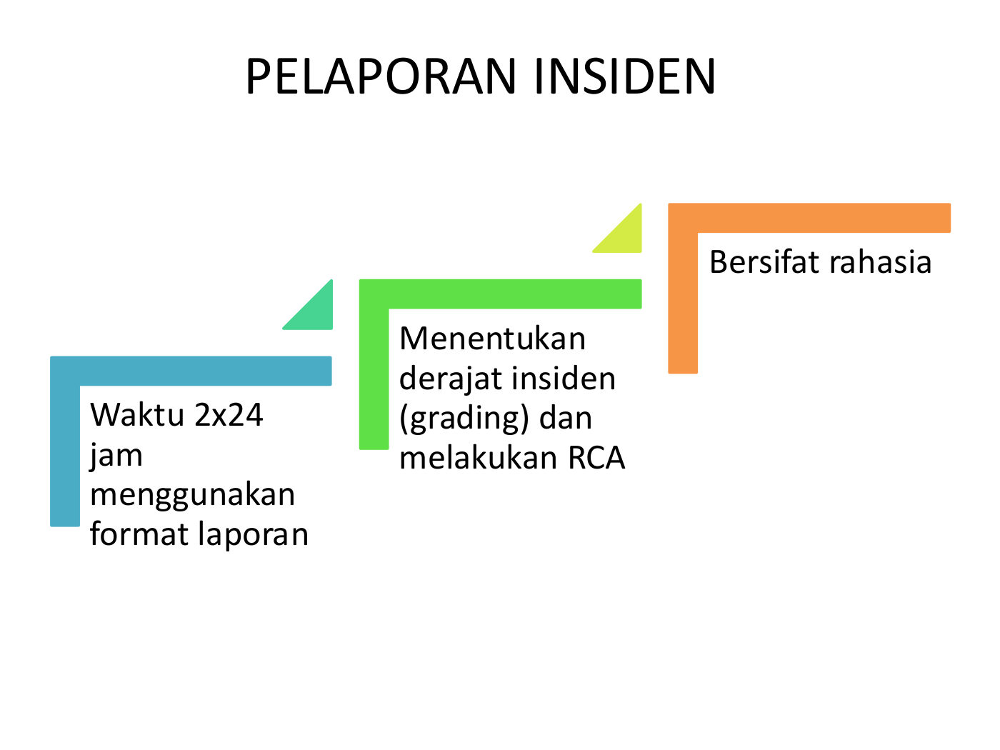
        </a>
        <div class="slide-caption">Slide 69 · Waktu 2x24 Jam, Grading & RCA</div>
      </div>
      <div class="slide-card">
        <a href="slides_bdt_kul3/slide_71.jpg" class="glightbox" data-gallery="bdt-b7" data-title="Slide 71 · Formulir Laporan Insiden Internal (Rahasia & Maks 2x24 Jam)">
          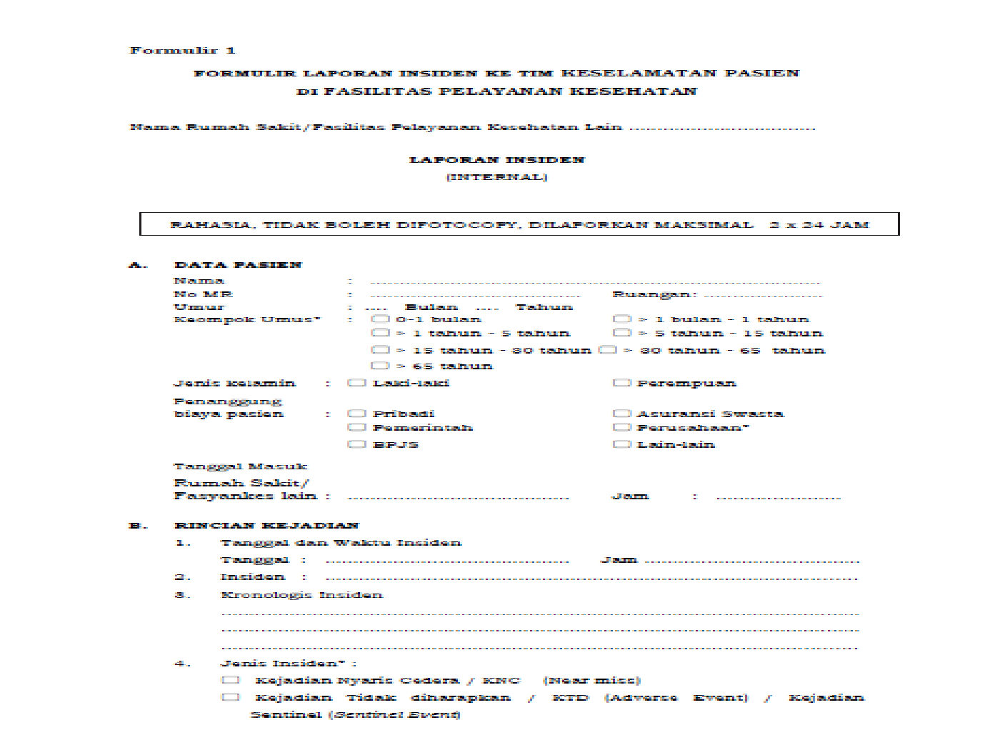
        </a>
        <div class="slide-caption">Slide 71 · Formulir Laporan Insiden 2x24 Jam</div>
      </div>
      <div class="slide-card">
        <a href="slides_bdt_kul3/slide_73.jpg" class="glightbox" data-gallery="bdt-b7" data-title="Slide 73 · Grading Risiko Kejadian: Biru, Hijau, Kuning, Merah">
          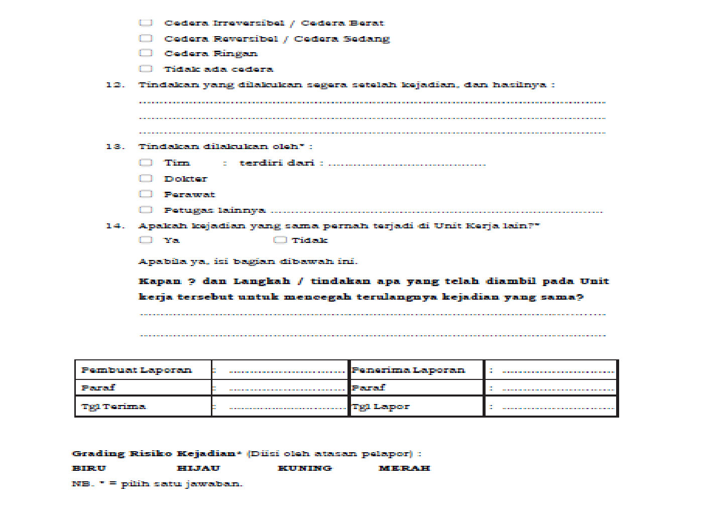
        </a>
        <div class="slide-caption">Slide 73 · Grading Biru, Hijau, Kuning, Merah</div>
      </div>
      <div class="slide-card">
        <a href="slides_bdt_kul3/slide_75.jpg" class="glightbox" data-gallery="bdt-b7" data-title="Slide 75 · Prinsip Analisis Akar Penyebab Masalah (RCA)">
          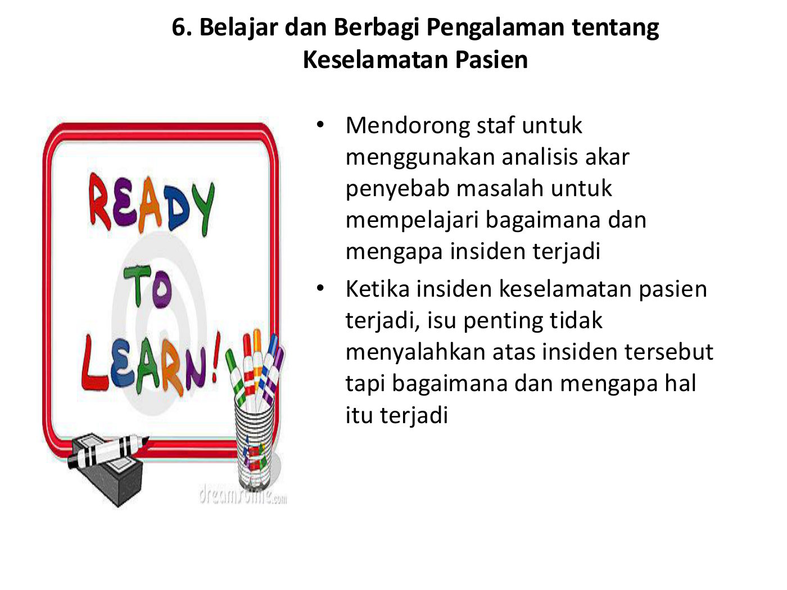
        </a>
        <div class="slide-caption">Slide 75 · Analisis Akar Masalah (RCA)</div>
      </div>
    </div>

---

## Simulator Soal Asli UAB & Remidi BDT (`mkdocs-quiz`)

*Pilih jawaban Anda lalu klik tombol **Submit** di setiap nomor untuk melihat umpan balik dan gambar slide buktinya:*

<quiz>
**[Soal Asli UAB BDT · Rekap Axonation No. 29]** Seorang perempuan berusia 35 tahun datang ke klinik pratama dengan keluhan nyeri perut. Dokter memberikan suntikan Antalgin untuk mengatasi rasa sakitnya. Beberapa menit kemudian pasien mengalami syok anafilaktik dan meninggal dunia. Termasuk insiden keselamatan pasien manakah kejadian tersebut?
- [ ] Kejadian Potensial Cedera (KPC)
  > Salah. KPC adalah kondisi berpotensi cedera ketika belum terjadi tindakan/insiden sama sekali.
- [ ] Kejadian Nyaris Cedera (KNC)
  > Salah. Pada KNC, kesalahan belum sampai terpapar ke tubuh pasien.
- [ ] Kejadian Tidak Cedera (KTC)
  > Salah. Pada KTC, pasien sudah terpapar namun tidak mengalami cedera.
- [ ] Kejadian Tidak Diharapkan (KTD)
  > Kurang tepat. Karena berujung pada kematian pasien, insiden ini masuk ke kategori paling berat yaitu Kejadian Sentinel.
- [x] Kejadian Sentinel
  > Benar! Sesuai Slide 18 baris terakhir, Kejadian Sentinel adalah suatu KTD yang mengakibatkan kematian atau cedera yang serius.

**Bukti Slide 18:**
{ width="380" }
</quiz>

<quiz>
**[Soal Asli UAB BDT · UAB 22 No. 70]** Pasien datang ke IGD karena nyeri kolik abdomen akut. Setelah diberikan injeksi analgetik, pasien mengalami henti jantung akibat reaksi anafilaksis berat dan dinyatakan meninggal. Kategori insiden keselamatan pasien pada kasus ini adalah...
- [ ] Kejadian Tidak Diharapkan (KTD)
  > Kurang tepat. KTD yang menyebabkan kematian atau cacat permanen diklasifikasikan khusus sebagai Kejadian Sentinel.
- [x] Kejadian Sentinel
  > Benar! Setiap KTD yang berujung kematian mendadak di luar perjalanan alamiah penyakit adalah Kejadian Sentinel (Slide 18).
- [ ] Kejadian Nyaris Cedera (KNC)
  > Salah. Obat sudah disuntikkan ke tubuh pasien.
- [ ] Kejadian Potensial Cedera (KPC)
  > Salah. KPC baru berupa kondisi potensial sebelum insiden terjadi.
- [ ] Kejadian Tidak Cedera (KTC)
  > Salah. Pasien mengalami cedera fatal hingga meninggal dunia.
</quiz>

<quiz>
**[Soal Asli UAB BDT-1 · Hal. 9–10]** Dokter meresepkan obat dengan dosis yang salah akibat kelelahan. Petugas farmasi telah menyiapkan obat tersebut, namun perawat ruangan menyadari ketidaksesuaian dosis saat melakukan pengecekan ulang sehingga obat batal diberikan kepada pasien. Disebut apakah insiden ini?
- [ ] Kejadian Potensial Cedera (KPC)
  > Salah. Di sini kesalahan penulisan dan penyiapan obat sudah terjadi, bukan sekadar kondisi potensial.
- [x] Kejadian Nyaris Cedera (KNC)
  > Benar! Sesuai Slide 18, KNC (Near Miss) adalah terjadinya insiden yang belum sampai terpapar ke pasien.
- [ ] Kejadian Tidak Cedera (KTC)
  > Salah. Disebut KTC apabila obat salah tersebut sudah telanjur diminum/disuntikkan ke pasien tetapi pasien tidak mengalami cedera.
- [ ] Kejadian Tidak Diharapkan (KTD)
  > Salah. Obat belum mengenai pasien dan pasien tidak cedera.
- [ ] Kejadian Sentinel
  > Salah. Tidak ada kematian atau cedera serius.
</quiz>

<quiz>
**[Soal Asli UAB BDT · Rekap Axonation No. 32]** Manakah di bawah ini yang termasuk dalam 7 Standar Keselamatan Pasien Rumah Sakit?
- [ ] Membangun kesadaran akan nilai keselamatan pasien
  > Jebakan! Ini adalah Step 1 dari "7 Langkah Menuju Keselamatan Pasien" (Slide 61), bukan 7 Standar.
- [ ] Memimpin dan mendukung staf dalam keselamatan pasien
  > Jebakan! Ini adalah Step 2 dari "7 Langkah Menuju Keselamatan Pasien" (Slide 61).
- [x] Peran kepemimpinan dalam meningkatkan keselamatan pasien
  > Benar! Tertulis persis di Slide 24 baris pertama sebagai Standar ke-5 dari "7 Standar Keselamatan Pasien".
- [ ] Mengembangkan sistem pelaporan insiden keselamatan pasien
  > Jebakan! Ini adalah Step 4 dari "7 Langkah Menuju Keselamatan Pasien" (Slide 61).
- [ ] Mengintegrasikan aktivitas pengelolaan risiko
  > Jebakan! Ini adalah Step 3 dari "7 Langkah Menuju Keselamatan Pasien" (Slide 61).

**Bukti Slide 24:**
{ width="380" }
</quiz>

<quiz>
**[Soal Asli UAB BDT · Rekap Axonation No. 44]** Standar keselamatan pasien rumah sakit merupakan acuan bagi fasyankes untuk melaksanakan pelayanannya. Yang termasuk dalam 7 Standar Keselamatan Pasien adalah...
- [x] Hak pasien
  > Benar! Sesuai Slide 23 poin pertama, "Hak Pasien" adalah Standar ke-1 dari 7 Standar Keselamatan Pasien.
- [ ] Ketepatan identifikasi pasien
  > Salah. Ini adalah SKP 1 (6 Sasaran Keselamatan Pasien — Slide 32).
- [ ] Peningkatan keamanan obat yang perlu diwaspadai
  > Salah. Ini adalah SKP 3 (6 Sasaran Keselamatan Pasien — Slide 32).
- [ ] Pengurangan risiko infeksi terkait pelayanan kesehatan
  > Salah. Ini adalah SKP 5 (6 Sasaran Keselamatan Pasien — Slide 33).
- [ ] Membangun kesadaran akan nilai keselamatan pasien
  > Salah. Ini adalah Step 1 dari 7 Langkah Keselamatan Pasien (Slide 61).

**Bukti Slide 23:**
{ width="380" }
</quiz>

<quiz>
**[Soal Asli UAB BDT-1 · Hal. 5 & 14]** Seorang pasien laki-laki berusia 58 tahun dirawat di bangsal paru dengan diagnosis pneumonia. Karena petugas admisi sibuk, pasien belum dipasangkan gelang identitas berwarna biru sehingga saat pemberian antibiotik injeksi, obat pasien tertukar dengan pasien di sebelah tempat tidurnya. Sasaran Keselamatan Pasien (SKP) manakah yang dilanggar?
- [x] Ketepatan identifikasi pasien
  > Benar! Pemasangan gelang identitas (biru untuk laki-laki sesuai Slide 35) dan verifikasi minimal 2 identitas sebelum pemberian obat adalah bagian dari SKP 1 (Slide 32).
- [ ] Peningkatan komunikasi yang efektif
  > Salah. SKP 2 mengatur komunikasi verbal/telepon (TBaK) dan SBAR antar-tenaga kesehatan.
- [ ] Peningkatan keamanan obat yang perlu diwaspadai
  > Salah. Akar masalah tertukarnya obat pada kasus ini adalah ketiadaan gelang identitas pasien.
- [ ] Kepastian tepat-lokasi, tepat-prosedur, tepat-pasien operasi
  > Salah. SKP 4 khusus untuk prosedur bedah/invasif di kamar operasi.
- [ ] Pengurangan risiko infeksi terkait pelayanan kesehatan
  > Salah. SKP 5 mengatur cuci tangan (Hand Hygiene).

**Bukti Slide 35:**
{ width="380" }
</quiz>

<quiz>
**[Soal Asli Remidi BDT · No. 39]** Cairan elektrolit pekat seperti Concentrated Potassium Chloride (KCl) dapat menyebabkan kejadian fatal bila diberikan tanpa pengenceran. Berdasarkan standar keselamatan pasien, label apakah yang wajib dipasang pada obat tersebut?
- [ ] Distinct
  > Jebakan visual! Kata "Distinct Packaging" tertulis di kotak biru kiri atas Slide 48 sebagai penjelasan kemasan, bukan nama labelnya.
- [x] High Alert
  > Benar! Lihat langsung botol di Slide 48: pada badan botol tertulis besar "HIGH ALERT! MEDICATION".
- [ ] Warning
  > Jebakan visual! Kata "Prominent Warning" adalah teks kotak biru kiri bawah di Slide 48.
- [ ] Harmful
  > Jebakan visual! Kata "Harmful Effects" adalah teks kotak biru kanan atas di Slide 48.
- [ ] Caution
  > Salah. Istilah resminya adalah High Alert.

**Bukti Slide 48:**
{ width="380" }
</quiz>

<quiz>
**[Soal Asli UAB BDT · Rekap Axonation No. 43]** Seorang pasien dijadwalkan menjalani operasi di daerah thoraks, namun saat selesai operasi ternyata bagian tungkai kaki pasien juga ikut dioperasi akibat kesalahpahaman instruksi di meja operasi. Berdasarkan materi Patient Safety, apakah penyebab utama terjadinya kesalahan bedah tersebut?
- [x] Komunikasi tidak efektif antar tim medis / bedah
  > Benar! Tertulis persis pada urutan nomor 1 di Slide 54 (Causes of Surgical Errors): "1. Komunikasi yang tidak efektif antara anggota tim bedah".
- [ ] Kurangnya fasilitas kamar operasi
  > Salah. Tidak termasuk dalam 4 penyebab utama di Slide 54.
- [ ] Efek samping obat anestesi
  > Salah. Bukan penyebab salah lokasi operasi (wrong-site surgery).
- [ ] Keluarga pasien terlambat menandatangani informed consent
  > Salah. Penandaan lokasi dan Time-Out adalah tanggung jawab tim bedah bersama pasien.
- [ ] Tidak tersedianya antibiotik profilaksis
  > Salah. Antibiotik profilaksis terkait pencegahan infeksi luka operasi, bukan salah lokasi insisi.

**Bukti Slide 54:**
{ width="380" }
</quiz>

<quiz>
**[Soal Asli UAB BDT · UAB 22 No. 85]** Seorang pasien terjatuh dari brankar saat proses transfer dari UGD menuju kamar operasi sehingga mengalami cedera kepala. Tim keselamatan pasien rumah sakit segera melakukan investigasi terstruktur untuk mencari akar penyebab sistemik agar kejadian serupa tidak terulang. Metode apakah yang digunakan tim tersebut?
- [x] Root Cause Analysis (RCA)
  > Benar! Sesuai Slide 69 dan Slide 75, setiap insiden keselamatan pasien dengan derajat risiko Kuning/Merah dianalisis akar masalahnya menggunakan Root Cause Analysis (RCA).
- [ ] Failure Mode and Effects Analysis (FMEA)
  > Salah. FMEA bersifat proaktif (sebelum insiden terjadi), sedangkan analisis sesudah insiden jatuh terjadi menggunakan RCA.
- [ ] Audit Medis Internal
  > Salah. Investigasi insiden keselamatan pasien oleh Tim KPRS menggunakan RCA.
- [ ] Visum et Repertum
  > Salah. Visum adalah keterangan medis untuk kepentingan peradilan pidana.
- [ ] Informed Consent
  > Salah. Informed consent adalah persetujuan tindakan kedokteran.

**Bukti Slide 75:**
{ width="380" }
</quiz>
