# Blok 9 (EMN) · Kuliah 2: Defisiensi Vitamin

**Dosen Pengampu:** dr. Iwal Reza Ahdi, Sp.PD · **Sumber Asli:** 28 Slide PPT · **Status Bank Soal:** 3 Kasus Asli Slide Dosen + 3 Prediksi Berbasis Slide *(0 Klaim Palsu Soal UAB EMN)*

!!! success "Belajar Tuntas Tanpa Perlu Buka File PPT"
    Seluruh **28 slide dr. Iwal Reza Ahdi, Sp.PD** telah dipadatkan menjadi **Mindmap Interaktif + 6 Bab Diagram Metabolik & Klinis** di bawah ini. Bukti tangkapan layar slide asli tersedia di tab pendamping setiap bab.

---

## Peta Konsep Utuh Defisiensi Vitamin (`Markmap`)

<div class="markmap-box">
<div class="markmap">
<script type="text/template">
# Defisiensi Vitamin (dr. Iwal, Sp.PD)
## 1. Empat Jalur Etiologi (Slide 5)
- Asupan Kurang: Diet restriktif, vegan (B12), alkoholik (B1)
- Gangguan Absorpsi: Celiac, reseksi ileum (B12), bariatrik, kolestasis (A,D,E,K)
- Peningkatan Kebutuhan: Kehamilan & laktasi (Folat/B9), tumbuh kembang
- Obat Spesifik: Metformin (B12), Isoniazid/INH (B6), Warfarin (Vit K)
## 2. Vitamin Larut Lemak (A, D, E, K)
- Vitamin A (Slide 8): Retinal (Rodopsin/Nyctalopia) vs Retinoat (Epitel/Bitot/Keratomalasia)
- Vitamin D (Slide 9): Kulit (D3) -> Hati (25-OH-D = Lab!) -> Ginjal (1,25-OH2-D = Aktif!)
- Vitamin E (Slide 10): Antioksidan membran -> Defisiensi: Ataksia & neuropati
- Vitamin K (Slide 10 & 19): Faktor II, VII, IX, X -> Defisiensi: PT/INR Memanjang!
## 3. Vitamin Larut Air (B Kompleks & C)
- B1 / Tiamin (Slide 11): Kofaktor TPP -> Beriberi Kering, Basah, & Ensefalopati Wernicke
- B2 / Riboflavin (Slide 13): FMN/FAD -> Angular cheilitis, glositis
- B3 / Niasin (Slide 13): NAD+/NADP+ -> Pellagra 3D (Dermatitis Casal necklace, Diare, Demensia)
- B6 / Piridoksin (Slide 13): Kofaktor PLP -> Neuropati akibat Isoniazid (INH)
- B9 vs B12 (Slide 16-17): Sama-sama MCV > 100 fL; bedanya B12 ada Neuropati & MMA Naik!
- Vitamin C / Skorbut (Slide 14 & 26): Hidroksilasi kolagen -> Gusi berdarah & PT/INR Normal!
</script>
</div>
</div>

---

## Bab 1 · 4 Jalur Penyebab Defisiensi & Interaksi Obat (Slide 1–7)

=== "Intisari & Diagram Alur Visual"

    ```mermaid
    flowchart TD
        ET["4 Jalur Menuju Defisiensi Vitamin (Slide 5)"] --> J1["01. ASUPAN KURANG
• Diet sangat restriktif
• Vegan murni tanpa suplemen (B12)
• Alkoholisme kronik (B1, Folat)"]
        ET --> J2["02. GANGGUAN ABSORPSI
• Reseksi ileum terminal / Crohn (B12)
• Operasi bariatrik / gastritis autoimun
• Kolestasis hepatobilier (Vit A, D, E, K)"]
        ET --> J3["03. PENINGKATAN KEBUTUHAN
• Kehamilan & laktasi (Folat/B9)
• Masa pertumbuhan cepat
• Penyakit kritis / infeksi berat"]
        ET --> J4["04. INTERAKSI OBAT KHAS ★
• Metformin jangka panjang → Def. B12
• Isoniazid (INH) obat TB → Def. B6
• Warfarin → Antagonis Vitamin K"]
    ```

    * **Algoritma Pendekatan Klinis 4 Langkah (`Slide 6`)**:
        1. **Identifikasi Pola Klinis**: Apakah pasien datang dengan pola *anemia makrositik*, *neuropati perifer*, *dermatitis mukokutan*, *nyeri/deformitas tulang*, atau *perdarahan*?
        2. **Nilai Faktor Risiko**: Telusuri riwayat diet, malabsorpsi GI/hepatobilier, konsumsi alkohol, obat rutin (*Metformin, INH, PPI*), usia, dan kehamilan.
        3. **Pilih Uji Lab Terarah**: `CBC + apusan darah tepi`, `B12 serum / MMA`, `25(OH)D`, atau `PT/INR` sesuai indikasi klinis.
        4. **Tangani & Koreksi Penyebab Dasar**: Berikan suplementasi spesifik sekaligus atasi penyakit yang mendasarinya.

=== "Bukti Slide Asli Dosen (Klik untuk Perbesar)"

    <div class="slide-grid">
      <div class="slide-card">
        <a href="slides_kul2/slide_5.jpg" class="glightbox" data-gallery="emn-b1" data-title="Slide 5 · Empat Jalur Menuju Defisiensi & Interaksi Obat">
          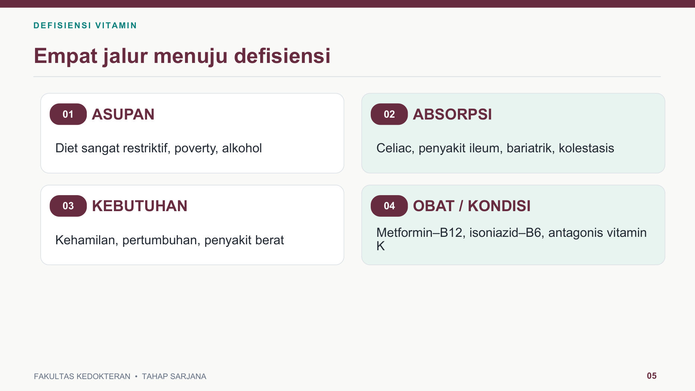
        </a>
        <div class="slide-caption">Slide 5 · 4 Jalur Etiologi & Obat</div>
      </div>
      <div class="slide-card">
        <a href="slides_kul2/slide_6.jpg" class="glightbox" data-gallery="emn-b1" data-title="Slide 6 · Pendekatan Klinis: Curiga → Uji → Tangani">
          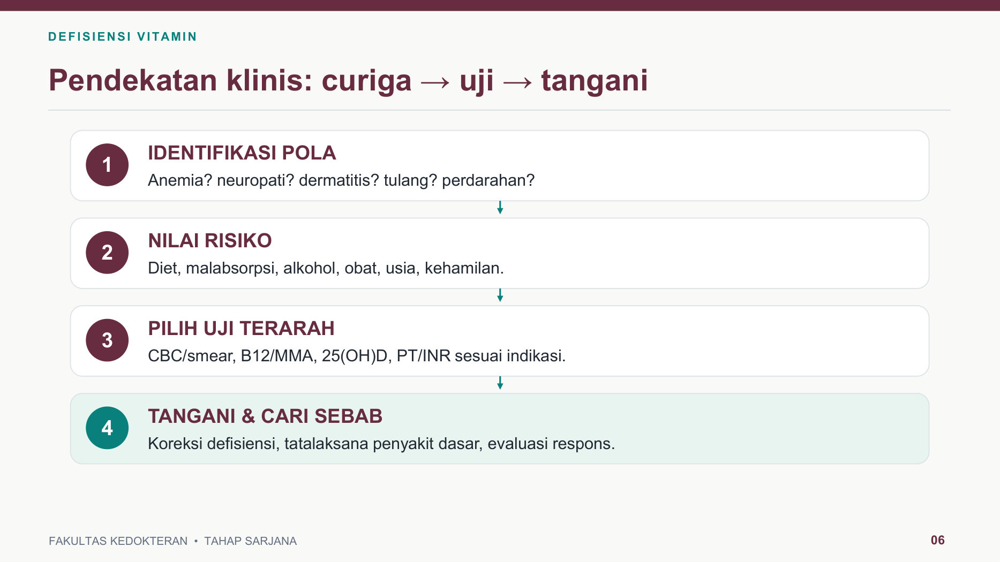
        </a>
        <div class="slide-caption">Slide 6 · Algoritma Curiga → Uji → Tangani</div>
      </div>
      <div class="slide-card">
        <a href="slides_kul2/slide_3.jpg" class="glightbox" data-gallery="emn-b1" data-title="Slide 3 · Kasus Pemicu Awal: Laki-laki 62 Tahun, Metformin Lama, MCV 112 fL">
          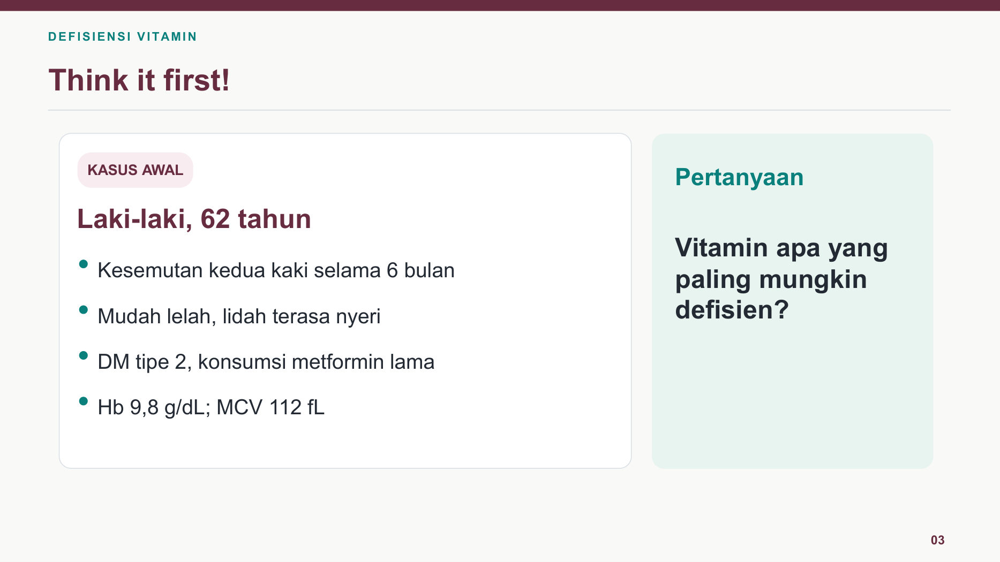
        </a>
        <div class="slide-caption">Slide 3 · Kasus Pembuka (Metformin & B12)</div>
      </div>
    </div>

---

## Bab 2 · Vitamin Larut Lemak: A, D, E, & K (Slide 8–10, 19)

=== "Intisari & Diagram Alur Visual"

    ```mermaid
    flowchart LR
        subgraph VITA ["1. Vitamin A (Slide 8)"]
            A1["Retinal → Rodopsin"] --> A2["Defisiensi Dini:
Rabun Senja (Nyctalopia)"]
            A3["Asam Retinoat → Diferensiasi Epitel"] --> A4["Xerophthalmia & Bercak Bitot
→ Keratomalasia (Buta)"]
        end
        subgraph VITD ["2. Jalur Aktivasi Vitamin D (Slide 9)"]
            D1["Kulit (UVB) / Diet
Vitamin D3 / D2"] --> D2["HATI (25-Hidroksilase)
25(OH)D / Kalsidiol
★ Parameter Lab Status Vit D!"]
            D2 --> D3["GINJAL (1α-Hidroksilase)
1,25-(OH)2-D / Kalsitriol
★ Bentuk Biologis Aktif!"]
            D3 --> D4["Anak: Rakitis
Dewasa: Osteomalasia"]
        end
    ```

    * **Ringkasan 4 Vitamin Larut Lemak (`Slide 19`)**:
        * **Vitamin A**: Siklus visual (*retinal*) & integritas epitel mukosa (*retinoat*). Defisiensi: *nyctalopia* $
ightarrow$ *xerophthalmia* + **Bercak Bitot** $
ightarrow$ *keratomalasia*.
        * **Vitamin D**: Absorpsi kalsium & fosfat di usus serta mineralisasi tulang. **Ingat catatan Slide 9**: Bentuk yang diukur di laboratorium untuk menilai status Vitamin D adalah **`25(OH)D`**, bukan `1,25-(OH)2-D`!
        * **Vitamin E**: Antioksidan pelindung membran lipid neuron & eritrosit. Defisiensi (pada malabsorpsi lemak kronik): **ataksia spinoserebelar, neuropati perifer, dan hemolisis**.
        * **Vitamin K**: Kofaktor $\gamma$-karboksilasi **Faktor Koagulasi II, VII, IX, X** (serta Protein C & S) di hati. Defisiensi (pada neonatus tanpa profilaksis injeksi Vit K1, kolestasis, atau terapi warfarin): **perdarahan aktif dengan pemanjangan PT/INR**.

=== "Bukti Slide Asli Dosen (Klik untuk Perbesar)"

    <div class="slide-grid">
      <div class="slide-card">
        <a href="slides_kul2/slide_8.jpg" class="glightbox" data-gallery="emn-b2" data-title="Slide 8 · Vitamin A: Penglihatan, Epitel, & Foto Klinis Bercak Bitot">
          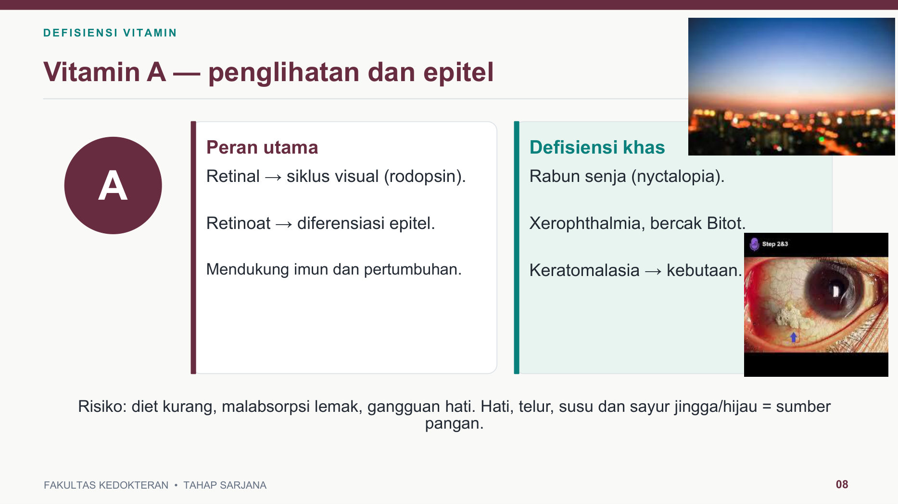
        </a>
        <div class="slide-caption">Slide 8 · Vitamin A & Foto Bercak Bitot</div>
      </div>
      <div class="slide-card">
        <a href="slides_kul2/slide_9.jpg" class="glightbox" data-gallery="emn-b2" data-title="Slide 9 · Vitamin D: Jalur Kulit-Hati-Ginjal & Rakitis vs Osteomalasia">
          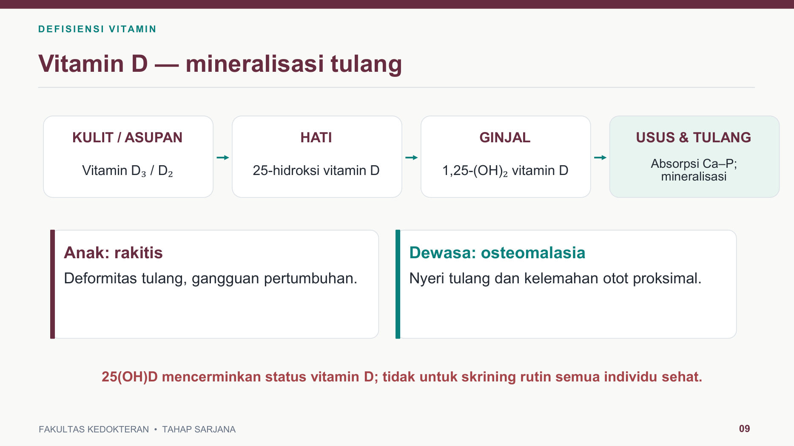
        </a>
        <div class="slide-caption">Slide 9 · Vitamin D & Parameter 25(OH)D</div>
      </div>
      <div class="slide-card">
        <a href="slides_kul2/slide_10.jpg" class="glightbox" data-gallery="emn-b2" data-title="Slide 10 · Vitamin E (Antioksidan) & Vitamin K (Koagulasi)">
          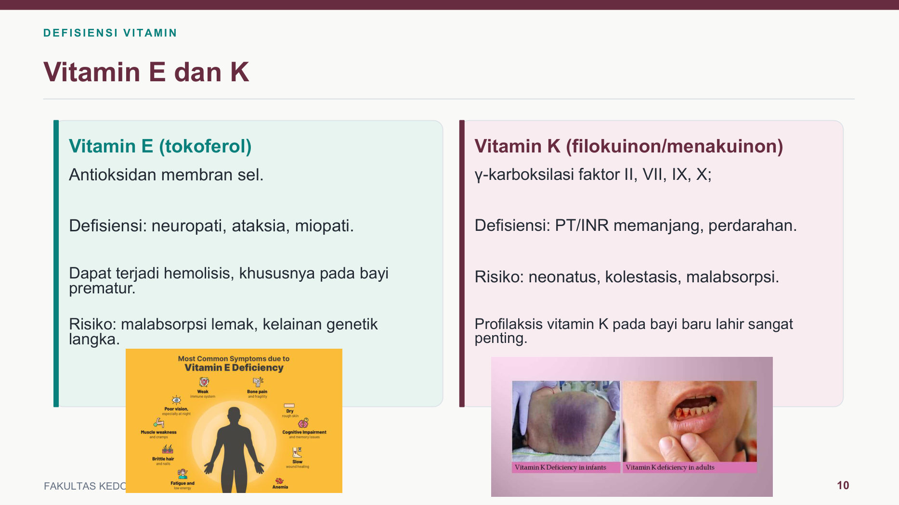
        </a>
        <div class="slide-caption">Slide 10 · Vitamin E & Vitamin K</div>
      </div>
      <div class="slide-card">
        <a href="slides_kul2/slide_19.jpg" class="glightbox" data-gallery="emn-b2" data-title="Slide 19 · Tabel Ringkasan Vitamin Larut Lemak (A, D, E, K)">
          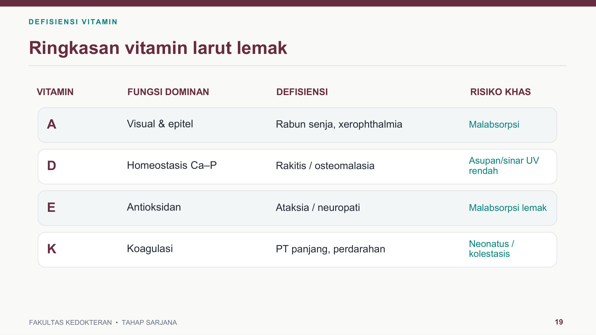
        </a>
        <div class="slide-caption">Slide 19 · Ringkasan Vitamin Larut Lemak</div>
      </div>
    </div>

---

## Bab 3 · Vitamin B1 (Tiamin), B2, B3 (Pellagra), & B6 (Slide 11–13, 25)

=== "Intisari & Diagram Alur Visual"

    ```mermaid
    flowchart TD
        B1["Defisiensi Vitamin B1 (Tiamin)
Kofaktor Aktif: Tiamin Pirofosfat (TPP) — Slide 11"] --> E1["3 Enzim yang Lumpuh:
1. Piruvat dehidrogenase
2. α-Ketoglutarat dehidrogenase
3. Transketolase (Jalur HMP)"]
        E1 --> S1["1. Beriberi Kering
Neuropati perifer simetris
(kelemahan & kesemutan distal)"]
        E1 --> S2["2. Beriberi Basah
Vasodilatasi perifer → Gagal jantung
curah tinggi (High-Output) & edema"]
        E1 --> S3["3. Ensefalopati Wernicke ★
Trias Akut: Konfusi + Ataksia +
Oftalmoplegia / Nistagmus (Slide 25)"]
    ```

    * **Vitamin B2 (`Riboflavin` — `Slide 13`)**: Kofaktor **FMN & FAD** (reaksi redoks). Tanda defisiensi: **Angular cheilitis** (luka/fisura di sudut bibir), glositis (lidah licin kemerahan/magenta), dan dermatitis seboroik nasolabial.
    * **Vitamin B3 (`Niasin` — `Slide 13`)**: Prekursor **NAD+ & NADP+**. Defisiensi berat (diet jagung monoton / malnutrisi) menyebabkan **Pellagra (Trias 3D)**:
        1. **D**ermatitis fotosensitif simetris di area leher yang terkena matahari (**Casal necklace**).
        2. **D**iare kronik (atrofi vili mukosa usus).
        3. **D**emensia / gangguan neuropsikiatri.
    * **Vitamin B6 (`Piridoksin` — `Slide 13`)**: Kofaktor **PLP** (transaminasi asam amino, sintesis neurotransmiter GABA, dan sintesis heme). Risiko khas: pasien TB yang mendapat terapi **Isoniazid (INH)** tanpa suplementasi B6 $
ightarrow$ **neuropati perifer, kejang, dan anemia sideroblastik**.

    !!! danger "Jebakan Klinis IGD pada Kasus Diskusi 2 (Slide 11 & Slide 25)"
        Pada pasien alkoholik kronik, malnutrisi berat, atau hiperemesis gravidarum yang datang ke IGD, **pemberian infus glukosa/dekstrosa TANPA pemberian Tiamin (B1) terlebih dahulu** akan menguras habis sisa TPP dan langsung memicu **Ensefalopati Wernicke akut**!

=== "Bukti Slide Asli Dosen (Klik untuk Perbesar)"

    <div class="slide-grid">
      <div class="slide-card">
        <a href="slides_kul2/slide_11.jpg" class="glightbox" data-gallery="emn-b3" data-title="Slide 11 · Vitamin B1 (Tiamin): 3 Enzim TPP, Beriberi, & Wernicke">
          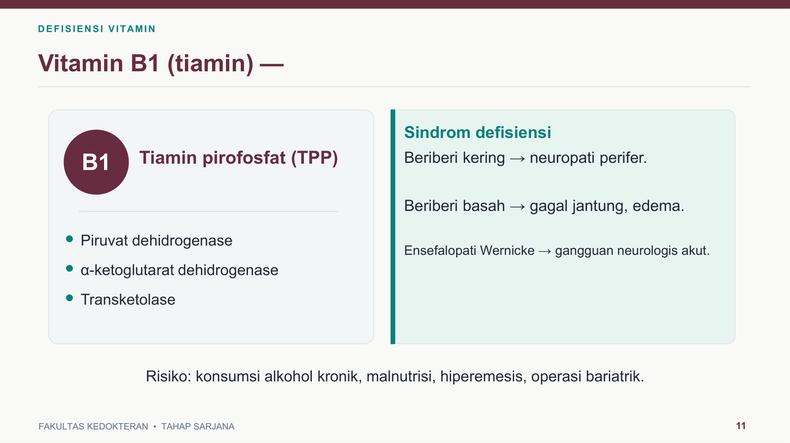
        </a>
        <div class="slide-caption">Slide 11 · Vitamin B1 (TPP, Beriberi, Wernicke)</div>
      </div>
      <div class="slide-card">
        <a href="slides_kul2/slide_13.jpg" class="glightbox" data-gallery="emn-b3" data-title="Slide 13 · Vitamin B2, B3 (Pellagra & Casal Necklace), dan B6">
          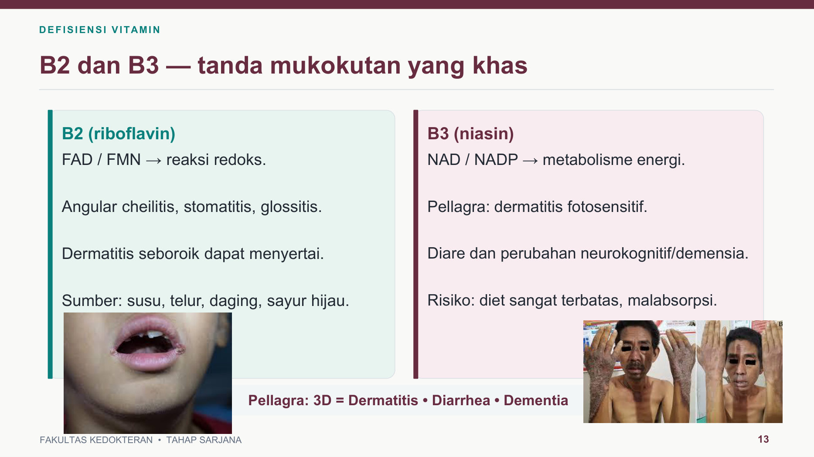
        </a>
        <div class="slide-caption">Slide 13 · B2, B3 (Pellagra), & B6 (INH)</div>
      </div>
      <div class="slide-card">
        <a href="slides_kul2/slide_25.jpg" class="glightbox" data-gallery="emn-b3" data-title="Slide 25 · Diskusi Kasus 2: Kebingungan Akut, Ataksia, Nistagmus (Wernicke)">
          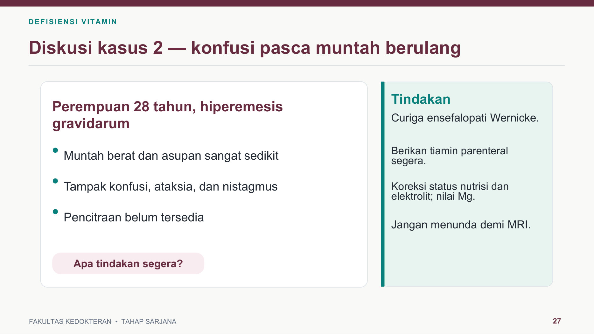
        </a>
        <div class="slide-caption">Slide 25 · Diskusi Kasus 2 (Wernicke)</div>
      </div>
    </div>

---

## Bab 4 · Pembeda Utama: Folat (B9) vs Kobalamin (B12) (Slide 16, 17, 24)

=== "Tabel Pembeda & Diagram Metabolik"

    ```mermaid
    flowchart LR
        subgraph B9B12 ["Persamaan B9 & B12"]
            M1["Gangguan Sintesis DNA"] --> M2["Anemia Megaloblastik
(MCV > 100 fL & Neutrofil Hipersegmentasi)
+ Homosistein Serum MENINGKAT"]
        end
        subgraph ONLYB12 ["Spesifik Hanya pada Defisiensi B12 (Slide 17)"]
            N1["Gagal Enzim Metilmalonil-KoA Mutase"] --> N2["Asam Metilmalonat (MMA) MENINGKAT ★
+ Demyelinisasi Kolumna Dorsalis & Saraf Tepi
(Kesemutan, Hilang Vibrasi, Ataksia)"]
        end
    ```

    | Parameter Pembeda (`Slide 17`) | Defisiensi Vitamin B9 (Folat) | Defisiensi Vitamin B12 (Kobalamin) |
    | :--- | :--- | :--- |
    | **MCV / Gambaran Darah** | Makrositik, megaloblastik (`MCV > 100 fL`) | Makrositik, megaloblastik (`MCV > 100 fL`) |
    | **Neuropati / Ataksia / Vibrasi** | **Tidak khas / Tidak ada** | ==**Khas!**== *(Dapat muncul walau Hb & MCV belum abnormal)* |
    | **Kadar Homosistein** | Sering meningkat | Sering meningkat |
    | **Asam Metilmalonat (`MMA`)** | **Normal** | ==**Meningkat Spesifik!**== |
    | **Faktor Risiko Utama** | Kehamilan, kurang sayur hijau, alkohol, fenitoin/MTX | **Metformin jangka panjang**, diet vegan, gastritis autoimun (anemia pernisiosa), reseksi ileum terminal |

    !!! danger "Peringatan Klinis di Bagian Bawah Slide 17"
        Memberikan terapi **asam folat saja** pada pasien defisiensi Vitamin B12 akan memperbaiki gambaran anemia megaloblastiknya secara semu, tetapi **kerusakan neurologis (demyelinisasi medula spinalis) akan terus memburuk secara ireversibel**!

=== "Bukti Slide Asli Dosen (Klik untuk Perbesar)"

    <div class="slide-grid">
      <div class="slide-card">
        <a href="slides_kul2/slide_17.jpg" class="glightbox" data-gallery="emn-b4" data-title="Slide 17 · Tabel Perbandingan Folat (B9) vs B12 (Kobalamin)">
          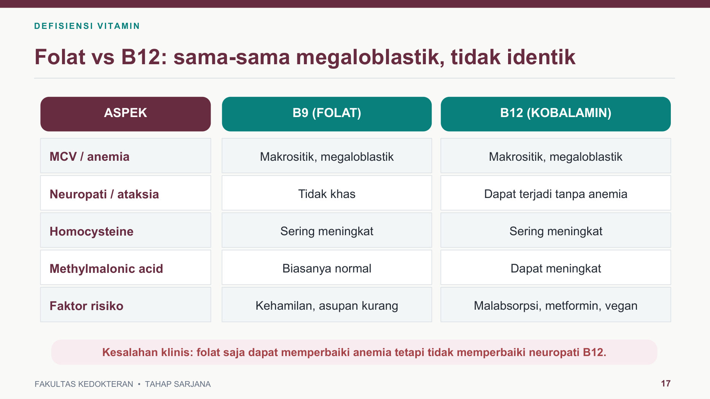
        </a>
        <div class="slide-caption">Slide 17 · Tabel B9 vs B12 (MMA & Neuropati)</div>
      </div>
      <div class="slide-card">
        <a href="slides_kul2/slide_16.jpg" class="glightbox" data-gallery="emn-b4" data-title="Slide 16 · Jalur Absorpsi B12 (Lambung IF → Ileum Terminal)">
          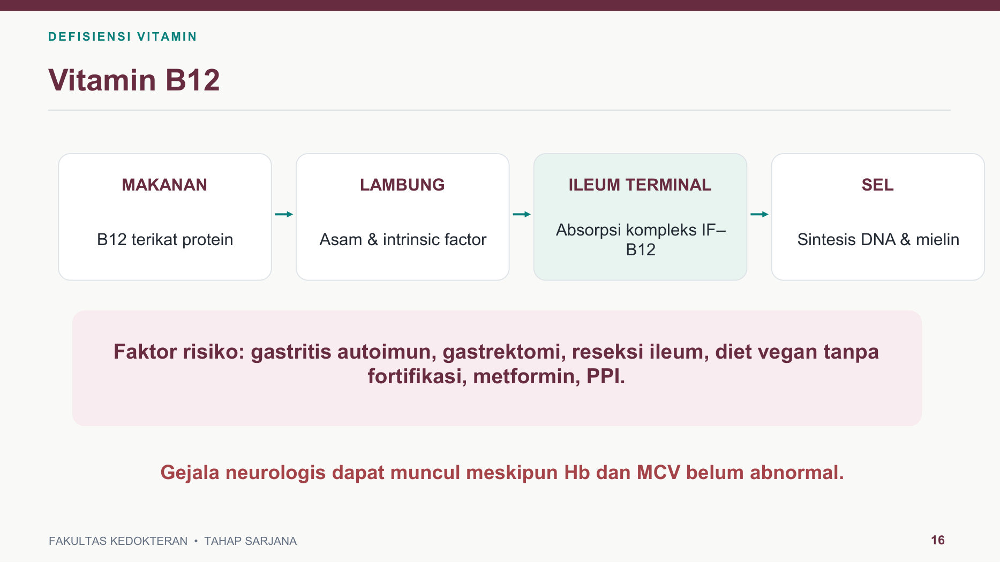
        </a>
        <div class="slide-caption">Slide 16 · Absorpsi B12 & Faktor Risiko</div>
      </div>
      <div class="slide-card">
        <a href="slides_kul2/slide_24.jpg" class="glightbox" data-gallery="emn-b4" data-title="Slide 24 · Diskusi Kasus 1: Metformin, Kesemutan, MCV 112 fL">
          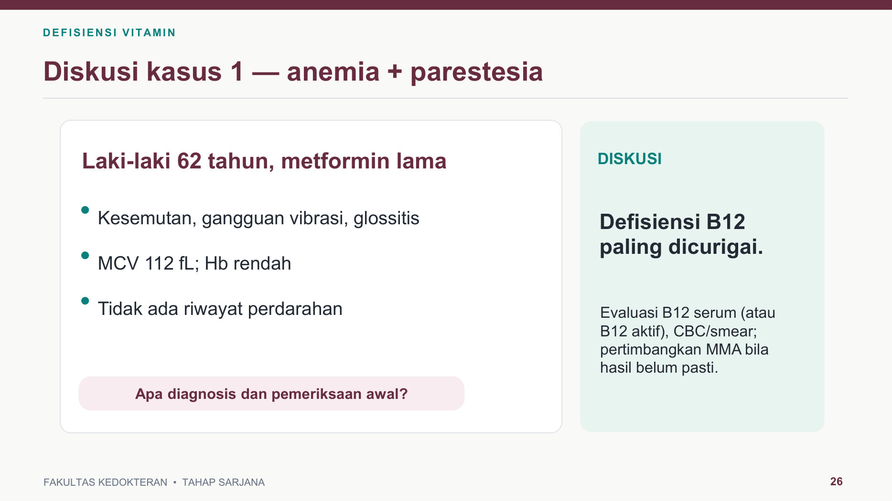
        </a>
        <div class="slide-caption">Slide 24 · Diskusi Kasus 1 (Defisiensi B12)</div>
      </div>
    </div>

---

## Bab 5 · Pembeda Perdarahan: Skorbut (Vit C) vs Defisiensi Vit K (Slide 14, 21, 26)

=== "Intisari & Diagram Alur Visual"

    ```mermaid
    flowchart TD
        BL["Pasien Datang dengan Perdarahan Gusi / Mudah Memar (Slide 26)"] --> LAB{"Cek Hasil Laboratorium
PT / INR & aPTT"}
        LAB -- "PT / INR NORMAL
+ Petechiae Perifolikular
+ Corkscrew Hair & Luka Lama Sembuh" --> VITC["DEFISIENSI VITAMIN C (SKORBUT)
Defek hidroksilasi prolin & lisin
→ Kolagen dinding kapiler rapuh"]
        LAB -- "PT / INR MEMANJANG
+ Riwayat Kolestasis / Warfarin /
Neonatus Tanpa Profilaksis" --> VITK["DEFISIENSI VITAMIN K
Defek γ-karboksilasi Faktor II, VII, IX, X
→ Gangguan kaskade koagulasi"]
    ```

=== "Bukti Slide Asli Dosen (Klik untuk Perbesar)"

    <div class="slide-grid">
      <div class="slide-card">
        <a href="slides_kul2/slide_26.jpg" class="glightbox" data-gallery="emn-b5" data-title="Slide 26 · Diskusi Kasus 3: Perdarahan Gingiva & PT/INR Normal (Skorbut)">
          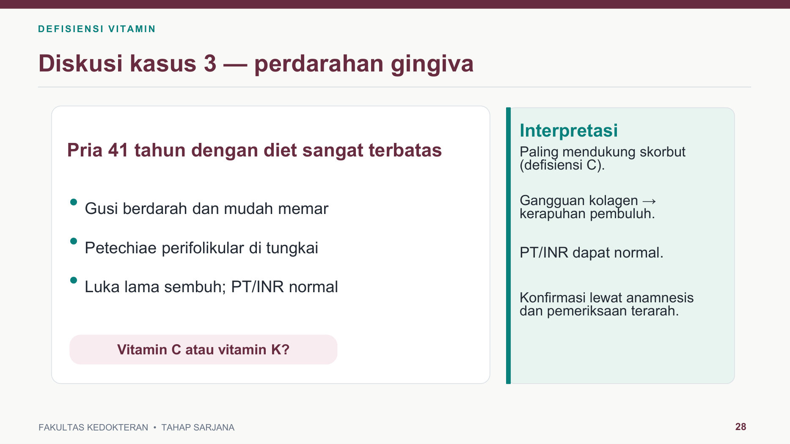
        </a>
        <div class="slide-caption">Slide 26 · Diskusi Kasus 3 (Vit C vs Vit K)</div>
      </div>
      <div class="slide-card">
        <a href="slides_kul2/slide_14.jpg" class="glightbox" data-gallery="emn-b5" data-title="Slide 14 · Vitamin C: Sintesis Kolagen & Gambaran Klinis Skorbut">
          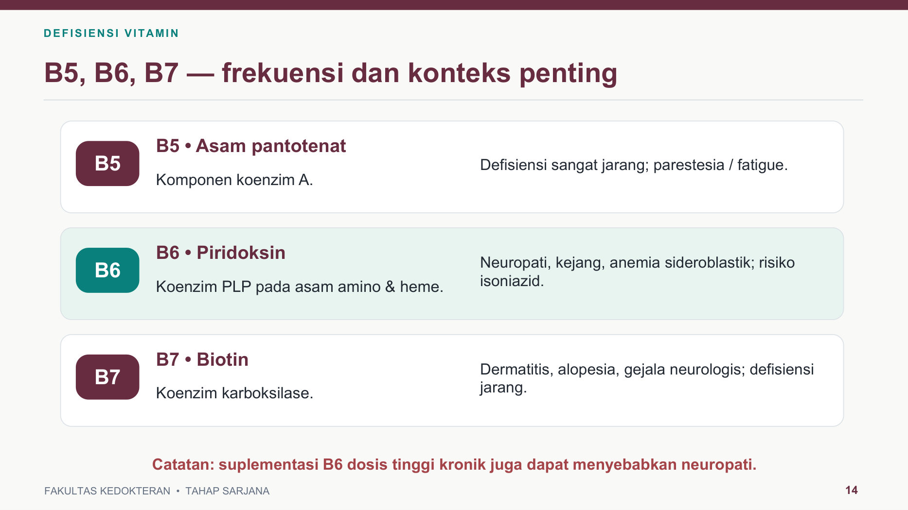
        </a>
        <div class="slide-caption">Slide 14 · Vitamin C & Skorbut</div>
      </div>
      <div class="slide-card">
        <a href="slides_kul2/slide_21.jpg" class="glightbox" data-gallery="emn-b5" data-title="Slide 21 · Pemilihan Pemeriksaan Lab Sesuai Pertanyaan Klinis">
          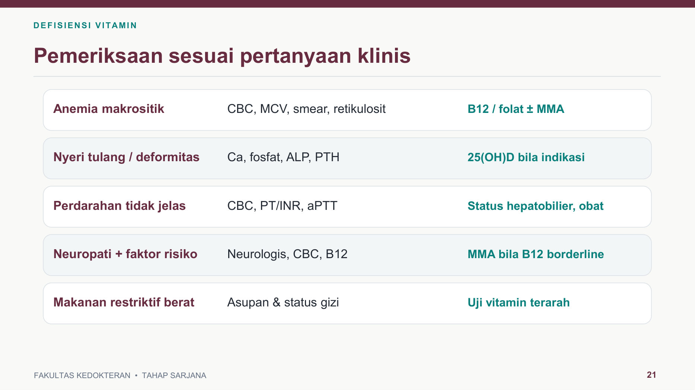
        </a>
        <div class="slide-caption">Slide 21 · Panduan Pemeriksaan Lab Terarah</div>
      </div>
    </div>

---

## Simulator Latihan Kasus Slide & Prediksi (`mkdocs-quiz`)

<quiz>
**[Kasus Asli Slide Dosen · Slide 3 & Slide 24]** Seorang laki-laki berusia 62 tahun dengan riwayat DM tipe 2 dan konsumsi metformin jangka panjang datang dengan keluhan kesemutan pada kedua kaki selama 6 bulan, mudah lelah, dan lidah terasa nyeri (glossitis). Pemeriksaan fisik menunjukkan gangguan sensasi vibrasi. Laboratorium: Hb 9,8 g/dL dan MCV 112 fL. Defisiensi vitamin manakah yang paling mungkin beserta pemeriksaan metabolit konfirmasinya?
- [ ] Vitamin B9 (Folat) — kadar homosistein normal
  > Salah. Pada defisiensi B9 maupun B12 kadar homosistein meningkat, dan B9 tidak menyebabkan gangguan vibrasi/neuropati perifer.
- [x] Vitamin B12 (Kobalamin) — peningkatan asam metilmalonat (MMA)
  > Benar! Konsumsi metformin jangka panjang menghambat absorpsi B12 di ileum terminal, memicu anemia megaloblastik (MCV 112 fL) + neuropati sensorik, dengan peningkatan spesifik asam metilmalonat (MMA) sesuai Slide 17 & 24.
- [ ] Vitamin B1 (Tiamin) — penurunan aktivitas transketolase
  > Salah. Defisiensi B1 tidak menyebabkan anemia makrositik (MCV 112 fL).
- [ ] Vitamin B6 (Piridoksin) — peningkatan feritin serum
  > Salah. Defisiensi B6 menyebabkan anemia mikrositik/sideroblastik, bukan MCV 112 fL.
- [ ] Vitamin E (Tokoferol) — pemanjangan PT/INR
  > Salah. Pemanjangan PT/INR adalah tanda defisiensi Vitamin K.

**Bukti Slide 24:**
{ width="380" }
</quiz>

<quiz>
**[Kasus Asli Slide Dosen · Slide 25]** Seorang pasien dengan riwayat malnutrisi berat dan muntah berkepanjangan dibawa ke IGD dalam kondisi kebingungan akut (konfusi), langkah jalan sempoyongan (ataksia), serta gangguan gerak bola mata (nistagmus/oftalmoplegia) setelah sebelumnya mendapat cairan infus dekstrosa. Defisiensi vitamin apakah yang mendasari kegawatan neurologis ini?
- [x] Vitamin B1 (Tiamin)
  > Benar! Trias konfusi akut, ataksia, dan nistagmus/oftalmoplegia pasca-pemberian glukosa adalah tanda klasik Ensefalopati Wernicke akibat defisiensi Tiamin Pirofosfat (Slide 11 & 25).
- [ ] Vitamin B2 (Riboflavin)
  > Salah. Defisiensi B2 bermanifestasi sebagai angular cheilitis dan glositis.
- [ ] Vitamin B3 (Niasin)
  > Salah. Defisiensi B3 menyebabkan Pellagra (Dermatitis, Diare, Demensia).
- [ ] Vitamin B12 (Kobalamin)
  > Salah. Defisiensi B12 menyebabkan degenerasi subakut medula spinalis, bukan trias akut Wernicke pasca-infus dekstrosa.
- [ ] Vitamin C (Asam Askorbat)
  > Salah. Defisiensi Vitamin C menyebabkan skorbut (perdarahan gusi & kapiler).

**Bukti Slide 25:**
{ width="380" }
</quiz>

<quiz>
**[Kasus Asli Slide Dosen · Slide 26]** Seorang pria berusia 41 tahun dengan diet sangat terbatas datang dengan keluhan gusi sering berdarah, mudah memar, bintik perdarahan perifolikular di kedua tungkai, dan luka yang lama sembuh. Hasil pemeriksaan darah menunjukkan jumlah trombosit normal serta nilai PT dan INR normal. Diagnosis yang paling tepat adalah...
- [ ] Defisiensi Vitamin K
  > Salah! Pada defisiensi Vitamin K, nilai PT dan INR pasti memanjang.
- [x] Defisiensi Vitamin C (Skorbut)
  > Benar! Sesuai Slide 26, perdarahan gingiva + petechiae perifolikular + luka lama sembuh dengan PT/INR yang NORMAL adalah ciri khas Skorbut akibat defek kolagen kapiler.
- [ ] Defisiensi Vitamin D (Osteomalasia)
  > Salah. Defisiensi Vitamin D menyebabkan gangguan mineralisasi tulang.
- [ ] Defisiensi Vitamin B3 (Pellagra)
  > Salah. Pellagra ditandai dermatitis fotosensitif, diare, dan demensia.
- [ ] Defisiensi Vitamin A (Xerophthalmia)
  > Salah. Defisiensi Vitamin A menyerang penglihatan senja dan epitel kornea/konjungtiva.

**Bukti Slide 26:**
{ width="380" }
</quiz>

<quiz>
**[Prediksi Berbasis Slide · Slide 8]** Seorang anak berusia 4 tahun dibawa ibunya karena sering menabrak benda saat senja hari. Pada pemeriksaan konjungtiva tampak bercak putih keperakan berbusa di sisi temporal (Bercak Bitot). Bentuk aktif vitamin manakah yang berperan menjaga diferensiasi epitel konjungtiva agar tidak mengalami metaplasia keratin tersebut?
- [x] Asam retinoat
  > Benar! Sesuai Slide 8: "Retinal → siklus visual (rodopsin)", sedangkan "Retinoat → diferensiasi epitel".
- [ ] 11-cis-retinal
  > Kurang tepat. Retinal berperan pada rodopsin di retina untuk penglihatan gelap, sedangkan diferensiasi epitel konjungtiva diatur oleh asam retinoat.
- [ ] Kalsitriol
  > Salah. Kalsitriol adalah bentuk aktif Vitamin D.
- [ ] Alfa-tokoferol
  > Salah. Alfa-tokoferol adalah bentuk aktif Vitamin E.
- [ ] Menakuinon
  > Salah. Menakuinon adalah Vitamin K2.

**Bukti Slide 8:**
{ width="380" }
</quiz>

<quiz>
**[Prediksi Berbasis Slide · Slide 9]** Seorang perempuan berusia 50 tahun mengeluhkan nyeri tulang difus dan kelemahan otot proksimal. Dokter mencurigai adanya osteomalasia akibat defisiensi Vitamin D. Pemeriksaan laboratorium manakah yang paling tepat dipilih untuk mencerminkan status cadangan Vitamin D tubuh pasien?
- [ ] 1,25-dihidroksivitamin D [1,25(OH)2D]
  > Jebakan! Walaupun 1,25(OH)2D adalah bentuk biologis paling aktif, waktu paruhnya sangat pendek sehingga tidak digunakan sebagai penanda status cadangan Vitamin D.
- [x] 25-hidroksivitamin D [25(OH)D]
  > Benar! Sesuai catatan kaki di Slide 9: "25(OH)D mencerminkan status vitamin D".
- [ ] 7-dehidrokolesterol
  > Salah. Ini adalah prekursor di kulit sebelum terpapar UVB.
- [ ] Kalsitonin serum
  > Salah. Kalsitonin adalah hormon sel parafolikular tiroid.
- [ ] Alkaline phosphatase urin
  > Salah. Bukan parameter baku status Vitamin D.

**Bukti Slide 9:**
{ width="380" }
</quiz>

<quiz>
**[Prediksi Berbasis Slide · Slide 13]** Seorang petani yang hanya mengonsumsi jagung tanpa variasi protein hewani datang dengan keluhan ruam kulit hiperpigmentasi simetris di area leher yang terpapar matahari (Casal necklace), disertai diare kronik dan penurunan daya ingat. Defisiensi kofaktor vitamin apakah yang dialami pasien?
- [ ] Vitamin B1 (Tiamin)
  > Salah. Defisiensi B1 menyebabkan beriberi dan ensefalopati Wernicke.
- [ ] Vitamin B2 (Riboflavin)
  > Salah. Defisiensi B2 menyebabkan stomatitis angularis dan glositis.
- [x] Vitamin B3 (Niasin / NAD+ & NADP+)
  > Benar! Sesuai Slide 13, trias Dermatitis fotosensitif (Casal necklace), Diare, dan Demensia adalah sindrom Pellagra akibat defisiensi Vitamin B3 (Niasin).
- [ ] Vitamin B6 (Piridoksin)
  > Salah. Defisiensi B6 terkait neuropati perifer akibat obat Isoniazid.
- [ ] Vitamin B7 (Biotin)
  > Salah. Defisiensi biotin menyebabkan alopesia dan dermatitis periorifisial.

**Bukti Slide 13:**
{ width="380" }
</quiz>
